# Diagrammes Mermaid

**Sources Mermaid de tous les circuits (à coller dans mermaid.live ou tout outil compatible)**

| Rubrique | Valeur |
|---|---|
| Système | SIGEC-PN / SIGPN-T — Système d'information de gestion de la Police nationale du Tchad |
| Éditeur et développeur | TECHNOTCHAD |
| Version du document | 1.0 — 10 novembre 2026 |
| Statut | Projet pour validation par la hiérarchie : les points marqués « À confirmer » ne sont pas des décisions |
| Source des informations | Lecture seule du système existant (code, catalogue des rôles et droits, écrans) — aucune donnée, aucun compte, aucun rôle, aucune permission n'a été modifié |

## A. Circuit d'une plainte

```mermaid
flowchart TD
  N0["Agent d'accueil<br/>Accueille le plaignant (étape physique, hors système) et lui explique ce qui sera enregistré."]
  N1["Agent d'accueil<br/>Identifie le plaignant : Personnes > recherche ; s'il n'existe pas, Nouvelle personne (nom, prénom, naissance, téléphone, pièce d'identité). Une plainte anonyme est possible (case « Plainte anonyme »)."]
  N2["Agent d'accueil<br/>Plaintes > Nouvelle plainte : catégorie (20 catégories), titre (5 à 200 caractères), description des faits (20 à 5000 caractères), date et lieu des faits, priorité (Basse, Normale, Haute, Urgente), commissariat récepteur.<br/><b>Statut : Brouillon (DRAFT) ou Enregistrée (REGISTERED)</b>"]
  N3["Système<br/>Attribue le numéro automatique (CMP-AAAA-NNNNN), horodate, journalise, et avertit les titulaires du droit « examiner les plaintes » du commissariat.<br/><b>Statut : Enregistrée</b>"]
  N4["Chef de service / Commissaire<br/>Ouvre la plainte, consulte les faits, ajoute ses observations et ajuste la priorité : action « Examiner ».<br/><b>Statut : En examen (UNDER_REVIEW)</b>"]
  N5["Chef de service / Commissaire<br/>Choisit l'enquêteur : action « Affecter ». L'enquêteur doit être actif, dans le périmètre du commissariat et avoir le droit de traiter plaintes ou affaires.<br/><b>Statut : Affectée (ASSIGNED)</b>"]
  N6{"Chef de service / Commissaire<br/>Les faits justifient-ils une enquête ? OUI : convertir en affaire. NON : classer (Clôturer) ou rejeter, avec un motif écrit d'au moins 5 caractères.<br/><b>Statut : Clôturée (CLOSED) ou Rejetée (REJECTED)</b>"}
  N7["Chef de service / Commissaire<br/>Action « Convertir en affaire » : titre, enquêteur responsable, case « Affaire sensible ». Le plaignant devient partie « Plaignant » de l'affaire ; la plainte garde le lien vers l'affaire.<br/><b>Statut : Plainte : Convertie (CONVERTED) ; Affaire : Affectée (ASSIGNED) ou Ouverte (OPEN)</b>"]
  N8["Enquêteur<br/>Instruit l'affaire : ajoute personnes (victime, témoin, mis en cause…), tâches, notes, pièces à conviction ; fait passer l'affaire « En enquête ».<br/><b>Statut : En enquête (UNDER_INVESTIGATION)</b>"]
  N9["Enquêteur<br/>Soumet l'affaire au contrôle du responsable : « Soumettre à examen ».<br/><b>Statut : En attente d'examen (PENDING_REVIEW)</b>"]
  N10{"Chef de service / Commissaire<br/>Contrôle le travail. Peut RENVOYER à l'enquête pour correction (retour à En enquête), TRANSMETTRE, ou CLÔTURER.<br/><b>Statut : Retournée / Transmise (REFERRED) / Clôturée (CLOSED)</b>"}
  N11["Chef de service / Commissaire<br/>Transmission : l'affaire passe en « Transmise » avec l'issue « Transmise au parquet » (ou « Transférée »). Le système enregistre la décision ; il n'envoie pas le dossier à une juridiction.<br/><b>Statut : Transmise (REFERRED)</b>"]
  N12(["Chef de service / Commissaire<br/>Clôture puis archivage : une affaire clôturée est en lecture seule ; l'archivage exige un droit distinct.<br/><b>Statut : Clôturée → Archivée</b>"])
  N0 --> N1
  N1 --> N2
  N2 --> N3
  N3 --> N4
  N4 --> N5
  N5 --> N6
  N6 --> N7
  N7 --> N8
  N8 --> N9
  N9 --> N10
  N10 --> N11
  N11 --> N12
```

## B. Circuit d'un mandat et d'un avis de recherche

```mermaid
flowchart TD
  N0["Enquêteur<br/>Mandats > Nouveau mandat : type (arrestation, perquisition, détention, citation, saisie, autre), personne visée, affaire liée, autorité émettrice (3 à 200 car.), référence de l'autorité, motifs (10 à 3000 car.), adresse visée, date d'expiration.<br/><b>Statut : Brouillon (DRAFT)</b>"]
  N1{"Chef de service / Commissaire<br/>Vérifie l'authenticité et la validité (référence, autorité, motifs, date d'expiration non dépassée), puis approuve ou rejette. Le demandeur ne peut JAMAIS approuver ni rejeter son propre mandat ; un mandat déjà expiré ne s'approuve pas ; le rejet exige un motif.<br/><b>Statut : Actif (ACTIVE) ou Rejeté (REJECTED)</b>"}
  N2["Enquêteur<br/>Personnes recherchées > Nouvel avis : personne, infraction, nature (mandat de recherche, citation à comparaître, personne disparue), niveau de danger, périmètre de diffusion (national, régional, local), base légale, autorité émettrice, motif, dernière localisation connue.<br/><b>Statut : Brouillon (DRAFT)</b>"]
  N3["Chef de service / Commissaire<br/>Vérification (quatre yeux) : contrôle les pièces et la base légale, ajoute ses observations, « Valider la vérification ». L'émetteur ne peut pas vérifier son propre avis.<br/><b>Statut : En attente d'approbation (PENDING_APPROVAL)</b>"]
  N4{"Direction générale / Commandement<br/>Approuve l'avis (autre personne que l'émetteur, vérification faite) : passage à Actif.<br/><b>Statut : Actif (ACTIVE)</b>"}
  N5["Système<br/>Diffuse automatiquement l'alerte aux unités du périmètre choisi, avec relances toutes les 5 minutes puis escalade (niveau 1 : unité parente et superviseurs régionaux ; niveau 2 : superviseurs nationaux).<br/><b>Statut : Alerte : en attente → remise → lue → acquittée</b>"]
  N6["Agent<br/>Reçoit l'alerte : « Marquer comme lu » puis « Acquitter ». Consulte l'avis depuis son commissariat (le périmètre de diffusion détermine ce qu'il voit).<br/><b>Statut : Alerte acquittée</b>"]
  N7["Agent<br/>Une correspondance peut apparaître : à la recherche (écran Personnes recherchées), au contrôle biométrique, ou lors d'un contrôle routier (plaque ou conducteur). Le système affiche « correspondance possible », jamais une certitude.<br/><b>Statut : Correspondance signalée</b>"]
  N8{"Agent<br/>Vérification de l'identité par un humain : « Demander vérification », « Notifier le supérieur », « Signaler une erreur » (faux positif, mauvaise capture, contesté), ou confirmer/rejeter la correspondance.<br/><b>Statut : Contrôle : vérification demandée / supérieur notifié / confirmé / rejeté</b>"}
  N9["Agent<br/>Si l'arrestation a lieu : Arrestations > Nouvelle arrestation avec le mandat en autorité « Mandat » : le mandat doit être ACTIF, non expiré et viser la même personne.<br/><b>Statut : Arrestation enregistrée</b>"]
  N10["Chef de service / Commissaire<br/>Enregistrement de l'exécution : le mandat est marqué « Exécuté » (droit « exécuter les mandats ») ; l'avis passe à Localisé ou Arrêté.<br/><b>Statut : Mandat : Exécuté (EXECUTED) ; Avis : Arrêté (ARRESTED)</b>"]
  N11(["Chef de service / Commissaire<br/>Mise à jour du statut et retrait : un avis arrêté, annulé ou expiré cesse d'être actif ; son éventuelle publication sur le site public est retirée automatiquement.<br/><b>Statut : Arrêté / Annulé / Expiré / Suspendu</b>"])
  N0 --> N1
  N1 --> N2
  N2 --> N3
  N3 --> N4
  N4 --> N5
  N5 --> N6
  N6 --> N7
  N7 --> N8
  N8 --> N9
  N9 --> N10
  N10 --> N11
```

## C. Circuit d'une main courante (module Incidents)

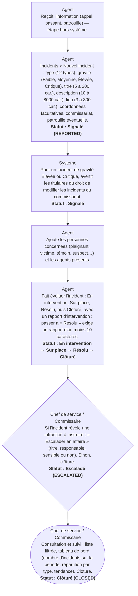

## D. Circuit des infractions

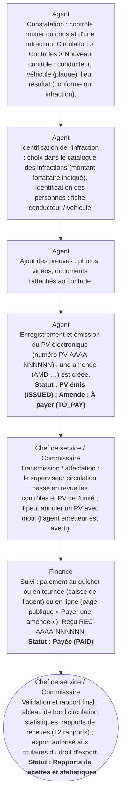

## E. Circuit des plaintes en cours

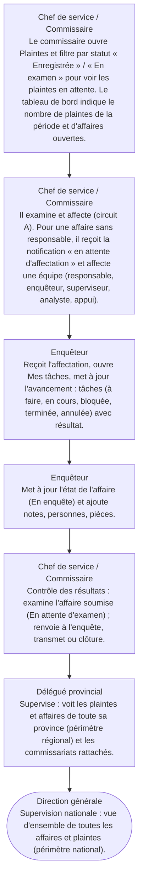

## F. Circuit des transferts de dossiers

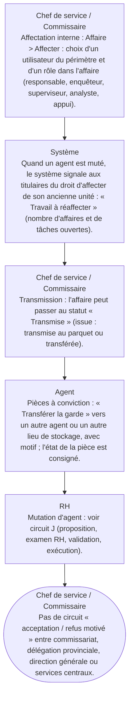

## G. Circuit des validations

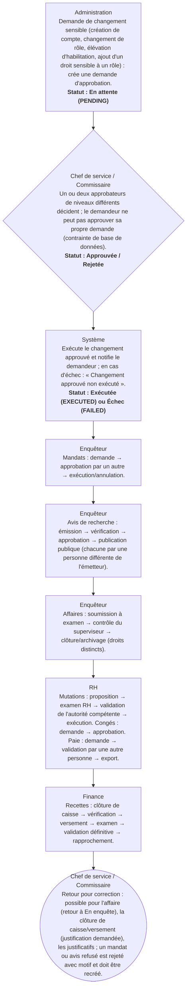

## D bis. Circuit d'une arrestation et d'une garde à vue

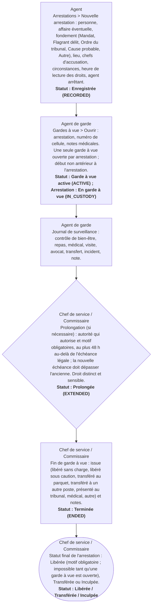

## H. Circuit du portail public (citoyen)

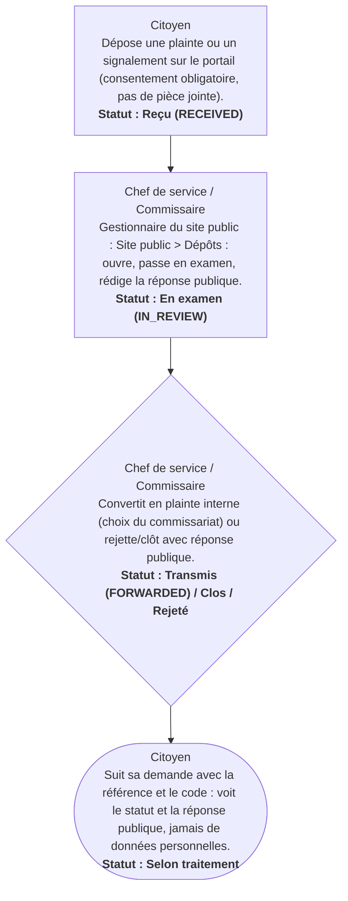

## I. Circuit des amendes, paiements et versements

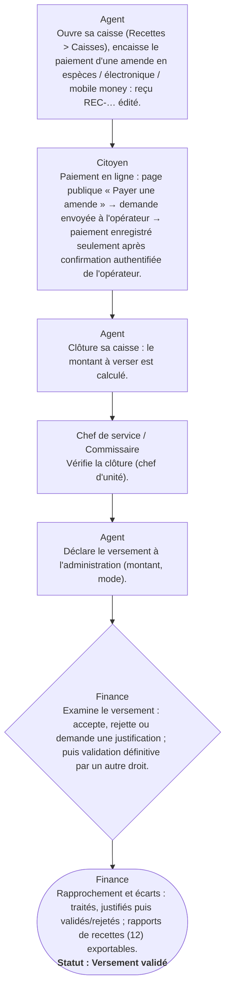

## J. Circuit des mutations et congés (ressources humaines)

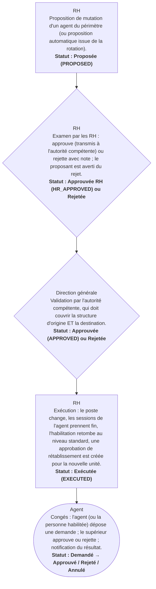

