# Circuit A — Circuit d'une plainte

**Circuit opérationnel complet**

| Rubrique | Valeur |
|---|---|
| Système | SIGEC-PN / SIGPN-T — Système d'information de gestion de la Police nationale du Tchad |
| Éditeur et développeur | TECHNOTCHAD |
| Version du document | 1.0 — 10 novembre 2026 |
| Statut | Projet pour validation par la hiérarchie : les points marqués « À confirmer » ne sont pas des décisions |
| Source des informations | Lecture seule du système existant (code, catalogue des rôles et droits, écrans) — aucune donnée, aucun compte, aucun rôle, aucune permission n'a été modifié |

## Circuit A — Circuit d'une plainte

Une plainte est reçue à l'accueil d'un commissariat (ou déposée par un citoyen sur le portail public, voir circuit H), enregistrée dans le système, examinée par le commissaire, affectée à un enquêteur, puis transformée en **affaire** (dossier d'enquête) qui est instruite, transmise ou clôturée.

**Modules concernés :** Plaintes, Personnes, Affaires, Tâches, Preuves

### Étapes détaillées

| N° | Qui | Action | Précisions du système | Statut après l'étape |
|---|---|---|---|---|
| 1 | Agent d'accueil | Accueille le plaignant (étape physique, hors système) et lui explique ce qui sera enregistré. | Aucune saisie à cette étape. |  |
| 2 | Agent d'accueil | Identifie le plaignant : Personnes > recherche ; s'il n'existe pas, Nouvelle personne (nom, prénom, naissance, téléphone, pièce d'identité). Une plainte anonyme est possible (case « Plainte anonyme »). | Le système signale un doublon probable ; il faut alors choisir la fiche existante ou confirmer expressément la création (« forcer »). |  |
| 3 | Agent d'accueil | Plaintes > Nouvelle plainte : catégorie (20 catégories), titre (5 à 200 caractères), description des faits (20 à 5000 caractères), date et lieu des faits, priorité (Basse, Normale, Haute, Urgente), commissariat récepteur. | Deux boutons : enregistrer en brouillon, ou enregistrer et soumettre. | Brouillon (DRAFT) ou Enregistrée (REGISTERED) |
| 4 | Système | Attribue le numéro automatique (CMP-AAAA-NNNNN), horodate, journalise, et avertit les titulaires du droit « examiner les plaintes » du commissariat. | Notification : « Nouvelle plainte à examiner » (type Approbation). | Enregistrée |
| 5 | Chef de service / Commissaire | Ouvre la plainte, consulte les faits, ajoute ses observations et ajuste la priorité : action « Examiner ». | Le brouillon doit d'abord être enregistré (soumis). | En examen (UNDER_REVIEW) |
| 6 | Chef de service / Commissaire | Choisit l'enquêteur : action « Affecter ». L'enquêteur doit être actif, dans le périmètre du commissariat et avoir le droit de traiter plaintes ou affaires. | Notification à l'enquêteur : « Plainte affectée à vous » (type Affectation). | Affectée (ASSIGNED) |
| 7 | Chef de service / Commissaire | Les faits justifient-ils une enquête ? OUI : convertir en affaire. NON : classer (Clôturer) ou rejeter, avec un motif écrit d'au moins 5 caractères. | Clôture / rejet : notification de l'enquêteur déjà affecté ; états définitifs. | Clôturée (CLOSED) ou Rejetée (REJECTED) |
| 8 | Chef de service / Commissaire | Action « Convertir en affaire » : titre, enquêteur responsable, case « Affaire sensible ». Le plaignant devient partie « Plaignant » de l'affaire ; la plainte garde le lien vers l'affaire. | Numéro d'affaire CASE-AAAA-NNNNN. Notification au responsable : « Nouvelle affaire qui vous est confiée ». | Plainte : Convertie (CONVERTED) ; Affaire : Affectée (ASSIGNED) ou Ouverte (OPEN) |
| 9 | Enquêteur | Instruit l'affaire : ajoute personnes (victime, témoin, mis en cause…), tâches, notes, pièces à conviction ; fait passer l'affaire « En enquête ». | Le journal chronologique de l'affaire enregistre chaque événement. | En enquête (UNDER_INVESTIGATION) |
| 10 | Enquêteur | Soumet l'affaire au contrôle du responsable : « Soumettre à examen ». | Notification aux titulaires du droit de clôture : « Affaire en attente d'examen du superviseur ». | En attente d'examen (PENDING_REVIEW) |
| 11 | Chef de service / Commissaire | Contrôle le travail. Peut RENVOYER à l'enquête pour correction (retour à En enquête), TRANSMETTRE, ou CLÔTURER. | Seuls les titulaires du droit de clôture peuvent transmettre ou clôturer ; la clôture exige une issue (résolue, non résolue, non fondée, transmise au parquet, transférée, classée). | Retournée / Transmise (REFERRED) / Clôturée (CLOSED) |
| 12 | Chef de service / Commissaire | Transmission : l'affaire passe en « Transmise » avec l'issue « Transmise au parquet » (ou « Transférée »). Le système enregistre la décision ; il n'envoie pas le dossier à une juridiction. | L'envoi réel du dossier à l'autorité judiciaire se fait hors système (voir « À confirmer »). | Transmise (REFERRED) |
| 13 | Chef de service / Commissaire | Clôture puis archivage : une affaire clôturée est en lecture seule ; l'archivage exige un droit distinct. | Statut final : Archivée (ARCHIVED). | Clôturée → Archivée |

### Règles appliquées par le système

- Le brouillon n'est visible que dans le périmètre du commissariat ; seul un brouillon, une plainte enregistrée ou en examen peut encore être modifiée.
- Les transitions de statut sont fixes : Brouillon → Enregistrée → En examen → Affectée → Convertie ; Clôturée et Rejetée sont possibles depuis Enregistrée, En examen ou Affectée ; Convertie, Clôturée et Rejetée sont définitives.
- Aucun enquêteur ne peut être affecté hors du périmètre de celui qui affecte.
- Toute action est inscrite au journal d'audit (qui, quand, avant/après).
- Une affaire marquée « sensible » n'est visible que de son équipe et des titulaires du droit « consulter les affaires sensibles ».

### Statuts

| Code | Libellé affiché | Signification |
|---|---|---|
| DRAFT | Brouillon | Saisie non soumise. |
| REGISTERED | Enregistrée | Soumise ; en attente d'examen. |
| UNDER_REVIEW | En examen | Examinée par le commissaire. |
| ASSIGNED | Affectée | Confiée à un enquêteur. |
| CONVERTED | Convertie | Transformée en affaire (définitif). |
| CLOSED | Clôturée | Classée avec motif (définitif). |
| REJECTED | Rejetée | Rejetée avec motif (définitif). |

| Code | Libellé affiché | Signification |
|---|---|---|
| OPEN | Ouverte | Affaire créée sans responsable. |
| ASSIGNED | Affectée | Responsable désigné. |
| UNDER_INVESTIGATION | En enquête | Instruction en cours. |
| PENDING_REVIEW | En attente d'examen | Soumise au contrôle du responsable. |
| REFERRED | Transmise | Décision de transmission enregistrée. |
| CLOSED | Clôturée | Issue enregistrée ; lecture seule. |
| ARCHIVED | Archivée | Archivage (droit distinct). |

### Notifications envoyées

| Événement | Destinataires | Message |
|---|---|---|
| Plainte enregistrée | Titulaires du droit « examiner les plaintes » du commissariat (sauf l'auteur) | Nouvelle plainte à examiner — CMP-… — titre |
| Plainte affectée | L'enquêteur désigné | Plainte affectée à vous |
| Plainte clôturée ou rejetée | L'enquêteur affecté, s'il y en a un | Plainte clôturée / rejetée — motif |
| Conversion en affaire | Le responsable désigné | Nouvelle affaire qui vous est confiée |
| Affaire créée sans responsable | Titulaires du droit « affecter les affaires » du commissariat | Nouvelle affaire en attente d'affectation |
| Affaire soumise à examen | Titulaires du droit de clôture du commissariat | Affaire en attente d'examen du superviseur |
| Changement de statut d'affaire | Le responsable de l'affaire (sauf l'auteur du changement) | Affaire — nouveau statut |
| Tâche confiée | La personne désignée | Tâche affectée à vous |

### Écrans

### À confirmer auprès de la hiérarchie

- Qui, dans l'organisation, joue le rôle de « chef de service » entre l'agent d'accueil et le commissaire : le système n'a pas de rôle distinct, c'est le Commissaire (ou toute personne portant le droit « examiner ») qui examine et affecte.
- Les règles de transmission au parquet (délais, pièces obligatoires, forme du bordereau) : le système enregistre seulement la décision de transmission.
- La compétence territoriale exacte pour qu'une plainte soit reçue ailleurs que dans le commissariat du lieu des faits.

### Ce que le système ne fait pas / améliorations recommandées

- Procès-verbaux d'enquête, déclarations et auditions : les écrans correspondants (Déclarations, Auditions, Enquêtes) sont prévus mais NON construits ; aujourd'hui les constats se consignent en notes d'affaire, tâches et pièces à conviction.
- Pas de génération de récépissé de plainte imprimable pour le plaignant.
- Pas de notification au plaignant (sauf via le portail public avec référence et code).

## Source Mermaid

```mermaid
flowchart TD
  N0["Agent d'accueil<br/>Accueille le plaignant (étape physique, hors système) et lui explique ce qui sera enregistré."]
  N1["Agent d'accueil<br/>Identifie le plaignant : Personnes > recherche ; s'il n'existe pas, Nouvelle personne (nom, prénom, naissance, téléphone, pièce d'identité). Une plainte anonyme est possible (case « Plainte anonyme »)."]
  N2["Agent d'accueil<br/>Plaintes > Nouvelle plainte : catégorie (20 catégories), titre (5 à 200 caractères), description des faits (20 à 5000 caractères), date et lieu des faits, priorité (Basse, Normale, Haute, Urgente), commissariat récepteur.<br/><b>Statut : Brouillon (DRAFT) ou Enregistrée (REGISTERED)</b>"]
  N3["Système<br/>Attribue le numéro automatique (CMP-AAAA-NNNNN), horodate, journalise, et avertit les titulaires du droit « examiner les plaintes » du commissariat.<br/><b>Statut : Enregistrée</b>"]
  N4["Chef de service / Commissaire<br/>Ouvre la plainte, consulte les faits, ajoute ses observations et ajuste la priorité : action « Examiner ».<br/><b>Statut : En examen (UNDER_REVIEW)</b>"]
  N5["Chef de service / Commissaire<br/>Choisit l'enquêteur : action « Affecter ». L'enquêteur doit être actif, dans le périmètre du commissariat et avoir le droit de traiter plaintes ou affaires.<br/><b>Statut : Affectée (ASSIGNED)</b>"]
  N6{"Chef de service / Commissaire<br/>Les faits justifient-ils une enquête ? OUI : convertir en affaire. NON : classer (Clôturer) ou rejeter, avec un motif écrit d'au moins 5 caractères.<br/><b>Statut : Clôturée (CLOSED) ou Rejetée (REJECTED)</b>"}
  N7["Chef de service / Commissaire<br/>Action « Convertir en affaire » : titre, enquêteur responsable, case « Affaire sensible ». Le plaignant devient partie « Plaignant » de l'affaire ; la plainte garde le lien vers l'affaire.<br/><b>Statut : Plainte : Convertie (CONVERTED) ; Affaire : Affectée (ASSIGNED) ou Ouverte (OPEN)</b>"]
  N8["Enquêteur<br/>Instruit l'affaire : ajoute personnes (victime, témoin, mis en cause…), tâches, notes, pièces à conviction ; fait passer l'affaire « En enquête ».<br/><b>Statut : En enquête (UNDER_INVESTIGATION)</b>"]
  N9["Enquêteur<br/>Soumet l'affaire au contrôle du responsable : « Soumettre à examen ».<br/><b>Statut : En attente d'examen (PENDING_REVIEW)</b>"]
  N10{"Chef de service / Commissaire<br/>Contrôle le travail. Peut RENVOYER à l'enquête pour correction (retour à En enquête), TRANSMETTRE, ou CLÔTURER.<br/><b>Statut : Retournée / Transmise (REFERRED) / Clôturée (CLOSED)</b>"}
  N11["Chef de service / Commissaire<br/>Transmission : l'affaire passe en « Transmise » avec l'issue « Transmise au parquet » (ou « Transférée »). Le système enregistre la décision ; il n'envoie pas le dossier à une juridiction.<br/><b>Statut : Transmise (REFERRED)</b>"]
  N12(["Chef de service / Commissaire<br/>Clôture puis archivage : une affaire clôturée est en lecture seule ; l'archivage exige un droit distinct.<br/><b>Statut : Clôturée → Archivée</b>"])
  N0 --> N1
  N1 --> N2
  N2 --> N3
  N3 --> N4
  N4 --> N5
  N5 --> N6
  N6 --> N7
  N7 --> N8
  N8 --> N9
  N9 --> N10
  N10 --> N11
  N11 --> N12
```

