# Circuit B — Circuit d'un mandat et d'un avis de recherche

**Circuit opérationnel complet**

| Rubrique | Valeur |
|---|---|
| Système | SIGEC-PN / SIGPN-T — Système d'information de gestion de la Police nationale du Tchad |
| Éditeur et développeur | TECHNOTCHAD |
| Version du document | 1.0 — 10 novembre 2026 |
| Statut | Projet pour validation par la hiérarchie : les points marqués « À confirmer » ne sont pas des décisions |
| Source des informations | Lecture seule du système existant (code, catalogue des rôles et droits, écrans) — aucune donnée, aucun compte, aucun rôle, aucune permission n'a été modifié |

## Circuit B — Circuit d'un mandat et d'un avis de recherche

Le système distingue deux objets liés : le **mandat** (acte de l'autorité judiciaire enregistré dans le système : arrestation, perquisition, détention, citation, saisie) et l'**avis de recherche** (diffusion d'une personne recherchée aux unités). Un avis de nature « mandat de recherche » exige un mandat **actif** lié. La diffusion passe par le réseau d'**alertes nationales**.

**Modules concernés :** Mandats, Personnes recherchées, Alertes nationales, Contrôle biométrique, Arrestations

### Étapes détaillées

| N° | Qui | Action | Précisions du système | Statut après l'étape |
|---|---|---|---|---|
| 1 | Enquêteur | Mandats > Nouveau mandat : type (arrestation, perquisition, détention, citation, saisie, autre), personne visée, affaire liée, autorité émettrice (3 à 200 car.), référence de l'autorité, motifs (10 à 3000 car.), adresse visée, date d'expiration. | Réception et enregistrement : le mandat émis par l'autorité judiciaire est saisi tel quel. Numéro WRT-AAAA-NNNNN. | Brouillon (DRAFT) |
| 2 | Chef de service / Commissaire | Vérifie l'authenticité et la validité (référence, autorité, motifs, date d'expiration non dépassée), puis approuve ou rejette. Le demandeur ne peut JAMAIS approuver ni rejeter son propre mandat ; un mandat déjà expiré ne s'approuve pas ; le rejet exige un motif. | Droit requis : approuver les mandats (droit sensible). | Actif (ACTIVE) ou Rejeté (REJECTED) |
| 3 | Enquêteur | Personnes recherchées > Nouvel avis : personne, infraction, nature (mandat de recherche, citation à comparaître, personne disparue), niveau de danger, périmètre de diffusion (national, régional, local), base légale, autorité émettrice, motif, dernière localisation connue. | Un avis « mandat de recherche » doit être lié à un mandat actif. Une personne ne peut avoir qu'un avis vivant à la fois. Numéro WNT-AAAA-NNNNN. | Brouillon (DRAFT) |
| 4 | Chef de service / Commissaire | Vérification (quatre yeux) : contrôle les pièces et la base légale, ajoute ses observations, « Valider la vérification ». L'émetteur ne peut pas vérifier son propre avis. | Base légale et autorité doivent être renseignées. | En attente d'approbation (PENDING_APPROVAL) |
| 5 | Direction générale / Commandement | Approuve l'avis (autre personne que l'émetteur, vérification faite) : passage à Actif. | Droit requis : approuver les avis de recherche (sensible). | Actif (ACTIVE) |
| 6 | Système | Diffuse automatiquement l'alerte aux unités du périmètre choisi, avec relances toutes les 5 minutes puis escalade (niveau 1 : unité parente et superviseurs régionaux ; niveau 2 : superviseurs nationaux). | Délais : avis ordinaire 15 min (niveau 1) et 60 min (niveau 2) ; avis urgent (danger élevé/extrême) 5 et 15 min. Un bandeau rouge apparaît sur toutes les pages des agents concernés en moins de 20 secondes. | Alerte : en attente → remise → lue → acquittée |
| 7 | Agent | Reçoit l'alerte : « Marquer comme lu » puis « Acquitter ». Consulte l'avis depuis son commissariat (le périmètre de diffusion détermine ce qu'il voit). | L'acquittement est horodaté et attribué à l'unité. | Alerte acquittée |
| 8 | Agent | Une correspondance peut apparaître : à la recherche (écran Personnes recherchées), au contrôle biométrique, ou lors d'un contrôle routier (plaque ou conducteur). Le système affiche « correspondance possible », jamais une certitude. | Lors d'un contrôle routier, les titulaires du droit d'approuver les avis de recherche du commissariat sont avertis (« correspondance avec un avis de recherche »). | Correspondance signalée |
| 9 | Agent | Vérification de l'identité par un humain : « Demander vérification », « Notifier le supérieur », « Signaler une erreur » (faux positif, mauvaise capture, contesté), ou confirmer/rejeter la correspondance. | Toute action est datée et attribuée ; aucune décision automatique. | Contrôle : vérification demandée / supérieur notifié / confirmé / rejeté |
| 10 | Agent | Si l'arrestation a lieu : Arrestations > Nouvelle arrestation avec le mandat en autorité « Mandat » : le mandat doit être ACTIF, non expiré et viser la même personne. | Voir circuit D bis (arrestation et garde à vue). | Arrestation enregistrée |
| 11 | Chef de service / Commissaire | Enregistrement de l'exécution : le mandat est marqué « Exécuté » (droit « exécuter les mandats ») ; l'avis passe à Localisé ou Arrêté. | Un mandat exécuté est définitif. | Mandat : Exécuté (EXECUTED) ; Avis : Arrêté (ARRESTED) |
| 12 | Chef de service / Commissaire | Mise à jour du statut et retrait : un avis arrêté, annulé ou expiré cesse d'être actif ; son éventuelle publication sur le site public est retirée automatiquement. | Suspension possible avec motif ; un avis expiré peut être réactivé. | Arrêté / Annulé / Expiré / Suspendu |

### Règles appliquées par le système

- Règle des quatre yeux : l'émetteur d'un avis ne peut ni le vérifier, ni l'approuver, ni le publier ; le demandeur d'un mandat ne peut ni l'approuver ni le rejeter.
- **Limite à connaître :** le système n'empêche pas que la même personne (autre que l'émetteur) vérifie PUIS approuve un avis : les droits de vérification, d'approbation et de publication sont portés par les mêmes profils (commissaire, délégué, commandement national, administrateur de la police).
- Statuts du mandat réellement gérés : Brouillon, Actif, Exécuté, Expiré, Annulé, Rejeté (et « En attente d'approbation » existe dans le modèle).
- Statuts de l'avis : Brouillon, En attente d'approbation, Actif, Localisé, Arrêté, Suspendu, Annulé, Expiré. Transitions fixes : un avis Arrêté ou Annulé est définitif.
- Le périmètre de diffusion (national, régional, local) ne peut être changé qu'avant l'approbation ; la nature, la base légale et l'autorité aussi.
- Le motif d'un avis reste interne ; seule une publication expresse (circuit H) expose un texte public.
- Une alerte n'établit jamais la culpabilité : vérification humaine avant toute action.

### Statuts

| Code | Libellé affiché | Signification |
|---|---|---|
| DRAFT | Brouillon | Mandat demandé, non approuvé. |
| ACTIVE | Actif | Approuvé et exploitable. |
| EXECUTED | Exécuté | Mis à exécution (définitif). |
| EXPIRED | Expiré | Date d'expiration dépassée. |
| CANCELLED | Annulé | Annulé avec motif. |
| REJECTED | Rejeté | Refusé avec motif. |

| Code | Libellé affiché | Signification |
|---|---|---|
| DRAFT | Brouillon | Avis en préparation. |
| PENDING_APPROVAL | En attente d'approbation | Vérifié, en attente de l'autorité. |
| ACTIVE | Actif | Diffusé. |
| LOCATED | Localisé | Personne localisée, pas encore arrêtée. |
| ARRESTED | Arrêté | Personne arrêtée (définitif). |
| SUSPENDED | Suspendu | Diffusion suspendue avec motif. |
| CANCELLED | Annulé | Retiré avec motif (définitif). |
| EXPIRED | Expiré | Date dépassée ; réactivable. |

### Notifications envoyées

| Événement | Destinataires | Message |
|---|---|---|
| Avis approuvé (Actif) | Unités du périmètre de diffusion (alerte avec bandeau) | Alerte nationale — avis de recherche |
| Alerte non prise en compte | Niveau 1 : unité parente et superviseurs régionaux ; niveau 2 : superviseurs nationaux | Escalade : avis du réseau national sans prise en compte |
| Contrôle routier avec correspondance | Titulaires du droit d'approuver les avis, commissariat du contrôle | Contrôle routier : correspondance avec un avis de recherche |
| Vérification biométrique demandée | Titulaires du droit de vérifier, commissariat concerné | Une vérification humaine est demandée |
| Erreur signalée sur un contrôle | Titulaires du droit de vérifier | Une erreur a été signalée sur un contrôle |

### Écrans

### À confirmer auprès de la hiérarchie

- Qui, dans la hiérarchie, détient le pouvoir d'approuver un mandat et un avis de recherche : le système le lie au droit « approuver » (portés par les commandants) ; la décision organisationnelle finale revient à la Direction.
- Qui contrôle l'authenticité d'un mandat émis par un magistrat : le système n'a pas d'étape « authentification » séparée ; elle se fait par la vérification humaine avant approbation.
- Le périmètre de diffusion par défaut (national / régional / local) selon la gravité.
- Faut-il exiger que le vérificateur et l'approbateur d'un avis soient deux personnes différentes (le système ne l'impose pas aujourd'hui) ?

### Ce que le système ne fait pas / améliorations recommandées

- Pas d'interface avec les juridictions : le mandat est saisi à la main à partir du document reçu.
- Pas de génération de document de mandat imprimable.
- Les sources frontières, vidéosurveillance et interopérabilité sont affichées « non connecté » ; le contrôle biométrique est une simulation tant qu'aucun matériel réel n'est branché.

## Source Mermaid

```mermaid
flowchart TD
  N0["Enquêteur<br/>Mandats > Nouveau mandat : type (arrestation, perquisition, détention, citation, saisie, autre), personne visée, affaire liée, autorité émettrice (3 à 200 car.), référence de l'autorité, motifs (10 à 3000 car.), adresse visée, date d'expiration.<br/><b>Statut : Brouillon (DRAFT)</b>"]
  N1{"Chef de service / Commissaire<br/>Vérifie l'authenticité et la validité (référence, autorité, motifs, date d'expiration non dépassée), puis approuve ou rejette. Le demandeur ne peut JAMAIS approuver ni rejeter son propre mandat ; un mandat déjà expiré ne s'approuve pas ; le rejet exige un motif.<br/><b>Statut : Actif (ACTIVE) ou Rejeté (REJECTED)</b>"}
  N2["Enquêteur<br/>Personnes recherchées > Nouvel avis : personne, infraction, nature (mandat de recherche, citation à comparaître, personne disparue), niveau de danger, périmètre de diffusion (national, régional, local), base légale, autorité émettrice, motif, dernière localisation connue.<br/><b>Statut : Brouillon (DRAFT)</b>"]
  N3["Chef de service / Commissaire<br/>Vérification (quatre yeux) : contrôle les pièces et la base légale, ajoute ses observations, « Valider la vérification ». L'émetteur ne peut pas vérifier son propre avis.<br/><b>Statut : En attente d'approbation (PENDING_APPROVAL)</b>"]
  N4{"Direction générale / Commandement<br/>Approuve l'avis (autre personne que l'émetteur, vérification faite) : passage à Actif.<br/><b>Statut : Actif (ACTIVE)</b>"}
  N5["Système<br/>Diffuse automatiquement l'alerte aux unités du périmètre choisi, avec relances toutes les 5 minutes puis escalade (niveau 1 : unité parente et superviseurs régionaux ; niveau 2 : superviseurs nationaux).<br/><b>Statut : Alerte : en attente → remise → lue → acquittée</b>"]
  N6["Agent<br/>Reçoit l'alerte : « Marquer comme lu » puis « Acquitter ». Consulte l'avis depuis son commissariat (le périmètre de diffusion détermine ce qu'il voit).<br/><b>Statut : Alerte acquittée</b>"]
  N7["Agent<br/>Une correspondance peut apparaître : à la recherche (écran Personnes recherchées), au contrôle biométrique, ou lors d'un contrôle routier (plaque ou conducteur). Le système affiche « correspondance possible », jamais une certitude.<br/><b>Statut : Correspondance signalée</b>"]
  N8{"Agent<br/>Vérification de l'identité par un humain : « Demander vérification », « Notifier le supérieur », « Signaler une erreur » (faux positif, mauvaise capture, contesté), ou confirmer/rejeter la correspondance.<br/><b>Statut : Contrôle : vérification demandée / supérieur notifié / confirmé / rejeté</b>"}
  N9["Agent<br/>Si l'arrestation a lieu : Arrestations > Nouvelle arrestation avec le mandat en autorité « Mandat » : le mandat doit être ACTIF, non expiré et viser la même personne.<br/><b>Statut : Arrestation enregistrée</b>"]
  N10["Chef de service / Commissaire<br/>Enregistrement de l'exécution : le mandat est marqué « Exécuté » (droit « exécuter les mandats ») ; l'avis passe à Localisé ou Arrêté.<br/><b>Statut : Mandat : Exécuté (EXECUTED) ; Avis : Arrêté (ARRESTED)</b>"]
  N11(["Chef de service / Commissaire<br/>Mise à jour du statut et retrait : un avis arrêté, annulé ou expiré cesse d'être actif ; son éventuelle publication sur le site public est retirée automatiquement.<br/><b>Statut : Arrêté / Annulé / Expiré / Suspendu</b>"])
  N0 --> N1
  N1 --> N2
  N2 --> N3
  N3 --> N4
  N4 --> N5
  N5 --> N6
  N6 --> N7
  N7 --> N8
  N8 --> N9
  N9 --> N10
  N10 --> N11
```

