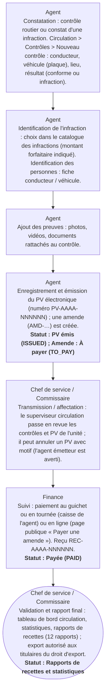

# Circuit D — Circuit des infractions

**Circuit opérationnel complet**

| Rubrique | Valeur |
|---|---|
| Système | SIGEC-PN / SIGPN-T — Système d'information de gestion de la Police nationale du Tchad |
| Éditeur et développeur | TECHNOTCHAD |
| Version du document | 1.0 — 10 novembre 2026 |
| Statut | Projet pour validation par la hiérarchie : les points marqués « À confirmer » ne sont pas des décisions |
| Source des informations | Lecture seule du système existant (code, catalogue des rôles et droits, écrans) — aucune donnée, aucun compte, aucun rôle, aucune permission n'a été modifié |

## Circuit D — Circuit des infractions

Le système traite les infractions de deux façons. (1) **Infractions routières** : contrôle, procès-verbal (PV) électronique, amende, paiement et reçu — module complet. (2) **Infractions pénales** : elles sont portées par une **plainte** puis une **affaire** (catégorie d'infraction : homicide, vol, fraude, etc.). Il n'existe pas de catalogue pénal dédié ; le catalogue des infractions et les barèmes d'amende concernent la circulation.

**Modules concernés :** Circulation (contrôles, PV, amendes), Plaintes, Affaires, Preuves

### Étapes détaillées

| N° | Qui | Action | Précisions du système | Statut après l'étape |
|---|---|---|---|---|
| 1 | Agent | Constatation : contrôle routier ou constat d'une infraction. Circulation > Contrôles > Nouveau contrôle : conducteur, véhicule (plaque), lieu, résultat (conforme ou infraction). | Numéro CTL-AAAA-NNNNN. Le système interroge les avis de recherche : si le conducteur ou la plaque correspondent, le commandement est averti. |  |
| 2 | Agent | Identification de l'infraction : choix dans le catalogue des infractions (montant forfaitaire indiqué). Identification des personnes : fiche conducteur / véhicule. | Certaines infractions ne sont pas justiciables de l'amende forfaitaire (délits) ; le système avertit alors les responsables de la gestion des amendes. |  |
| 3 | Agent | Ajout des preuves : photos, vidéos, documents rattachés au contrôle. | Droit « joindre des preuves ». |  |
| 4 | Agent | Enregistrement et émission du PV électronique (numéro PV-AAAA-NNNNNN) ; une amende (AMD-…) est créée. | Le PV est numéroté automatiquement. | PV émis (ISSUED) ; Amende : À payer (TO_PAY) |
| 5 | Chef de service / Commissaire | Transmission / affectation : le superviseur circulation passe en revue les contrôles et PV de l'unité ; il peut annuler un PV avec motif (l'agent émetteur est averti). | Notification à l'agent : « PV annulé — motif ». |  |
| 6 | Finance | Suivi : paiement au guichet ou en tournée (caisse de l'agent) ou en ligne (page publique « Payer une amende »). Reçu REC-AAAA-NNNNNN. | Voir circuit I (recettes). Statut d'amende : En attente, À payer, Partiellement payée, Payée, Contestée, Annulée. | Payée (PAID) |
| 7 | Chef de service / Commissaire | Validation et rapport final : tableau de bord circulation, statistiques, rapports de recettes (12 rapports) ; export autorisé aux titulaires du droit d'export. | Chaque export est journalisé. | Rapports de recettes et statistiques |

### Règles appliquées par le système

- Un PV annulé ne peut plus être payé ; une amende peut être suspendue, contestée ou annulée par les titulaires du droit de gérer les amendes.
- Un paiement enregistré par erreur s'annule (droit distinct) sans effacement : il devient « annulé ».
- Le catalogue des infractions est consultable ; son activation/désactivation est un droit distinct.

### Statuts

| Code | Libellé affiché | Signification |
|---|---|---|
| ISSUED | PV émis | PV valide. |
| CANCELLED | PV annulé | Annulé avec motif. |

| Code | Libellé affiché | Signification |
|---|---|---|
| PENDING | En attente | Amende en préparation. |
| TO_PAY | À payer | Montant dû. |
| PARTIALLY_PAID | Partiellement payée | Paiement partiel. |
| PAID | Payée | Soldée. |
| CONTESTED | Contestée | Contestation enregistrée. |
| CANCELLED | Annulée | Annulée. |

### Notifications envoyées

| Événement | Destinataires | Message |
|---|---|---|
| PV annulé | L'agent qui avait émis le PV | PV annulé — motif |
| Contrôle avec correspondance | Titulaires du droit d'approuver les avis | Correspondance avec un avis de recherche |
| PV comportant un délit | Titulaires du droit de gérer les amendes | PV comportant un délit (Interdiction d'arbitrage) |

### Écrans

### À confirmer auprès de la hiérarchie

- Les barèmes d'amendes forfaitaires et la liste des délits non arbitrables doivent être validés par la hiérarchie et la justice (catalogue chargé à partir de la source indiquée dans la documentation Infractions routières).
- Pour les infractions pénales : un registre ou catalogue pénal dédié est-il attendu ?

### Ce que le système ne fait pas / améliorations recommandées

- Pas de catalogue d'infractions pénales : la qualification est la catégorie de l'affaire (20 catégories).
- Pas de rapport final automatique d'infraction pénale (les rapports et statistiques généraux sont prévus mais NON construits).

## Source Mermaid

