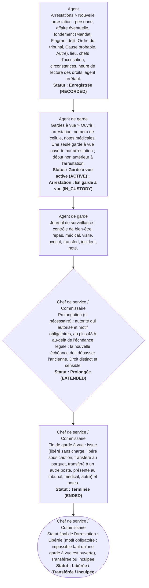

# Circuit D bis — Circuit d'une arrestation et d'une garde à vue

**Circuit opérationnel complet**

| Rubrique | Valeur |
|---|---|
| Système | SIGEC-PN / SIGPN-T — Système d'information de gestion de la Police nationale du Tchad |
| Éditeur et développeur | TECHNOTCHAD |
| Version du document | 1.0 — 10 novembre 2026 |
| Statut | Projet pour validation par la hiérarchie : les points marqués « À confirmer » ne sont pas des décisions |
| Source des informations | Lecture seule du système existant (code, catalogue des rôles et droits, écrans) — aucune donnée, aucun compte, aucun rôle, aucune permission n'a été modifié |

## Circuit D bis — Circuit d'une arrestation et d'une garde à vue

L'arrestation est enregistrée avec son fondement (mandat, flagrant délit, ordre du tribunal, cause probable, autre). La garde à vue démarre avec une échéance légale fixée à 48 heures (constante du code, à confirmer) ; elle est surveillée par un journal, peut être prolongée par le commissaire et se termine par une issue.

**Modules concernés :** Arrestations, Gardes à vue, Mandats, Personnes

### Étapes détaillées

| N° | Qui | Action | Précisions du système | Statut après l'étape |
|---|---|---|---|---|
| 1 | Agent | Arrestations > Nouvelle arrestation : personne, affaire éventuelle, fondement (Mandat, Flagrant délit, Ordre du tribunal, Cause probable, Autre), lieu, chefs d'accusation, circonstances, heure de lecture des droits, agent arrêtant. | Sur mandat : le mandat doit être actif, non expiré et viser la même personne. L'heure ne peut pas être dans le futur. Numéro ARR-AAAA-NNNNN. | Enregistrée (RECORDED) |
| 2 | Agent de garde | Gardes à vue > Ouvrir : arrestation, numéro de cellule, notes médicales. Une seule garde à vue ouverte par arrestation ; début non antérieur à l'arrestation. | Échéance légale = arrestation + 48 h. Numéro DET-AAAA-NNNNN. | Garde à vue active (ACTIVE) ; Arrestation : En garde à vue (IN_CUSTODY) |
| 3 | Agent de garde | Journal de surveillance : contrôle de bien-être, repas, médical, visite, avocat, transfert, incident, note. | Impossible sur une garde à vue terminée. |  |
| 4 | Chef de service / Commissaire | Prolongation (si nécessaire) : autorité qui autorise et motif obligatoires, au plus 48 h au-delà de l'échéance légale ; la nouvelle échéance doit dépasser l'ancienne. Droit distinct et sensible. | L'agent de garde ne voit pas ce formulaire. | Prolongée (EXTENDED) |
| 5 | Chef de service / Commissaire | Fin de garde à vue : issue (libéré sans charge, libéré sous caution, transféré au parquet, transféré à un autre poste, présenté au tribunal, médical, autre) et notes. | L'arrestation suit l'issue ; le mandat éventuel est marqué exécuté. | Terminée (ENDED) |
| 6 | Chef de service / Commissaire | Statut final de l'arrestation : Libérée (motif obligatoire ; impossible tant qu'une garde à vue est ouverte), Transférée ou Inculpée. | États finaux définitifs. Les gardes à vue dont le délai est dépassé sont signalées dans la liste. | Libérée / Transférée / Inculpée |

### Règles appliquées par le système

- Libérer une personne exige un motif et la fin préalable de la garde à vue.
- Le délai de 48 h est une constante du code : à confirmer avec la Direction et le parquet.
- Chaque étape est au journal d'audit.

### Statuts

| Code | Libellé affiché | Signification |
|---|---|---|
| RECORDED | Enregistrée | Arrestation saisie. |
| IN_CUSTODY | En garde à vue | Personne gardée. |
| RELEASED | Libérée | Fin sans suite (définitif). |
| TRANSFERRED | Transférée | Transfert (définitif). |
| CHARGED | Inculpée | Inculpation (définitif). |

| Code | Libellé affiché | Signification |
|---|---|---|
| ACTIVE | Active | Garde à vue en cours. |
| EXTENDED | Prolongée | Délai prolongé. |
| ENDED | Terminée | Issue enregistrée. |

### Notifications envoyées

| Événement | Destinataires | Message |
|---|---|---|
| (aucune notification automatique) | — | Les gardes à vue en dépassement sont signalées dans la liste ; aucune notification n'est envoyée |

### Écrans

### À confirmer auprès de la hiérarchie

- Durée légale de la garde à vue et durée maximale de prolongation (48 h + 48 h dans le code).
- Qui autorise une prolongation (champ libre « autorité » dans le formulaire).

### Ce que le système ne fait pas / améliorations recommandées

- Aucune notification automatique d'une garde à vue qui dépasse son délai : amélioration recommandée.

## Source Mermaid

