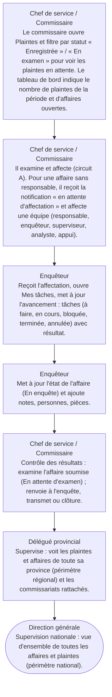

# Circuit E — Circuit des plaintes en cours

**Circuit opérationnel complet**

| Rubrique | Valeur |
|---|---|
| Système | SIGEC-PN / SIGPN-T — Système d'information de gestion de la Police nationale du Tchad |
| Éditeur et développeur | TECHNOTCHAD |
| Version du document | 1.0 — 10 novembre 2026 |
| Statut | Projet pour validation par la hiérarchie : les points marqués « À confirmer » ne sont pas des décisions |
| Source des informations | Lecture seule du système existant (code, catalogue des rôles et droits, écrans) — aucune donnée, aucun compte, aucun rôle, aucune permission n'a été modifié |

## Circuit E — Circuit des plaintes en cours

Ce circuit décrit le suivi quotidien des plaintes déjà enregistrées et des affaires ouvertes : qui voit quoi, qui relance, qui contrôle.

**Modules concernés :** Plaintes, Affaires, Tâches, Tableau de bord

### Étapes détaillées

| N° | Qui | Action | Précisions du système | Statut après l'étape |
|---|---|---|---|---|
| 1 | Chef de service / Commissaire | Le commissaire ouvre Plaintes et filtre par statut « Enregistrée » / « En examen » pour voir les plaintes en attente. Le tableau de bord indique le nombre de plaintes de la période et d'affaires ouvertes. | Chiffres calculés dans le périmètre du commissariat ; un chiffre sans droit n'est jamais affiché. |  |
| 2 | Chef de service / Commissaire | Il examine et affecte (circuit A). Pour une affaire sans responsable, il reçoit la notification « en attente d'affectation » et affecte une équipe (responsable, enquêteur, superviseur, analyste, appui). | Affecter à l'affaire : notification de l'intéressé. |  |
| 3 | Enquêteur | Reçoit l'affectation, ouvre Mes tâches, met à jour l'avancement : tâches (à faire, en cours, bloquée, terminée, annulée) avec résultat. | Une tâche confiée à un tiers avertit celui-ci. |  |
| 4 | Enquêteur | Met à jour l'état de l'affaire (En enquête) et ajoute notes, personnes, pièces. | Journal chronologique alimenté automatiquement. |  |
| 5 | Chef de service / Commissaire | Contrôle des résultats : examine l'affaire soumise (En attente d'examen) ; renvoie à l'enquête, transmet ou clôture. | Voir règles de contrôle du circuit A. |  |
| 6 | Délégué provincial | Supervise : voit les plaintes et affaires de toute sa province (périmètre régional) et les commissariats rattachés. | Il ne voit pas les autres provinces. |  |
| 7 | Direction générale | Supervision nationale : vue d'ensemble de toutes les affaires et plaintes (périmètre national). | Aucune validation nationale n'est exigée par le système sur une affaire courante. |  |

### Règles appliquées par le système

- Une affaire clôturée ou archivée est en lecture seule.
- Seule l'équipe de l'affaire ou un titulaire du droit d'affecter peut la modifier.
- Tout changement d'équipe est notifié à la personne concernée.

### Statuts

| Code | Libellé affiché | Signification |
|---|---|---|
| OPEN | Ouverte |  |

### Notifications envoyées

| Événement | Destinataires | Message |
|---|---|---|
| Affectation à une affaire | La personne affectée | Affecté à l'affaire en tant que … |

### Écrans

### À confirmer auprès de la hiérarchie

- Les délais de traitement attendus par type de plainte (aucun délai automatique n'existe dans le système).

### Ce que le système ne fait pas / améliorations recommandées

- Pas d'alerte automatique de plainte « en retard » ni de relance de l'enquêteur : amélioration recommandée.

## Source Mermaid

