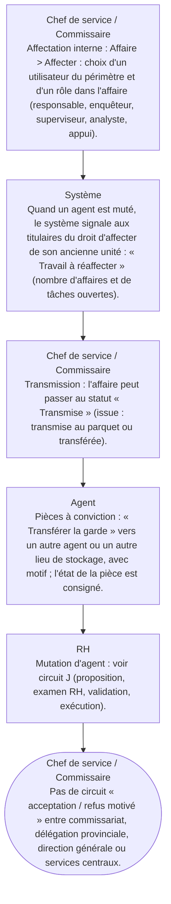

# Circuit F — Circuit des transferts de dossiers

**Circuit opérationnel complet**

| Rubrique | Valeur |
|---|---|
| Système | SIGEC-PN / SIGPN-T — Système d'information de gestion de la Police nationale du Tchad |
| Éditeur et développeur | TECHNOTCHAD |
| Version du document | 1.0 — 10 novembre 2026 |
| Statut | Projet pour validation par la hiérarchie : les points marqués « À confirmer » ne sont pas des décisions |
| Source des informations | Lecture seule du système existant (code, catalogue des rôles et droits, écrans) — aucune donnée, aucun compte, aucun rôle, aucune permission n'a été modifié |

## Circuit F — Circuit des transferts de dossiers

**Le SIGPN-T ne comporte pas de procédure formelle de transfert d'un dossier entre commissariats avec acceptation ou refus motivé du destinataire.** Ce que le système fait : (1) l'**affectation** d'une affaire à une autre personne de son périmètre ; (2) la **réaffectation du travail** quand un agent est muté ; (3) la **transmission** (statut Transmise) ; (4) le **transfert de garde** des pièces à conviction ; (5) la **mutation des agents** (circuit RH). Les transferts de dossiers entre commissariats, délégations et direction générale sont à confirmer et à construire.

**Modules concernés :** Affaires, Ressources humaines (mutations), Preuves

### Étapes détaillées

| N° | Qui | Action | Précisions du système | Statut après l'étape |
|---|---|---|---|---|
| 1 | Chef de service / Commissaire | Affectation interne : Affaire > Affecter : choix d'un utilisateur du périmètre et d'un rôle dans l'affaire (responsable, enquêteur, superviseur, analyste, appui). | Interdit sur une affaire clôturée. L'intéressé est notifié. Entre services d'un même commissariat, c'est ce mécanisme qui s'applique. |  |
| 2 | Système | Quand un agent est muté, le système signale aux titulaires du droit d'affecter de son ancienne unité : « Travail à réaffecter » (nombre d'affaires et de tâches ouvertes). | Les affaires restent attribuées jusqu'à réaffectation manuelle. |  |
| 3 | Chef de service / Commissaire | Transmission : l'affaire peut passer au statut « Transmise » (issue : transmise au parquet ou transférée). | C'est un enregistrement de décision, pas un envoi vers un autre service informatique. |  |
| 4 | Agent | Pièces à conviction : « Transférer la garde » vers un autre agent ou un autre lieu de stockage, avec motif ; l'état de la pièce est consigné. | Chaîne de conservation tracée. |  |
| 5 | RH | Mutation d'agent : voir circuit J (proposition, examen RH, validation, exécution). | Exécutée, la mutation clôt les accès de l'ancien poste et notifie les unités. |  |
| 6 | Chef de service / Commissaire | Pas de circuit « acceptation / refus motivé » entre commissariat, délégation provinciale, direction générale ou services centraux. | À confirmer par la hiérarchie avant développement. |  |

### Règles appliquées par le système

- Toute affectation est inscrite au journal d'audit et au journal de l'affaire.
- Une affaire sensible reste invisible aux personnes hors équipe sans droit particulier.
- La portée territoriale empêche d'affecter quelqu'un hors de son périmètre.

### Statuts

| Code | Libellé affiché | Signification |
|---|---|---|
| REFERRED | Transmise | Décision de transmission enregistrée. |

### Notifications envoyées

| Événement | Destinataires | Message |
|---|---|---|
| Affectation à une affaire | La personne affectée | Affecté à l'affaire en tant que … |
| Travail à réaffecter | Titulaires du droit d'affecter de l'ancienne unité | X a quitté l'unité : N affaire(s) et N tâche(s) ouvertes |

### Écrans

Captures d'écran non disponibles dans le dossier d'images actuel pour ce circuit (voir l'annexe « Limites »).

### À confirmer auprès de la hiérarchie

- Souhaite-t-on un vrai transfert entre unités (demande, réception, acceptation ou refus motivé, traçabilité, notification) ? Qui accepte à chaque niveau (commissariat, délégation, direction générale, services centraux) ?
- Cas des affaires qui dépassent la compétence territoriale du commissariat.

### Ce que le système ne fait pas / améliorations recommandées

- AMÉLIORATION RECOMMANDÉE (non construite) : module de transfert avec statuts Demandé / Reçu / Accepté / Refusé (motif obligatoire), notification de l'expéditeur et du destinataire, historique, et restriction par niveau hiérarchique.

## Source Mermaid

