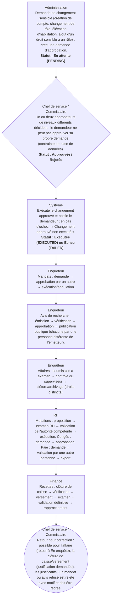

# Circuit G — Circuit des validations

**Circuit opérationnel complet**

| Rubrique | Valeur |
|---|---|
| Système | SIGEC-PN / SIGPN-T — Système d'information de gestion de la Police nationale du Tchad |
| Éditeur et développeur | TECHNOTCHAD |
| Version du document | 1.0 — 10 novembre 2026 |
| Statut | Projet pour validation par la hiérarchie : les points marqués « À confirmer » ne sont pas des décisions |
| Source des informations | Lecture seule du système existant (code, catalogue des rôles et droits, écrans) — aucune donnée, aucun compte, aucun rôle, aucune permission n'a été modifié |

## Circuit G — Circuit des validations

Le système impose des **validations réelles**, reposant sur des droits précis et la règle des **quatre yeux** (jamais la même personne pour demander et valider). Ce tableau recense celles dont la preuve existe dans le code.

**Modules concernés :** Approbations, Mandats, Avis de recherche, Affaires, Mutations, Congés, Paie, Recettes

### Étapes détaillées

| N° | Qui | Action | Précisions du système | Statut après l'étape |
|---|---|---|---|---|
| 1 | Administration | Demande de changement sensible (création de compte, changement de rôle, élévation d'habilitation, ajout d'un droit sensible à un rôle) : crée une demande d'approbation. | Les titulaires du droit « décider les approbations » sont notifiés. | En attente (PENDING) |
| 2 | Chef de service / Commissaire | Un ou deux approbateurs de niveaux différents décident ; le demandeur ne peut pas approuver sa propre demande (contrainte de base de données). | Les comptes sensibles exigent deux approbateurs. | Approuvée / Rejetée |
| 3 | Système | Exécute le changement approuvé et notifie le demandeur ; en cas d'échec : « Changement approuvé non exécuté ». |  | Exécutée (EXECUTED) ou Échec (FAILED) |
| 4 | Enquêteur | Mandats : demande → approbation par un autre → exécution/annulation. | Voir circuit B. |  |
| 5 | Enquêteur | Avis de recherche : émission → vérification → approbation → publication publique (chacune par une personne différente de l'émetteur). | Voir circuit B. |  |
| 6 | Enquêteur | Affaires : soumission à examen → contrôle du superviseur → clôture/archivage (droits distincts). | Voir circuit A. |  |
| 7 | RH | Mutations : proposition → examen RH → validation de l'autorité compétente → exécution. Congés : demande → approbation. Paie : demande → validation par une autre personne → export. | Voir circuit J. |  |
| 8 | Finance | Recettes : clôture de caisse → vérification → versement → examen → validation définitive → rapprochement. | Voir circuit I. |  |
| 9 | Chef de service / Commissaire | Retour pour correction : possible pour l'affaire (retour à En enquête), la clôture de caisse/versement (justification demandée), les justificatifs ; un mandat ou avis refusé est rejeté avec motif et doit être recréé. | Un avis refusé en brouillon ne se « renvoie » pas : il est annulé avec motif. |  |

### Règles appliquées par le système

- Le pouvoir de valider découle UNIQUEMENT des droits portés par le rôle ; aucun pouvoir n'est attribué hors de ces droits.
- Les droits sensibles (20) ne sont utilisables que si le compte a l'habilitation suffisante ; certains imposent le second facteur.
- Un administrateur technique n'a aucun droit de valider une opération de police.

### Statuts

| Code | Libellé affiché | Signification |
|---|---|---|
| PENDING | En attente | Demande déposée. |
| APPROVED | Approuvée | Décision favorable ; en cours d'exécution. |
| EXECUTED | Exécutée | Changement appliqué. |
| REJECTED | Rejetée | Refusée. |
| CANCELLED | Annulée | Retirée. |
| EXPIRED | Expirée | Délai dépassé. |
| FAILED | Échec | Exécution impossible. |

### Notifications envoyées

| Événement | Destinataires | Message |
|---|---|---|
| Nouvelle demande d'approbation | Titulaires du droit de décider (sauf le demandeur) | Une modification sensible attend votre décision |
| Demande rejetée | Le demandeur | Votre demande a été rejetée |
| Changement exécuté / non exécuté | Le demandeur | Changement approuvé exécuté / non exécuté |

### Écrans

### À confirmer auprès de la hiérarchie

- Qui doit valider chaque acte organisationnel (le système reflète seulement les droits attribués aux rôles actuels).

### Ce que le système ne fait pas / améliorations recommandées

- Un tableau unique « mes validations en attente » couvrant mandats, avis, affaires et mutations n'existe pas : seul l'écran Approbations regroupe les demandes de changement d'accès.

## Source Mermaid

