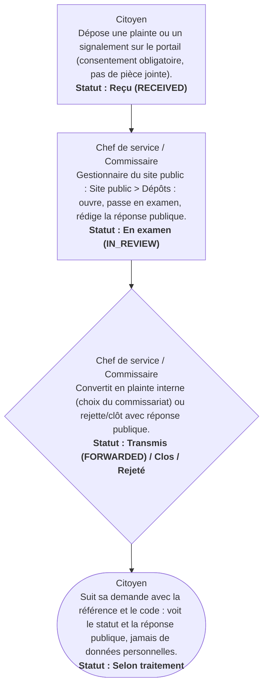

# Circuit H — Circuit du portail public (citoyen)

**Circuit opérationnel complet**

| Rubrique | Valeur |
|---|---|
| Système | SIGEC-PN / SIGPN-T — Système d'information de gestion de la Police nationale du Tchad |
| Éditeur et développeur | TECHNOTCHAD |
| Version du document | 1.0 — 10 novembre 2026 |
| Statut | Projet pour validation par la hiérarchie : les points marqués « À confirmer » ne sont pas des décisions |
| Source des informations | Lecture seule du système existant (code, catalogue des rôles et droits, écrans) — aucune donnée, aucun compte, aucun rôle, aucune permission n'a été modifié |

## Circuit H — Circuit du portail public (citoyen)

Le portail public permet à un citoyen, sans compte, de déposer une plainte ou un signalement, de suivre sa demande, de consulter l'annuaire des commissariats, les actualités et les avis de recherche **publiés**. Rien n'est jamais créé automatiquement comme plainte officielle : un agent habilité convertit le dépôt.

**Modules concernés :** Portail public, Gestion du site public

### Étapes détaillées

| N° | Qui | Action | Précisions du système | Statut après l'étape |
|---|---|---|---|---|
| 1 | Citoyen | Dépose une plainte ou un signalement sur le portail (consentement obligatoire, pas de pièce jointe). | Le système remet une référence et un code de suivi, affichés UNE SEULE fois ; le code est conservé haché. | Reçu (RECEIVED) |
| 2 | Chef de service / Commissaire | Gestionnaire du site public : Site public > Dépôts : ouvre, passe en examen, rédige la réponse publique. | Droit « gérer les dépôts ». | En examen (IN_REVIEW) |
| 3 | Chef de service / Commissaire | Convertit en plainte interne (choix du commissariat) ou rejette/clôt avec réponse publique. | Aucune fiche Personne n'est créée à partir des données du déclarant. | Transmis (FORWARDED) / Clos / Rejeté |
| 4 | Citoyen | Suit sa demande avec la référence et le code : voit le statut et la réponse publique, jamais de données personnelles. | Limites de débit par référence ; mêmes réponses pour un mauvais code et une référence inconnue. | Selon traitement |

### Règles appliquées par le système

- Les dépôts sont traités par les profils portant le droit « traiter les dépôts du site public » : commissaires, délégués provinciaux, commandement national et administrateur de la police (pas de profil dédié).
- Un avis de recherche n'est publié que sur validation expresse, par une personne autre que l'émetteur, s'il est actif, vérifié et d'un type publiable ; il est retiré automatiquement quand il n'est plus actif.
- Un commissariat n'apparaît dans l'annuaire que si ses coordonnées publiques sont vérifiées.
- L'indexation des moteurs de recherche est désactivée.

### Statuts

| Code | Libellé affiché | Signification |
|---|---|---|
| RECEIVED | Reçu | Dépôt enregistré. |
| IN_REVIEW | En examen | Pris en charge. |
| FORWARDED | Transmis | Converti en plainte interne. |
| CLOSED | Clos | Traité. |
| REJECTED | Rejeté | Refusé. |

### Notifications envoyées

| Événement | Destinataires | Message |
|---|---|---|
| (pas de notification interne dédiée) | — | Le gestionnaire consulte la file des dépôts |

### Écrans

### À confirmer auprès de la hiérarchie

- Réponses types et délais de réponse aux citoyens.
- Opportunité d'un SMS ou courriel de confirmation (aujourd'hui absents).

### Ce que le système ne fait pas / améliorations recommandées

- Pas de CAPTCHA, de SMS ni de courriel de confirmation ; pas de pièce jointe.

## Source Mermaid

