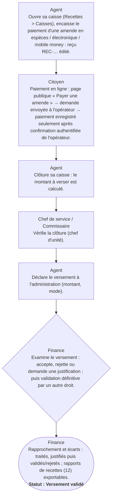

# Circuit I — Circuit des amendes, paiements et versements

**Circuit opérationnel complet**

| Rubrique | Valeur |
|---|---|
| Système | SIGEC-PN / SIGPN-T — Système d'information de gestion de la Police nationale du Tchad |
| Éditeur et développeur | TECHNOTCHAD |
| Version du document | 1.0 — 10 novembre 2026 |
| Statut | Projet pour validation par la hiérarchie : les points marqués « À confirmer » ne sont pas des décisions |
| Source des informations | Lecture seule du système existant (code, catalogue des rôles et droits, écrans) — aucune donnée, aucun compte, aucun rôle, aucune permission n'a été modifié |

## Circuit I — Circuit des amendes, paiements et versements

Du paiement d'une amende (au guichet, sur le terrain ou en ligne) jusqu'au rapprochement des versements à l'administration : l'agent a une **caisse**, la clôture est vérifiée, le **versement** est examiné puis validé, et des **écarts** sont justifiés.

**Modules concernés :** Circulation, Caisses et recettes, Paiement en ligne

### Étapes détaillées

| N° | Qui | Action | Précisions du système | Statut après l'étape |
|---|---|---|---|---|
| 1 | Agent | Ouvre sa caisse (Recettes > Caisses), encaisse le paiement d'une amende en espèces / électronique / mobile money : reçu REC-… édité. | Un paiement saisi par erreur est annulé (jamais effacé) par un titulaire du droit d'annulation. |  |
| 2 | Citoyen | Paiement en ligne : page publique « Payer une amende » → demande envoyée à l'opérateur → paiement enregistré seulement après confirmation authentifiée de l'opérateur. | En développement : opérateur simulé ; Airtel écrit mais non essayé en réel ; Moov non construit. |  |
| 3 | Agent | Clôture sa caisse : le montant à verser est calculé. | Notification aux vérificateurs de versement : « Caisse clôturée ». |  |
| 4 | Chef de service / Commissaire | Vérifie la clôture (chef d'unité). |  |  |
| 5 | Agent | Déclare le versement à l'administration (montant, mode). | Notification : « Versement à vérifier ». |  |
| 6 | Finance | Examine le versement : accepte, rejette ou demande une justification ; puis validation définitive par un autre droit. | Notification à l'agent : « Versement rejeté / Justification demandée ». |  |
| 7 | Finance | Rapprochement et écarts : traités, justifiés puis validés/rejetés ; rapports de recettes (12) exportables. | Chaque export est journalisé. | Versement validé |

### Règles appliquées par le système

- Les droits sont séparés : encaisser, vérifier, examiner, valider, rapprocher, bloquer.
- Un montant différent ou une amende déjà réglée sur un paiement en ligne place la demande en échec « remboursement requis » (remboursement manuel, hors application).

### Statuts

| Code | Libellé affiché | Signification |
|---|---|---|
| OPEN | Caisse ouverte |  |
| CLOSED | Caisse clôturée |  |
| DEPOSITED | Versée |  |
| VALIDATED | Validée |  |
| BLOCKED | Bloquée |  |

### Notifications envoyées

| Événement | Destinataires | Message |
|---|---|---|
| Caisse clôturée | Vérificateurs de versement de la province | Caisse clôturée : montant à verser |
| Versement déclaré | Vérificateurs de versement | Versement à vérifier |
| Versement rejeté / justification demandée | Les agents-caisse de l'unité | Versement rejeté / Justification demandée |

### Écrans

### À confirmer auprès de la hiérarchie

- Comptes bancaires/Trésor de versement, délais de versement, barème des écarts tolérés.

### Ce que le système ne fait pas / améliorations recommandées

- Écrans de recettes non capturés dans le dossier d'images actuel.

## Source Mermaid

