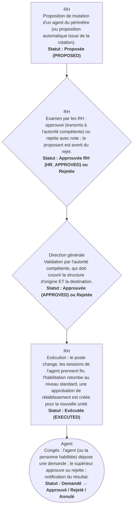

# Circuit J — Circuit des mutations et congés (ressources humaines)

**Circuit opérationnel complet**

| Rubrique | Valeur |
|---|---|
| Système | SIGEC-PN / SIGPN-T — Système d'information de gestion de la Police nationale du Tchad |
| Éditeur et développeur | TECHNOTCHAD |
| Version du document | 1.0 — 10 novembre 2026 |
| Statut | Projet pour validation par la hiérarchie : les points marqués « À confirmer » ne sont pas des décisions |
| Source des informations | Lecture seule du système existant (code, catalogue des rôles et droits, écrans) — aucune donnée, aucun compte, aucun rôle, aucune permission n'a été modifié |

## Circuit J — Circuit des mutations et congés (ressources humaines)

Le module Ressources humaines gère les dossiers des agents, les mutations, la rotation, la présence, les congés, la formation, la discipline et la paie. Les mutations suivent un circuit à quatre étapes avec séparation des fonctions.

**Modules concernés :** Ressources humaines

### Étapes détaillées

| N° | Qui | Action | Précisions du système | Statut après l'étape |
|---|---|---|---|---|
| 1 | RH | Proposition de mutation d'un agent du périmètre (ou proposition automatique issue de la rotation). | Numéro MUT-AAAA-NNNNN. | Proposée (PROPOSED) |
| 2 | RH | Examen par les RH : approuve (transmis à l'autorité compétente) ou rejette avec note ; le proposant est averti du rejet. | Droit « examiner les mutations ». | Approuvée RH (HR_APPROVED) ou Rejetée |
| 3 | Direction générale | Validation par l'autorité compétente, qui doit couvrir la structure d'origine ET la destination. | Droit « valider les mutations ». | Approuvée (APPROVED) ou Rejetée |
| 4 | RH | Exécution : le poste change, les sessions de l'agent prennent fin, l'habilitation retombe au niveau standard, une approbation de rétablissement est créée pour la nouvelle unité. | Notifications : agent (« Nouvelle affectation »), proposant (« Mutation exécutée »), unités départ et arrivée, responsables des affaires ouvertes (« Travail à réaffecter »). | Exécutée (EXECUTED) |
| 5 | Agent | Congés : l'agent (ou la personne habilitée) dépose une demande ; le supérieur approuve ou rejette ; notification du résultat. | Types : annuel, exceptionnel, permission, autorisation d'absence, indisponibilité. | Demandé → Approuvé / Rejeté / Annulé |

### Règles appliquées par le système

- Les données de paie et de discipline sont strictement confidentielles ; chaque lecture est journalisée.
- Celui qui demande une modification de paie ne peut pas la valider.

### Statuts

| Code | Libellé affiché | Signification |
|---|---|---|
| PROPOSED | Proposée |  |
| HR_APPROVED | Approuvée par les RH |  |
| APPROVED | Approuvée par l'autorité |  |
| EXECUTED | Exécutée |  |
| REJECTED | Rejetée |  |
| CANCELLED | Annulée |  |

### Notifications envoyées

| Événement | Destinataires | Message |
|---|---|---|
| Mutation à examiner | Titulaires du droit d'examen RH | Transfert à examiner |
| Mutation rejetée | Le proposant | Transfert rejeté |
| Nouvelle affectation | L'agent muté | Nouvelle affectation |
| Demande de congé | Titulaires du droit d'approuver les congés | Demande de congé à décider |
| Résultat de congé | Le demandeur | Demande de congé approuvée / rejetée |
| Rotation | Titulaires des droits RH | Agents bientôt éligibles à la rotation |

### Écrans

### À confirmer auprès de la hiérarchie

- Les durées de rotation et les délais d'alerte sont des paramètres du système à valider.

### Ce que le système ne fait pas / améliorations recommandées

- Écrans RH non capturés dans le dossier d'images actuel.

## Source Mermaid

