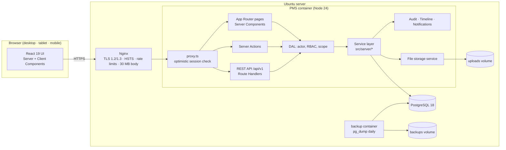
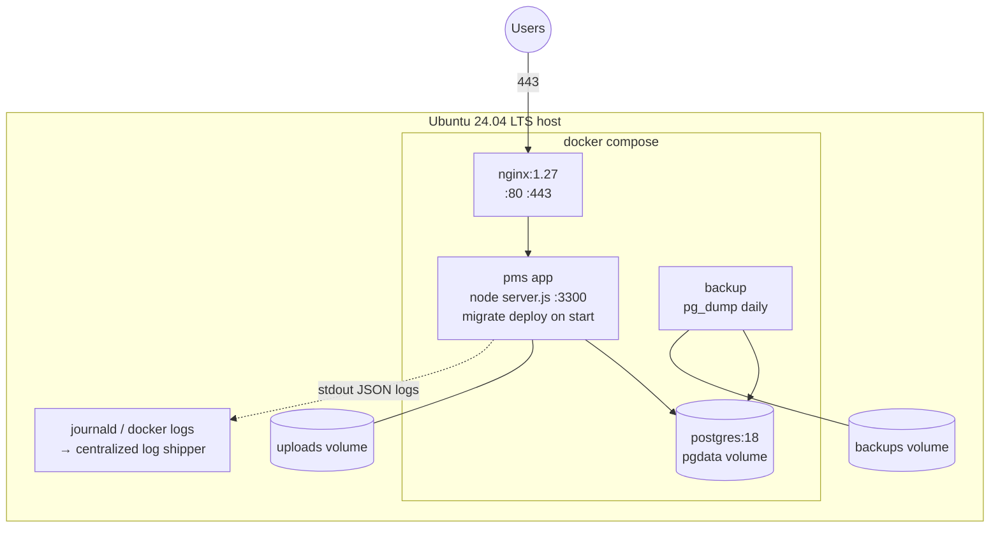

# Police Management System — Architecture

Version 0.1 · Phase 0 deliverable · 2026-09-11

## 1. Architecture decisions (ADR summary)

| # | Decision | Rationale |
| - | -------- | --------- |
| ADR-1 | **Single deployable Next.js 16 application** (React 19 + TypeScript + Tailwind 4) hosting the UI, Server Actions and a versioned REST API (`/api/v1`) on Node.js 24. | Meets the required stack (React/TS/Tailwind + Node/TS REST) with one build, one process, one TLS endpoint. A separate NestJS service would double the auth surface and deployment complexity for no functional gain in a single-tenant on-premise system. The service layer is framework-agnostic so it can be lifted into a standalone API later. |
| ADR-2 | **PostgreSQL 18 via Prisma 7** (`pg` driver adapter), migrations checked in. | Required database; typed schema is the ERD source of truth; migrations give reproducible deploys. Embedded PostgreSQL for developer machines, Docker `postgres:18` in production. |
| ADR-3 | **Database-backed sessions** (random 256-bit token, SHA-256 stored, httpOnly/SameSite=Lax/Secure cookie) instead of JWT. | Sessions can be revoked instantly (logout, lock, password change, admin), idle + absolute expiry are enforced server-side, and every session is auditable. |
| ADR-4 | **bcrypt (cost 12)** for passwords, **AES-256-GCM** for MFA secrets at rest, **TOTP (RFC 6238)** MFA with hashed recovery codes. | Argon2id needs a native build on Windows dev boxes; bcryptjs cost 12 is the accepted alternative named in the specification. Secrets never stored in plaintext. |
| ADR-5 | **RBAC with DB-managed roles**, code-defined permission catalog (`module:action`), and a **scope level** per role (NATIONAL / REGIONAL / STATION / OWN). | Roles and their permission sets are editable by administrators (Roles & Permissions modules) while the catalog stays type-safe. Scope implements organizational access control; case-level access adds explicit assignments and a sensitive flag. |
| ADR-6 | **Append-only audit log and chain of custody** enforced by PostgreSQL triggers, not only by application code. | Historical custody records and audit rows must be tamper-evident even for a DBA using the app role. Custody events are additionally hash-chained. |
| ADR-7 | **Local encrypted-at-rest-capable file storage** under `UPLOAD_DIR` with content-hash naming, MIME/magic validation, versioned documents; downloads only through authorized route handlers. | No object storage is available on the target Ubuntu server; a volume-backed directory with strict path handling meets the requirement and can be swapped for S3-compatible storage behind `src/server/storage`. |
| ADR-8 | **Soft-delete / status transitions only** for critical records. | Data-integrity rule of the specification. |
| ADR-9 | **Bilingual UI, French by default, English as second language** (owner decision, Phase 1). Locale is a cookie (`pms_lang`), never inferred from `Accept-Language`, so French is always the default. All UI strings are keys in `src/lib/i18n/fr.ts` (reference) / `en.ts` (TypeScript enforces identical keys); enum labels, system role names and permission descriptions are bilingual; service-layer messages stay English and are translated on display (`src/lib/i18n/errors.ts`); audit summaries stay English as system records. | Operational users work in French; English remains available for partners and documentation alignment with the English specification. Cookie-based locale avoids `/fr/...` route prefixes in an internal application. |

## 2. System architecture



**Request lifecycle (mutation)**: Browser → Nginx → `proxy.ts` (redirects unauthenticated page requests) → Server Action or Route Handler → `requireActor()` (session lookup, status check, MFA check, permission set) → `can()` + scope guard → zod validation → service function inside a Prisma transaction → audit log + case timeline + notifications → response → UI revalidation.

## 3. Frontend architecture

- **App Router** with two route groups: `(auth)` (login, MFA, password reset — public shell) and `(app)` (authenticated shell: sidebar, header, notifications, breadcrumbs).
- **Server Components by default**; Client Components only for interactivity (forms with `useActionState`, drawers, tabs, charts, search boxes, voice recorder).
- **Design system** in `src/components/ui.tsx` (Button, Card, Badge, Alert, Field, Table, Tabs, Stepper, EmptyState, StatCard, Drawer, Dialog) built on Tailwind 4 tokens defined in `globals.css`. Palette: deep navy (`#0f2a4a`), police blue (`#1e5aa8`), gold accent, semantic success/warning/danger/info.
- **Responsive rules**: sidebar collapses to a drawer below `lg`; tables become stacked cards below `md` (`data-label` pattern); forms use a 1→2 column grid; dashboards use CSS grid with `auto-fit`. Target breakpoints tested: 1920, 1366, 1024, 768, 390.
- **Forms**: progressive enhancement, native constraint attributes + zod on the server; server returns `FormState { error | ok, message, fieldErrors }`.
- **Case workspace**: `/cases/[id]/(tabs)` with Overview, Persons, Victims, Witnesses, Suspects, Investigation, Evidence, Statements, Interviews, Warrants, Arrests, Documents, Tasks, Timeline, Audit.

## 4. Backend architecture

```text
src/
  proxy.ts                     optimistic auth redirect (never the only check)
  app/(auth)/…                 login, mfa, reset
  app/(app)/…                  authenticated pages
  app/api/v1/**/route.ts       REST handlers (thin: parse → service → JSON)
  server/
    auth/     session.ts password.ts mfa.ts login.ts dal.ts api-auth.ts rate-limit.ts
    rbac/     permissions.ts (catalog) roles.ts (effective set, scope)
    audit.ts  timeline.ts  notifications.ts  sequences.ts  storage.ts  crypto.ts  env.ts
    <module>/ service.ts actions.ts queries.ts schemas.ts
  lib/        labels.ts format.ts navigation.ts (pure helpers, safe for client)
  components/ ui.tsx forms.tsx app-shell/* tables.tsx charts/*
  generated/prisma             generated client (git-ignored)
```

- **Service functions** have the signature `fn(actor: Actor, input: ValidatedInput, ctx: RequestContext)` and are the only place with business rules and status machines. Server Actions and Route Handlers are adapters.
- **Errors**: `AuthError` (401/403), `BusinessError` (409/422 with message), `NotFoundError` (404). Adapters map them to `FormState` or JSON `{ error: { code, message } }`. Stack traces never reach clients.
- **Status machines** are declared as transition tables (`ALLOWED[from] = [to…]`) in each service and enforced inside the transaction using `updateMany({ where: { id, status: from } })` to avoid races.
- **Numbering**: `DocumentSequence` rows per `TYPE-YEAR`, incremented inside the transaction (`CASE-2026-00001`, `CMP-`, `EVD-`, `ARR-`, `WRT-`, `INC-`, `PTL-`, `OPS-`, `DET-`, `INV-`, `RPT-`, `STM-`, `ITV-`, `WNT-`, `PID-`, `GEN-`).

## 5. Database architecture

Source of truth: `prisma/schema.prisma` (64 tables, 57 enums). Full table reference in `DATABASE_DOCUMENTATION.md`.

### 5.1 Entity-relationship overview

```mermaid
erDiagram
  Organization ||--o{ Region : has
  Region ||--o{ Station : has
  Station ||--o{ Department : has
  Station ||--o{ Officer : posts
  Department o|--o{ Officer : groups
  Rank ||--o{ Officer : holds
  Officer ||--o{ OfficerAssignment : history
  Officer |o--o| User : "login account"
  Role ||--o{ User : has
  Role ||--o{ RolePermission : grants
  Permission ||--o{ RolePermission : in
  User ||--o{ Session : opens
  User ||--o{ ApiKey : owns
  User ||--o{ AuditLog : acts

  Person ||--o{ PersonIdentifier : has
  Person ||--o{ PersonAlias : has
  Person ||--o{ PersonRelationship : links
  Person ||--o{ CaseParty : "victim/witness/suspect"
  Person ||--o{ WantedPerson : flagged
  Person ||--o{ Complaint : complainant

  Complaint |o--o| Case : "converted to"
  Case ||--o{ CaseAssignment : team
  Case ||--o{ CaseParty : parties
  Case ||--o{ CaseEvent : timeline
  Case ||--o{ CaseNote : notes
  Case ||--o{ Task : tasks
  Case ||--o{ Investigation : investigations
  Investigation ||--o{ InvestigationReport : reports
  Investigation o|--o{ Task : tasks
  Case ||--o{ Statement : statements
  Case ||--o{ Interview : interviews
  Interview o|--o{ Transcript : transcripts
  Statement o|--o{ Transcript : transcripts
  Case ||--o{ Evidence : evidence
  Evidence ||--o{ CustodyEvent : "chain of custody"
  StorageLocation o|--o{ Evidence : holds
  Case o|--o{ Warrant : warrants
  Warrant o|--o{ Arrest : executes
  Case o|--o{ Arrest : arrests
  Arrest ||--o{ Detention : custody
  Detention ||--o{ DetentionLog : log
  Officer ||--o{ Arrest : "arresting officer"

  Station ||--o{ Patrol : runs
  Patrol ||--o{ PatrolOfficer : crew
  Zone o|--o{ Patrol : covers
  Vehicle o|--o{ Patrol : uses
  Station ||--o{ Incident : handles
  Incident ||--o{ IncidentOfficer : responders
  Incident ||--o{ IncidentPerson : involved
  Case o|--o{ Incident : "linked"
  Station ||--o{ Operation : conducts
  Operation ||--o{ OperationTeam : teams
  OperationTeam ||--o{ OperationMember : members
  Operation ||--o{ OperationResource : resources
  Station ||--o{ Vehicle : fleet
  Vehicle ||--o{ MaintenanceRecord : maintenance
  Vehicle ||--o{ FuelLog : fuel
  Vehicle ||--o{ VehicleAssignment : assignments

  Document ||--o{ DocumentVersion : versions
  Case o|--o{ Document : attachments
  Evidence o|--o{ Document : files
  GeneratedReport |o--o| Document : pdf
  User ||--o{ Notification : receives
```



### 5.2 Integrity rules

- FKs everywhere with `RESTRICT` semantics by default (Prisma default for required relations); only security tables (`Session`, `LoginChallenge`, `MfaRecoveryCode`, `PasswordResetToken`, `ApiKey`, `Notification`, `PasswordHistory`) cascade on user deletion, and users are soft-deleted anyway.
- Unique business numbers on every numbered entity; `(caseId, personId, role)` unique on `CaseParty`; `(evidenceId, seq)` unique on `CustodyEvent`; `(type, value)` unique on identifiers.
- Append-only tables: `AuditLog`, `CustodyEvent` — triggers `pms_forbid_mutation()` raise on UPDATE/DELETE (migration `immutability_triggers`).
- Indexes on every status/foreign-key/date column used by list pages and dashboards (see schema `@@index`).

## 6. API architecture

- Base path `/api/v1`. JSON only. Authentication by session cookie (browser) **or** `Authorization: Bearer pms_<key>` (API key, hashed at rest, owner's permissions).
- Uniform envelope: success `{ data, meta? }`; error `{ error: { code, message, details? } }` with HTTP 400/401/403/404/409/422/429/500.
- Pagination `?page=&pageSize=` (max 100), filtering by documented query params, sorting `?sort=field:asc`.
- Every handler: `withApi(handler, { permission })` wrapper → actor resolution → permission → rate limit → zod parse → service → audit (mutations).
- Health: `GET /api/health` (unauthenticated liveness, no data). Endpoint catalog maintained in `API_DOCUMENTATION.md` as phases deliver.

## 7. Security architecture

| Control | Implementation |
| ------- | -------------- |
| Transport | TLS at Nginx, HSTS, HTTP→HTTPS redirect |
| Headers | CSP (self only, no inline scripts except Next runtime nonce-less inline allowed for hydration data), X-Frame-Options DENY, nosniff, Referrer-Policy, Permissions-Policy |
| Authentication | username/email + password (bcrypt 12), account status gate, lockout after `LOGIN_MAX_FAILURES` for `LOGIN_LOCK_MINUTES`, per-IP + per-identifier attempt tracking in `LoginAttempt` |
| MFA | TOTP required for roles flagged `requiresMfa` (admins, commanders, evidence custodians); enrolment with QR; 8 hashed recovery codes; step-up challenge cookie valid 5 min |
| Sessions | DB sessions, idle 60 min, absolute 10 h, rotation on privilege change, revoke-all on password change, IP/UA recorded |
| Passwords | min 12 chars, 3 of 4 classes, no username/email inside, history of 5, max age 90 d, forced change on first login |
| Authorization | RBAC permission set + scope level (NATIONAL/REGIONAL/STATION/OWN) + case-level assignment + sensitive-case flag, enforced in the service layer; UI hides what the user cannot do but never relies on it |
| CSRF | Server Actions: origin check by Next; REST: SameSite=Lax cookie + custom header requirement for state-changing cookie-authenticated requests; API keys are not CSRF-exposed |
| Input | zod on every boundary; Prisma parameterized queries (no raw SQL with user input); output encoding by React |
| Files | size limit, MIME allow-list + magic-byte sniff, random content-hash filenames, stored outside web root, served only via authorized handler with `Content-Disposition: attachment` and nosniff |
| Rate limiting | Nginx zones + in-app limiter (login, MFA, reset, API) keyed by IP and identifier |
| Secrets | `.env` only, never committed; MFA secrets AES-256-GCM with `DATA_ENCRYPTION_KEY`; audit redaction of `password*`, `token*`, `secret*` |
| Audit | every auth event, every mutation, every denied access, exports and downloads → `AuditLog` (immutable) |

## 8. File storage architecture

`UPLOAD_DIR/<entity>/<yyyy>/<mm>/<sha256-prefix>-<random>.<ext>`. Metadata (name, MIME, size, SHA-256, uploader, version) lives in `DocumentVersion`. New uploads for the same document create a new version; old versions are retained (never overwritten). Audio recordings for transcripts are preserved as the original version forever.

## 9. Audit architecture

`logAudit({ actor, action, module, entity, summary, before, after, outcome, context })` writes one row per event; failures to write audit are logged to stderr but never break the business operation **except** for custody transfers, where audit + custody row are in the same transaction. Actions are `UPPER_SNAKE` strings such as `LOGIN`, `LOGIN_FAILED`, `ACCESS_DENIED`, `CASE_CREATED`, `EVIDENCE_TRANSFERRED`, `PERMISSION_CHANGED`. Audit viewer: filter by actor, module, entity, date, outcome; export CSV (audited).

## 10. Backup & recovery

- **Daily** `pg_dump --format=custom` from the `backup` container to the `backups` volume with SHA-256 manifest and 30-day retention (`deploy/backup/backup.sh`).
- **On-demand** backup from System Administration (records a `BackupRecord`, runs `pg_dump` via `scripts/backup.ts`).
- **Uploads** are backed up by snapshotting the `uploads` volume (rsync/tar in the same cron; documented in the deployment guide).
- **Restore**: `deploy/backup/restore.sh <file>` (checksum verify → `pg_restore --clean`), then `prisma migrate deploy`, then restore uploads. Tested in Phase 15.
- RPO 24 h (configurable cron), RTO < 30 min.

## 11. Deployment architecture



Environments: **Development** (Windows/macOS/Linux, embedded PostgreSQL, `npm run dev`), **Testing** (same, with `npm test`, `test:integration`, `test:security` against the dev DB), **Staging/Production** (compose stack above, secrets from `.env.production`).

## 12. Environment configuration

See `.env.example`. Required in production: `DATABASE_URL`, `AUTH_SECRET`, `DATA_ENCRYPTION_KEY`, `APP_URL`. Optional tuning: session, lockout, password policy, upload limits, backup dir, STT provider. `TRUST_PROXY=1` makes the app trust `X-Forwarded-For` from Nginx.

## 13. Module map

| # | Module | Phase | Main tables |
| - | ------ | ----- | ----------- |
| 1 | Dashboard | 12 | aggregates |
| 2 | Authentication | 1 | User, Session, LoginChallenge, LoginAttempt, PasswordResetToken |
| 3–5 | Users, Roles, Permissions | 1 | User, Role, Permission, RolePermission |
| 6–10 | Organizations, Regions, Stations, Departments, Ranks | 2 | Organization, Region, Station, Department, Rank |
| 11 | Officers | 2/11 | Officer, OfficerAssignment |
| 12–16 | Persons, Victims, Witnesses, Suspects, Wanted | 3 | Person, PersonIdentifier, PersonAlias, PersonRelationship, CaseParty, WantedPerson |
| 17 | Complaints | 4 | Complaint |
| 18 | Cases | 5 | Case, CaseAssignment, CaseParty, CaseEvent, CaseNote |
| 19–22 | Investigations, Tasks, Statements, Interviews | 6 | Investigation, InvestigationReport, Task, Statement, Interview |
| 23–24 | Evidence, Chain of Custody | 7 | Evidence, CustodyEvent, StorageLocation |
| 25–27 | Arrests, Detention, Warrants | 8 | Arrest, Detention, DetentionLog, Warrant |
| 33–34, 36 | Documents, Versioning, Reports | 9 | Document, DocumentVersion, GeneratedReport |
| 28–30 | Patrols, Incidents, Operations | 10 | Patrol, Zone, Incident, Operation, OperationTeam |
| 31–32 | Vehicles, Maintenance | 11 | Vehicle, VehicleAssignment, MaintenanceRecord, FuelLog |
| 35 | Notifications | 1+ | Notification |
| 37 | Statistics | 12 | aggregates |
| 38 | Audit Logs | 1 | AuditLog |
| 39 | Voice / Speech-to-Text | 13 | Transcript |
| 40–42 | System, Security Administration, Backup | 1/14/15 | SystemSetting, ApiKey, BackupRecord |
