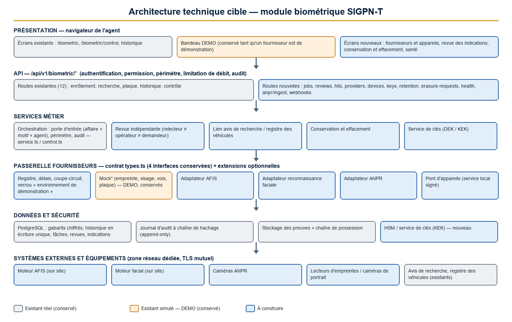
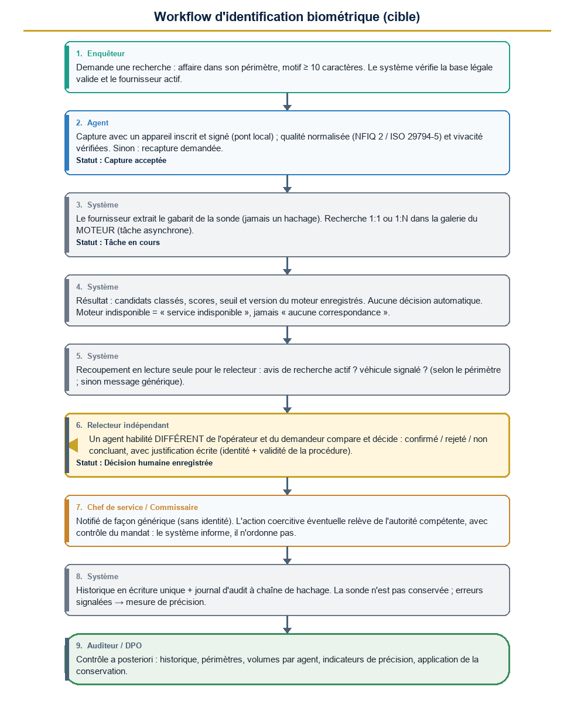
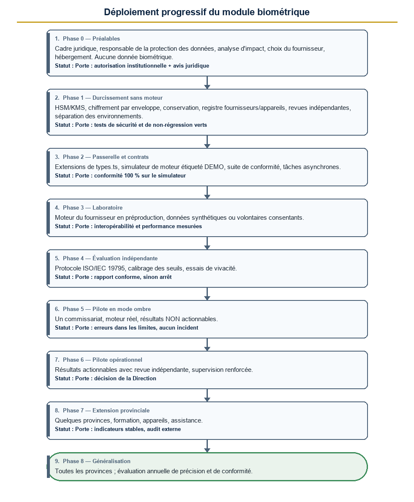

# SIGPN-T — Évolution du module biométrique : spécifications techniques

**Police nationale du Tchad — Éditeur : TECHNOTCHAD — Version 1.0 du 11 novembre 2026 — Document de conception (aucune modification du code, des tables, des données ni des configurations)**

| Rubrique | Valeur |
|---|---|
| Statut | **Conception pour validation.** Rien de ce qui est décrit ici n'est construit. |
| Point de départ | Audit du module biométrique actuel (11 novembre 2026) : module entièrement simulé, enveloppe de contrôle et de traçabilité réelle |
| Règle absolue | Aucun moteur réel n'est branché sans autorisation institutionnelle, validation juridique, tests indépendants et approbation du responsable du projet |
| Marqueurs DEMO | **Conservés** partout où le module reste simulé ; leur retrait n'est possible que par la procédure du chapitre 12 |

[[SOMMAIRE]]

<!--pagebreak-->

## 1. Objectif, principes et périmètre

**Objectif.** Faire évoluer par étapes le module de démonstration en une solution biométrique professionnelle, sécurisée et évolutive : moteur d'empreintes (AFIS), reconnaissance faciale, équipements de capture compatibles, recherches 1:1 et 1:N performantes, liens avec les avis de recherche et le registre des véhicules, gestion des clés, politique de conservation, validation humaine indépendante et journal d'audit inviolable.

**Principes directeurs.**

1. **Conserver ce qui est correct** : la porte d'entrée (affaire + motif + agent obligatoires), les périmètres territoriaux, l'historique en écriture unique, la décision humaine, la chaîne de possession des captures, le contrôle d'identité à quatre états, le chiffrement des gabarits au repos. Rien de cela n'est reconstruit.
2. **Ne pas reconstruire** : les évolutions sont **additives** (nouvelles colonnes, nouvelles tables, nouveaux fichiers). Aucune table existante n'est supprimée ni renommée.
3. **Réutiliser les quatre interfaces fournisseurs** de `src/server/biometric/providers/types.ts` (`FingerprintProvider`, `FaceRecognitionProvider`, `VoiceRecognitionProvider`, `LicensePlateProvider`). Elles restent le contrat de base ; on y ajoute des **extensions optionnelles** (chapitre 6) sans casser les adaptateurs de démonstration.
4. **Un résultat biométrique est une indication, jamais une preuve ni un ordre d'agir.** Aucune action coercitive n'est déclenchée sans validation humaine indépendante.
5. **Aucune donnée biométrique réelle hors du périmètre de production** : jamais dans la démonstration, le développement ni les jeux d'essai.
6. **Interdiction de principe** : un simple hachage SHA-256 d'une image **n'est pas et ne sera jamais** un gabarit biométrique. Le « gabarit » de démonstration actuel (sha256) est étiqueté `DEMO_SHA256` ; aucun adaptateur réel ne l'accepte ; aucune migration ne le transforme en donnée réelle.

**Hors périmètre de ce document** : le choix commercial du fournisseur, le texte juridique lui-même, la construction du code.

## 2. Fonctionnalités réelles et fonctionnalités simulées (état actuel, présenté séparément)

### 2.1 Réel aujourd'hui (à conserver)

| Fonction | Preuve dans le système |
|---|---|
| Porte d'entrée de toute recherche : affaire dans le périmètre, motif de 10 caractères au moins, agent, type | `searchGateSchema` (`schemas.ts`) |
| Historique des recherches en écriture unique, sans chemin de suppression | modèle `BiometricSearch`, `recordBiometricAction()` seule autorisée à compléter l'action |
| Résultats limités à « correspondance potentielle » / « aucune correspondance » ; jamais « vérifiée » automatiquement | `MATCH_THRESHOLD` et `service.ts` |
| Périmètres territoriaux de consultation de l'historique | `biometricScopeWhere` |
| Chiffrement des gabarits au repos (AES-256-GCM) | `encryptSecret` / `decryptSecret` (`crypto.ts`) ; `templateSecretEnc` jamais renvoyé par l'API |
| Capture conservée comme pièce à conviction avec chaîne de possession à hachage | `detectLicensePlate` → `Evidence` + `CustodyEvent` |
| Contrôle d'identité : quatre états, texte « vérification humaine obligatoire », jamais « aucune correspondance » pour un service indisponible | `control.ts`, `biometric-control.ts` |
| Vérification humaine par un agent **différent** de celui qui a fait le contrôle (contrainte en base) | `BiometricControl` |
| Notifications génériques (sans identité) : vérification demandée, supérieur notifié, erreur signalée | `control.ts` |
| Journal d'audit à chaîne de hachage (append-only) | `audit-chain.ts`, `pms_audit_verify()` |
| Comparaison d'une plaque et d'un conducteur avec les avis de recherche lors d'un contrôle routier | `findWantedHits` (`traffic/enforcement.ts`) |

### 2.2 Simulé aujourd'hui (marqué DEMO, à ne pas confondre avec du réel)

| Élément simulé | Réalité |
|---|---|
| Les quatre « moteurs » (empreinte, visage, voix, plaque) | `providers/mock-*.ts` : gabarit = sha256 des octets ; similarité = accord de chiffres hexadécimaux ; ANPR = plaque inventée depuis le hachage |
| Qualité de capture | Valeur 60 à 100 déduite de la taille du fichier : sans signification |
| Contrôle d'identité | `simulateOutcome()` tire un scénario fictif ; aucun gabarit n'est comparé ; contrainte `isSimulation = true` en base |
| Seuils : 60 (recherches, `MATCH_THRESHOLD`) ; 80 / 45 / qualité 40 (contrôles) | Valeurs de démonstration, non calibrées |
| Sources « Base nationale (DEMO) » | Étiquettes de texte, pas de base nationale |
| Matériel | Aucun : téléversement de fichier ou aperçu navigateur |

### 2.3 Absent aujourd'hui (à construire)

Moteur AFIS réel · reconnaissance faciale réelle · détection de vivacité (PAD) · lecteurs et caméras · identification 1:N dans le moteur · gestion de clés externe (HSM/KMS) · politique de conservation et d'effacement · base légale enregistrée · liens automatiques ANPR ↔ avis de recherche ↔ registre des véhicules · mesure continue de la précision · validation indépendante des enrôlements.

<!--pagebreak-->

## 3. Architecture technique cible

### 3.1 Vue d'ensemble



**Code couleur du diagramme** : gris = existant réel (conservé) · orange = existant simulé (DEMO, conservé) · bleu = à construire.

### 3.2 Les composants

| Composant | Rôle | Nature |
|---|---|---|
| **Écrans existants** (`/biometric`, `/biometric/control`, historique) | Recherches et contrôles par les agents habilités | Existant, étendu |
| **Écrans nouveaux** | Fournisseurs et appareils ; revue des correspondances ; conservation et effacement ; santé et précision | À construire |
| **API `/api/v1/biometric/*`** | Points d'entrée existants conservés ; nouveaux points : tâches asynchrones, fournisseurs, appareils, conservation (chapitre 5) | Existant + nouveau |
| **Service d'orchestration** (`service.ts`, `control.ts`) | Applique la porte d'entrée, le périmètre, l'audit ; **délègue** extraction et recherche à la passerelle | Existant, refactoré |
| **Revue indépendante** | Généralise la règle « relecteur ≠ opérateur » des contrôles à toutes les recherches et aux enrôlements | À construire (règle existante étendue) |
| **Passerelle fournisseurs** | Choisit l'adaptateur selon la modalité et l'environnement ; applique délais, coupe-circuit, journalisation de corrélation, étiquetage DEMO | À construire sur `providers/index.ts` |
| **Adaptateurs** | `Mock*` (conservés, DEMO) ; `AfisAdapter`, `FaceAdapter`, `AnprAdapter`, `DeviceGateway` | Mocks existants ; réels à construire |
| **Coffre de gabarits** | Gabarits chiffrés par enveloppe, rattachés à une personne, une base légale et une échéance de conservation | Existant (colonnes `templateSecretEnc`), étendu |
| **Service de clés** | Clé de chiffrement de clés (KEK) dans un HSM/KMS ; clés de données (DEK) par enregistrement ; rotation ; double contrôle | À construire |
| **Lien avis de recherche / véhicules** | Recoupe les plaques lues et les identités confirmées avec `WantedVehicle`, `WantedPerson`, `TrafficVehicle` | À construire |
| **Tâche de conservation** | Applique les échéances, l'effacement par destruction de clé, les demandes de contestation | À construire |
| **Journal d'audit** | Chaîne de hachage existante ; nouveaux types d'événements | Existant, étendu |
| **Stockage des preuves** | Captures conservées comme pièces avec chaîne de possession | Existant |

### 3.3 Flux de données et frontières de sécurité

1. Le navigateur de l'agent ne parle **jamais** directement au moteur : tout passe par le serveur SIGPN-T (authentification, périmètre, audit).
2. Le serveur parle au moteur biométrique par une liaison **chiffrée et authentifiée** (TLS mutuel), dans une **zone réseau dédiée**, moteur hébergé sur site (aucune donnée biométrique ne quitte le territoire sans décision expresse).
3. Les **sondes** (échantillon de la personne recherchée) ne sont conservées ni côté serveur ni côté moteur au-delà de la durée de la tâche (contrat avec le fournisseur, vérifié par test).
4. Les **galeries** (gabarits de référence) vivent dans le moteur (identification 1:N) ; SIGPN-T conserve la copie chiffrée de référence et l'identifiant d'enrôlement chez le moteur.
5. Les équipements de capture passent par un **pont local** (service installé sur le poste) qui signe chaque capture.

### 3.4 Performances : recherche 1:1 et 1:N

| Sujet | Situation actuelle | Cible |
|---|---|---|
| 1:1 | Les gabarits de la personne sont chargés et déchiffrés dans l'application | Idem pour un petit nombre de gabarits, mais le calcul de similarité est fait par le moteur ; **objectif p95 ≤ 2 s de bout en bout** (capture exclue) |
| 1:N | `loadTemplates` charge et déchiffre **tous** les gabarits actifs en mémoire à chaque recherche | **La galerie reste dans le moteur** : SIGPN-T envoie la sonde, le moteur renvoie des candidats classés. Plus aucun chargement massif de gabarits dans l'application |
| Durée 1:N | Non mesurée | **Tâche asynchrone** (chapitre 5) : accusé immédiat, résultat sous quelques secondes à quelques dizaines de secondes selon la taille de la galerie ; objectif p95 ≤ 10 s pour une galerie de 1 million d'empreintes (à confirmer avec le fournisseur) |
| Résilience | Aucune | Délai maximal, coupe-circuit, bascule en « service indisponible » (jamais lu comme « aucune correspondance »), reprise sur incident |
| Pré-filtrage | Aucun | Possible par métadonnées prudentes (région d'enrôlement, doigt, type de capture) **sans jamais exclure silencieusement** des candidats : toute réduction de galerie est journalisée |
| Mesure | Aucune | Latence, taux d'erreur, file d'attente, qualité : tableau de bord (chapitre 10) |

<!--pagebreak-->

## 4. Architecture de la base de données

**Règle de migration :** uniquement additive (`ALTER TABLE … ADD COLUMN` avec valeur par défaut compatible, nouvelles tables). Chaque migration documente son retour arrière. Rien n'est appliqué par ce document.

### 4.1 Tables existantes conservées

`FingerprintRecord`, `FaceRecord`, `VoiceRecord`, `LicensePlateDetection`, `BiometricSearch`, `BiometricMatch`, `BiometricControl` et leurs index. Les colonnes actuelles ne changent pas.

### 4.2 Colonnes à ajouter

| Table | Colonne | Rôle |
|---|---|---|
| `FingerprintRecord`, `FaceRecord`, `VoiceRecord` | `templateFormat` (`DEMO_SHA256`, `ISO_19794_2`, `ISO_39794`, `VENDOR_<code>`) | Identifie la nature du gabarit ; les lignes actuelles reçoivent `DEMO_SHA256` |
| idem | `providerCode`, `providerTemplateVersion`, `providerEnrollmentId` | Fournisseur, version de l'algorithme (un changement de version impose un ré-enrôlement), identifiant côté moteur |
| idem | `keyId` | Clé de données utilisée (chiffrement par enveloppe) |
| idem | `legalBasisId` | Base légale de l'enrôlement (obligatoire pour tout gabarit réel) |
| idem | `retentionUntil`, `retentionTrigger`, `status` (`PENDING_VALIDATION`, `ACTIVE`, `SUSPENDED`, `PURGED`), `purgedAt`, `purgeReason` | Conservation et effacement |
| idem | `qualityStandard` (`NFIQ2`, `ISO_29794_5`), `qualityScore`, `padResult` (vivacité), `deviceId` | Qualité normalisée, vivacité, appareil de capture |
| idem | `validatedById`, `validatedAt` | Validation indépendante de l'enrôlement (≠ agent qui a capturé) |
| `BiometricSearch` | `providerCode`, `engineVersion`, `thresholdUsed`, `galleryScope`, `latencyMs`, `jobId`, `templateFormat` | Reproductibilité de chaque résultat |
| `BiometricSearch` | `isDemo` conservée | Reste vrai tant que le fournisseur est de démonstration |
| `LicensePlateDetection` | `trafficVehicleId`, `watchStatus`, `confidence`, `normalizedPlate`, `source` (`UPLOAD`, `CAMERA`) | Lien registre des véhicules et surveillance |
| `BiometricControl` | `providerCode`, `matchedEnrollmentRef` | Chemin réel du contrôle, sans retirer la simulation |

### 4.3 Nouvelles tables

| Table | Contenu | Remarque |
|---|---|---|
| `BiometricProvider` | code, modalité, nom, fournisseur, version, `isDemo`, `status` (`REGISTERED`, `SANDBOX`, `VALIDATED`, `ACTIVE`, `SUSPENDED`, `RETIRED`), référence de l'évaluation indépendante, date de validation, référence de décision | **Un fournisseur ne passe à `ACTIVE` que par une approbation** (circuit d'approbations existant, nouveau type de demande) |
| `BiometricDevice` | numéro de série, type (lecteur d'empreintes, caméra, caméra ANPR), modèle, certification, commissariat, certificat de l'appareil (empreinte), statut, dernière activité | Un appareil inconnu ne peut pas fournir de capture |
| `BiometricKey` | `keyId`, type (`KEK`, `DEK`), référence au coffre externe, algorithme, créée, retirée, détruite | **Métadonnées seulement** : jamais de matériau de clé en base |
| `BiometricLegalBasis` | référence du texte, autorité, périmètre (modalités, finalités), début, fin, version | Sans base légale valide, enrôlement et recherche réels sont refusés |
| `BiometricRetentionPolicy` | modalité, finalité, durée, événement déclencheur, base légale | Valeurs proposées au chapitre 9 |
| `BiometricRetentionRun` | exécution, date, nombre de gabarits purgés, erreurs | Preuve de l'application de la politique |
| `BiometricErasureRequest` | personne, origine (contestation, mise hors de cause, décision), statut, décideur, motif, date | Droit de contestation |
| `BiometricJob` | type (`ENROLL`, `VERIFY`, `IDENTIFY`), fournisseur, demande, statut, horodatages, durée, code d'erreur | Recherches asynchrones |
| `BiometricReview` | recherche ou contrôle, relecteur, décision (`CONFIRMED`, `REJECTED`, `INCONCLUSIVE`), justification, date | **Contrainte : relecteur ≠ opérateur ≠ demandeur** |
| `BiometricWatchHit` | origine (plaque, visage, empreinte), cible (avis de recherche, véhicule signalé), score, statut (`NEW`, `UNDER_REVIEW`, `CONFIRMED`, `REJECTED`), relecteur | Indications, jamais alertes automatiques |
| `BiometricProviderHealth` | fournisseur, date, latence, erreurs, version | Surveillance |

### 4.4 Contraintes et garde-fous en base

1. **Écriture unique** des champs principaux de `BiometricSearch` et `BiometricReview` (déclencheur d'interdiction de modification/suppression, comme pour le journal d'audit).
2. `BiometricControl_simulation_only` (`isSimulation = true`) **reste en vigueur** dans les environnements de démonstration. Elle ne sera remplacée que dans l'environnement de production par une règle : `isSimulation = false` autorisé seulement si le fournisseur est `ACTIVE`, non démo, avec décision enregistrée.
3. Un gabarit `DEMO_SHA256` ne peut être comparé qu'à un autre gabarit `DEMO_SHA256` (jamais envoyé à un moteur réel).
4. `reviewer ≠ operator` pour toute décision `CONFIRMED`.
5. Index : par personne, fournisseur, statut, `retentionUntil` ; pas d'index sur du matériau biométrique.
6. Séparation physique recommandée : schéma ou base dédiée aux gabarits, sauvegardes chiffrées séparément.

<!--pagebreak-->

## 5. Spécifications des API

**Conventions** : mêmes règles que les routes actuelles (`withApi`, authentification, permission, périmètre, limitation de débit, audit). Réponses `{ data, meta? }` ou `{ error }`. Tous les appels qui reçoivent un échantillon utilisent `multipart/form-data` ; aucun échantillon brut n'est renvoyé dans une réponse.

### 5.1 Points d'entrée existants (conservés sans changement de contrat)

`POST /api/v1/biometric/fingerprint/enroll` · `…/fingerprint/search` · `…/face/enroll` · `…/face/search` · `…/voice/enroll` · `…/voice/search` · `…/anpr/detect` · `…/anpr/search` · `GET /api/v1/biometric/history` et `/history/{id}` · `GET/POST /api/v1/biometric/control` et `/control/{id}`.

### 5.2 Nouveaux points d'entrée

| Méthode et chemin | Permission | Objet |
|---|---|---|
| `POST /api/v1/biometric/jobs` | selon la modalité (`biometric:search_*`) | Soumet une identification 1:N ou une vérification 1:1 **asynchrone** ; répond `202 { jobId }` |
| `GET /api/v1/biometric/jobs/{id}` | propriétaire du job + historique | Statut et résultat (candidats classés, sans identité hors périmètre) |
| `POST /api/v1/biometric/reviews` | `biometric:verify` | Décision humaine indépendante (chapitre 7) |
| `POST /api/v1/biometric/enrollments/{id}/validate` | `biometric:enroll_validate` | Validation indépendante d'un enrôlement |
| `POST /api/v1/biometric/anpr/ingest` | clé d'appareil signée | Réception d'un événement de caméra ANPR |
| `GET /api/v1/biometric/hits` · `PATCH /hits/{id}` | `biometric:watchlist_review` | Revue des indications avis de recherche / véhicules |
| `GET/POST /api/v1/biometric/providers` · `PATCH /providers/{id}` | `biometric:provider_manage` | Enregistrement et cycle de vie des fournisseurs (activation soumise à approbation) |
| `GET/POST /api/v1/biometric/devices` · `PATCH /devices/{id}` | `biometric:device_manage` | Appareils de capture |
| `POST /api/v1/biometric/keys/rotate` | `biometric:key_manage` (double contrôle) | Rotation de clé |
| `GET /api/v1/biometric/retention/policies` · `POST /retention/run` | `biometric:retention_manage` | Politiques et exécution de la purge |
| `POST /api/v1/biometric/erasure-requests` · `PATCH /{id}` | création : agent habilité ; décision : `biometric:erasure_decide` | Contestation et effacement |
| `GET /api/v1/biometric/health` | `biometric:provider_manage` | Santé des fournisseurs et indicateurs de précision |
| `POST /api/v1/biometric/webhooks/{provider}` | signature du fournisseur | Résultats asynchrones du moteur (signés, idempotents, comme les notifications de paiement) |

### 5.3 Exemples de contrats

**Soumission d'une identification 1:N**

```
POST /api/v1/biometric/jobs        (multipart)
  type=IDENTIFY, modality=FINGERPRINT, caseId=…, reason="…≥10 car.",
  captureId=<identifiant d'une capture signée du pont local>  OU  file=<échantillon>
  position=RIGHT_INDEX (facultatif), device=<numéro de série>

202 { "data": { "jobId": "bjob_…", "status": "QUEUED", "pollAfterMs": 1500 } }
```

**Résultat**

```
GET /api/v1/biometric/jobs/{id}
200 { "data": {
  "status": "COMPLETED",
  "provider": { "code": "afis-x", "version": "9.2", "isDemo": false },
  "thresholdUsed": 62.0,
  "candidates": [ { "rank": 1, "score": 78.4, "scoreRaw": 3120, "personRef": "PID-…", "visible": true } ],
  "decision": "REVIEW_REQUIRED",
  "latencyMs": 4100,
  "notice": "Indication à vérifier : ce résultat n'est ni une preuve ni un ordre d'agir."
} }
```

Aucun champ de décision automatique n'existe : les valeurs possibles sont `NO_CANDIDATE`, `REVIEW_REQUIRED`, `UNAVAILABLE`.

**Décision humaine**

```
POST /api/v1/biometric/reviews
  { "targetType": "SEARCH", "targetId": "…", "outcome": "CONFIRMED|REJECTED|INCONCLUSIVE",
    "justification": "≥ 30 caractères : identité, éléments comparés, validité de la procédure" }
201 …   409 si relecteur = opérateur ou demandeur ; 403 sans biometric:verify
```

### 5.3 bis Codes d'erreur

`400` validation · `401/403` droits · `404` hors périmètre (jamais de fuite d'existence) · `409` conflit (même personne, relecteur identique, fournisseur non actif) · `422` qualité insuffisante ou vivacité non établie (avec indication de recapture) · `429` limitation · `502/504` moteur indisponible ou lent (réponse `UNAVAILABLE`, **jamais** « aucune correspondance »).

<!--pagebreak-->

## 6. Contrats des fournisseurs (AFIS, reconnaissance faciale, plaque, pont d'appareils)

### 6.1 Principe : étendre `types.ts` sans le casser

Les quatre interfaces actuelles restent valides. On ajoute un **contrat d'extension optionnel** que seuls les adaptateurs réels implémentent ; les `Mock*` ne changent pas, hormis l'ajout d'un `capabilities` qui annonce `isDemo: true`.

```ts
// Spécification (non appliquée)
interface ProviderCapabilities {
  code: string; version: string; isDemo: boolean;
  modality: "FINGERPRINT" | "FACE" | "VOICE" | "ANPR";
  templateFormats: string[];          // ex. ["ISO_19794_2", "VENDOR_X_v9"]
  supportsGalleryIdentification: boolean;   // 1:N dans le moteur
  supportsPad: boolean;               // vivacité (ISO/IEC 30107-3)
  maxGallerySize?: number;
  scoreScale: { min: number; max: number; higherIsBetter: true };
}
interface ProviderExtensions {
  capabilities(): Promise<ProviderCapabilities>;
  health(): Promise<{ ok: boolean; latencyMs: number; version: string }>;
  assessQuality(sample: Buffer): Promise<{ standard: "NFIQ2" | "ISO_29794_5"; score: number; ok: boolean; reasons: string[] }>;
  enroll(subject: { ref: string }, samples: Buffer[]): Promise<{ enrollmentId: string; templateFormat: string; templateVersion: string; template: string }>;
  identifyInGallery(probe: string, opts: { gallery: string; maxCandidates: number; threshold: number; requestId: string }): Promise<{ candidates: { enrollmentId: string; score: number; scoreRaw?: number }[]; engineVersion: string }>;
  remove(enrollmentId: string): Promise<void>;       // effacement côté moteur
}
```

**Règles de contrat communes** (tous fournisseurs) :

| Exigence | Détail |
|---|---|
| Gabarit | Format normalisé quand il existe (ISO/IEC 19794-2 pour les minuties, ISO/IEC 39794 pour le visage) ou format propriétaire **versionné**. **Jamais** un hachage d'image. L'adaptateur rejette explicitement `DEMO_SHA256` |
| Scores | Normalisés sur une échelle documentée ; le score brut est conservé ; le seuil utilisé est enregistré avec chaque résultat |
| Idempotence | Chaque appel porte un `requestId` ; un rejeu ne crée ni doublon d'enrôlement ni double facturation |
| Délais | Délai maximal par type d'appel ; au-delà : `UNAVAILABLE` |
| Erreurs | Taxonomie fermée : `POOR_QUALITY`, `PAD_FAILED`, `NO_FACE_DETECTED`, `MULTIPLE_FACES`, `TEMPLATE_VERSION_MISMATCH`, `ENGINE_UNAVAILABLE`, `TIMEOUT`, `QUOTA`, `INTERNAL` |
| Données | Pas de conservation des sondes au-delà de la tâche ; pas d'apprentissage sur les données de la police ; hébergement sur site ; suppression sur demande (`remove`) avec preuve |
| Sécurité | TLS mutuel, identifiants stockés dans le coffre, pas de journalisation des échantillons ni des gabarits |
| Traçabilité | `requestId` corrélé au journal d'audit de SIGPN-T |
| Changement de version | Toute montée de version de l'algorithme est une **opération planifiée** (ré-enrôlement ou conversion documentée), jamais silencieuse |

### 6.2 Contrat AFIS (empreintes)

| Sujet | Exigence |
|---|---|
| Opérations | enrôlement, mise à jour, suppression, vérification 1:1, identification 1:N dans une galerie nommée, santé, capacités |
| Entrées | images conformes (résolution 500 ppp ou 1000 ppp, formats WSQ/PNG/ISO), ou gabarits ISO/IEC 19794-2 |
| Qualité | NFIQ 2 (ISO/IEC 29794-4) calculée à l'enrôlement ; seuil d'acceptation fixé par l'évaluation |
| Résultats | liste de candidats classés avec score ; nombre maximal paramétrable ; aucune décision binaire imposée par le moteur |
| Mode de transport | API REST/gRPC du fournisseur ou SDK encapsulé dans un service local ; l'application ne voit que le contrat ci-dessus |
| Normes de référence à exiger | ISO/IEC 19794-2 / 19794-4, ANSI/NIST-ITL 1-2011 (échange), NFIQ 2, ISO/IEC 19795 (méthode d'évaluation) |
| Exploitation | disponibilité cible 99,5 %, sauvegarde et restauration de la galerie, journal d'activité exportable |

### 6.3 Contrat reconnaissance faciale

| Sujet | Exigence |
|---|---|
| Opérations | détection (nombre de visages), qualité, vivacité (PAD), extraction, vérification 1:1, identification 1:N, suppression |
| Photos à plusieurs visages | l'opérateur **choisit** le visage ; plus de sélection implicite |
| Vivacité | niveau d'attaque de présentation testé selon ISO/IEC 30107-3 pour les captures en direct |
| Équité | le fournisseur fournit ses taux d'erreur par groupe ; l'évaluation indépendante les mesure sur la population locale (chapitre 10) |
| Format | ISO/IEC 19794-5 / ISO/IEC 39794-5 pour l'image ; gabarit propriétaire versionné |
| Usage restreint | la reconnaissance faciale sert **l'aide à la vérification** ; aucune identification de masse en temps réel dans l'espace public n'est dans le périmètre |

### 6.4 Contrat voix

Interface `VoiceRecognitionProvider` conservée. **Aucune mise en service n'est envisagée** tant qu'un besoin opérationnel et une évaluation ne sont pas établis (zéro enregistrement aujourd'hui).

### 6.5 Contrat lecture de plaques (ANPR)

Interface `LicensePlateProvider` conservée ; extension : `readPlate` renvoie aussi `confidence`, la zone de lecture, le format reconnu et l'heure de l'image. Les caméras fixes envoient des événements signés à `/anpr/ingest`.

### 6.6 Contrat du pont d'appareils (lecteurs et caméras)

| Sujet | Exigence |
|---|---|
| Équipements | lecteurs d'empreintes conformes aux spécifications d'image (famille FBI PIV / Annexe F ou équivalent ISO), caméras de portrait conformes ISO/IEC 19794-5, caméras ANPR industrielles |
| Architecture | **service local sur le poste** exposant une interface locale authentifiée au navigateur ; chaque appareil a un certificat |
| Capture signée | `{ sample, deviceId, capturedAt, nonce, operatorId, signature }` ; le serveur vérifie la signature, l'unicité du `nonce` et la fraîcheur : **une image injectée ou rejouée est refusée** |
| Hors ligne | pas de capture réelle sans connexion au serveur ; pas de stockage local d'échantillons |
| Gestion | inventaire dans `BiometricDevice`, révocation immédiate d'un appareil perdu ou volé |

<!--pagebreak-->

## 7. Workflow complet d'identification



### 7.1 Règles d'indépendance

| Rôle dans le processus | Qui | Contrainte |
|---|---|---|
| Demandeur | enquêteur de l'affaire | renseigne l'affaire et le motif |
| Opérateur de capture et de recherche | agent biométrie / enquêteur habilité | `operator` enregistré |
| **Relecteur indépendant** | titulaire de `biometric:verify` | **≠ opérateur et ≠ demandeur** (contrainte en base) ; justification écrite obligatoire (≥ 30 caractères) sur l'identité **et** la validité de la procédure |
| Décideur d'une action coercitive | autorité compétente hors système | le système n'ordonne jamais ; il informe |
| Contrôle a posteriori | auditeur, commissaire, DPO | consultent l'historique, ne modifient rien |

### 7.2 Étapes et règles

1. **Autorisation** : droit de recherche, affaire dans le périmètre, motif ≥ 10 caractères, **base légale valide** pour la modalité (nouveau), fournisseur actif.
2. **Capture** : appareil inscrit et signé ; qualité normalisée suffisante ; vivacité établie pour une capture en direct. Sinon `422` avec consigne de recapture.
3. **Extraction** du gabarit de la sonde par le fournisseur (jamais par un hachage).
4. **Recherche** : 1:1 (personne désignée) ou 1:N (galerie du moteur) ; tâche asynchrone pour le 1:N.
5. **Résultat** : candidats classés, scores, seuil et version moteur enregistrés. Valeurs possibles : `NO_CANDIDATE`, `REVIEW_REQUIRED`, `UNAVAILABLE`. **Jamais de décision automatique.**
6. **Recoupement** (lecture seule, pour le relecteur) : la personne candidate fait-elle l'objet d'un avis actif ? Visible selon le périmètre du relecteur ; sinon message générique « contacter le commissariat émetteur ».
7. **Revue indépendante** : comparaison visuelle par le relecteur, décision `CONFIRMED` / `REJECTED` / `INCONCLUSIVE` avec justification.
8. **Suites** : rattachement à l'affaire, notification générique du supérieur, signalement d'erreur éventuel (alimente la mesure de précision). L'action coercitive éventuelle relève de l'autorité compétente, avec contrôle du mandat (le système le rappelle).
9. **Journalisation** : chaque étape dans le journal à chaîne de hachage ; historique de la recherche en écriture unique.
10. **Conservation** : la sonde n'est pas conservée (ou, si elle sert de preuve, comme pièce avec chaîne de possession et échéance propre).

### 7.3 Workflow d'enrôlement (nouveau)

Capture signée → qualité et vivacité → extraction → **validation indépendante** par un second agent (identité de la personne et qualité) → activation (`ACTIVE`) avec base légale et échéance → inscription dans la galerie du moteur. Sans validation, le gabarit reste `PENDING_VALIDATION` et n'est jamais comparé.

### 7.4 Workflow d'effacement et de contestation

Demande (mise hors de cause, décision de justice, contestation de la personne) → instruction → décision du responsable de la protection des données → **effacement par destruction de la clé de données** (« cryptographic erasure ») et suppression côté moteur → preuve datée au journal.

### 7.5 Liens avec les avis de recherche et le registre des véhicules

| Source | Recoupement | Résultat |
|---|---|---|
| Plaque lue (ANPR, image ou caméra) | normalisation de la plaque (fonction existante du module circulation) ; recherche dans `WantedVehicle` (avis actifs) et dans `TrafficVehicle` (statuts volé, saisi, suspendu) | `BiometricWatchHit` (statut `NEW`) |
| Identité confirmée | `WantedPerson` en vigueur | indication au relecteur, pas d'alerte |
| Contrôle routier | recoupement existant (`findWantedHits`) conservé | inchangé |

**Règles** : une indication n'envoie jamais d'alerte nationale automatique ; elle ouvre une revue indépendante ; elle notifie génériquement les titulaires du droit de revue du commissariat concerné ; la plaque seule ne désigne pas une personne.

<!--pagebreak-->

## 8. Matrice des rôles et permissions

### 8.1 Droits existants (état actuel, lu dans la base de démonstration)

| Droit | Profils qui le détiennent aujourd'hui |
|---|---|
| `biometric:control` | Enquêteur, agent biométrie, police technique |
| `biometric:search_fingerprint` | Enquêteur, agent biométrie, police technique |
| `biometric:search_face` | Enquêteur, agent biométrie |
| `biometric:search_voice` | Enquêteur, agent biométrie |
| `biometric:search_anpr` | Enquêteur, agent biométrie, agent de patrouille |
| `biometric:manage` (enrôlement) | Police technique |
| `biometric:verify` | Enquêteur, agent biométrie |
| `biometric:history_view` | 12 profils (commandements, auditeur, analyste, parquet, administrateur de la police, etc.) |

### 8.2 Droits à ajouter

| Nouveau droit | Objet | Sensible |
|---|---|---|
| `biometric:enroll_validate` | Valider un enrôlement réalisé par un autre | Oui |
| `biometric:watchlist_review` | Revoir les indications avis de recherche / véhicules | Oui |
| `biometric:provider_manage` | Enregistrer fournisseurs ; suivre leur santé (**l'activation exige une approbation**) | Oui |
| `biometric:device_manage` | Inscrire et révoquer les appareils | Non |
| `biometric:key_manage` | Rotation et destruction de clés (double contrôle) | Oui |
| `biometric:retention_manage` | Politiques et exécution de la purge | Oui |
| `biometric:erasure_decide` | Décider d'un effacement | Oui |

### 8.3 Attribution proposée et séparation des fonctions

| Profil | Droits nouveaux proposés | Interdits (séparation) |
|---|---|---|
| Administrateur technique | `provider_manage` (enregistrement seulement), `device_manage` | Aucune recherche, aucune revue, aucune clé : **il n'a pas de droit opérationnel** |
| Administrateur de sécurité | `key_manage` (double contrôle avec un second approbateur) | Aucune recherche ni revue |
| **Responsable de la protection des données (profil à créer, à confirmer)** | `retention_manage`, `erasure_decide`, `history_view` | Aucune recherche, aucun enrôlement |
| Police technique | `manage` (enrôlement) | **Ne valide pas ses propres enrôlements** |
| Agent biométrie | `enroll_validate` (pour les enrôlements des autres), `watchlist_review` | Ne revoit pas ses propres recherches |
| Enquêteur | recherches existantes, `verify` | `verify` impossible sur ses propres recherches (contrainte) |
| Commissaire / délégué / commandement | `history_view` ; réception des notifications | Aucun droit de recherche ni d'enrôlement (inchangé) |
| Auditeur, parquet | `history_view` seulement | Lecture seule |

Toute attribution d'un droit sensible passe par le circuit d'approbation existant (deux approbateurs).

<!--pagebreak-->

## 9. Politique de sécurité et de conservation

### 9.1 Chiffrement et gestion des clés

| Sujet | Situation actuelle | Cible |
|---|---|---|
| Algorithme | AES-256-GCM | Conservé |
| Clé | **Une seule clé de données** dérivée de la configuration du serveur ; sa perte rend tous les gabarits illisibles | **Chiffrement par enveloppe** : une clé de données (DEK) par enregistrement, elle-même chiffrée par une clé maîtresse (KEK) **détenue dans un HSM ou un service de clés** ; la KEK ne quitte jamais le coffre |
| Rotation | Aucune | KEK : au moins annuelle et sur incident ; DEK : à chaque ré-enrôlement ; ré-enveloppement sans ré-extraction |
| Contrôle | Une personne technique | **Double contrôle** pour créer, faire tourner et détruire une KEK (deux personnes distinctes, journalisées) |
| Effacement | Suppression de ligne | **Destruction de la DEK** (effacement cryptographique) + suppression côté moteur |
| Sauvegardes | Non spécifié | Chiffrées, clés séparées, restauration testée |
| Secours | — | Procédure de séquestre de la KEK, testée ; perte de clé = perte de gabarits : acceptable, jamais de contournement |

### 9.2 Protection des données

1. **Minimisation** : aucun échantillon brut conservé par défaut ; seule une capture versée comme pièce à conviction (avec hachage et chaîne de possession) peut subsister, sous l'échéance de l'affaire.
2. **Séparation** : gabarits dans un schéma dédié ; aucun gabarit dans les journaux, exports, sauvegardes de démonstration.
3. **Accès** : besoin d'en connaître, affaire obligatoire, périmètre territorial, limitation de débit, détection d'usage anormal (volume de recherches par agent, recherches hors horaires, recherches répétées sur une même personne).
4. **Transport** : TLS partout, TLS mutuel vers le moteur.
5. **Environnements** : aucune donnée biométrique réelle en développement, essai ou démonstration ; un verrou refuse tout fournisseur non démo dans ces environnements.
6. **Analyse d'impact** sur la protection des données obligatoire avant le pilote.
7. **Incidents** : procédure de notification (compromission de clé, accès anormal) sous 72 heures à la Direction et à l'autorité compétente (délai à confirmer par le juridique).

### 9.3 Durées de conservation proposées (à confirmer par le juridique)

| Donnée | Durée proposée | Déclencheur |
|---|---|---|
| Gabarit d'une personne en procédure ouverte | Durée de la procédure + délai de recours (à fixer) | Clôture définitive |
| Gabarit d'une personne mise hors de cause, non-lieu, relaxe | **Effacement sous 30 jours** | Décision |
| Gabarit d'un condamné | Selon le texte légal (à fixer) | Décision |
| Sonde d'une recherche | **Non conservée** au-delà de la tâche | Fin de la tâche |
| Capture versée comme preuve | Durée de l'affaire (règles des pièces) | Clôture |
| Historique des recherches (métadonnées, sans biométrie) | Conservé, en écriture unique ; durée longue (à fixer) | — |
| Lectures de plaques non rattachées à une affaire | 12 mois | Date de lecture |
| Contrôles d'identité simulés (démonstration) | Durée de la démonstration | — |

### 9.4 Journal d'audit

Le journal à chaîne de hachage existant reçoit de nouveaux types d'événements : enrôlement, validation, recherche, tâche, revue, indication, effacement, rotation de clé, activation de fournisseur, appareil inscrit ou révoqué, purge. **Aucun événement ne contient de donnée biométrique.** L'empreinte de tête de la chaîne est exportée quotidiennement hors de la base pour détecter la suppression de la dernière ligne (limite connue du dispositif actuel).

<!--pagebreak-->

## 10. Plan de tests et de validation

### 10.1 Tests existants à conserver (non-régression)

Fichiers : `tests/unit/biometric.test.ts`, `tests/unit/biometric-control.test.ts`, `tests/integration/biometric.test.ts`, `tests/integration/biocontrol.test.ts`. Ils doivent rester verts à chaque étape avec les adaptateurs de démonstration.

### 10.2 Nouveaux tests

| Famille | Contenu | Critère d'acceptation |
|---|---|---|
| **Contrat des fournisseurs** | Suite de conformité exécutée contre chaque adaptateur (réel et simulateur) : idempotence, taxonomie d'erreurs, délais, rejet de `DEMO_SHA256`, scores normalisés | 100 % de réussite avant toute activation |
| **Simulateur de moteur** | Faux serveur AFIS/facial, **étiqueté DEMO**, pour tester sans moteur réel | Les tests d'intégration ne dépendent d'aucun fournisseur réel |
| **Sécurité des données** | Aucun gabarit ni échantillon dans les journaux, réponses, sauvegardes de démo ; `templateSecretEnc` jamais exposé ; rotation de clé ; effacement cryptographique irréversible | Aucun écart |
| **Indépendance** | Relecteur = opérateur → refus ; validateur d'enrôlement = capteur → refus ; vérifié en base et par l'API | Aucun contournement |
| **Falsification** | Tentative de modification/suppression de l'historique et du journal ; capture rejouée ; image injectée ; appareil révoqué | Détectée et refusée |
| **Périmètre** | Un agent ne voit ni candidat, ni historique hors de son périmètre ; 404 sans fuite | Vérifié sur tous les profils |
| **Performance** | 1:1 : p95 ≤ 2 s ; 1:N sur galerie de volume cible : p95 ≤ 10 s ; charge de pointe simulée ; coupe-circuit | Seuils du chapitre 3.4 |
| **Résilience** | Moteur arrêté, lent, répondant en erreur : message « indisponible » (jamais « aucune correspondance »), reprise automatique | Conforme |
| **Conservation** | Exécution de la politique : purge à l'échéance, preuve au journal, aucun gabarit orphelin dans le moteur | Conforme |
| **Liens plaques / avis / véhicules** | Plaque d'un avis actif, d'un véhicule signalé, plaque lue de mauvaise qualité, homonymies | Aucune alerte automatique ; indication créée et revue |
| **Accessibilité et usage** | Français et arabe, téléphone, instructions de recapture | Parcours complets sans aide |

### 10.3 Évaluation indépendante de la précision (condition préalable au pilote)

| Élément | Exigence |
|---|---|
| Évaluateur | Organisme **indépendant** du fournisseur et de l'éditeur, désigné par la Direction |
| Méthode | Protocole conforme à ISO/IEC 19795 ; jeu de données **local, légalement constitué, avec consentement ou base légale**, jamais des données de démonstration |
| Mesures | Empreintes : taux de faux rejet (FNMR) à taux de fausse acceptation (FMR) fixé ; taux d'identification au rang 1 ; taux de faux positifs d'identification (FPIR). Visage : mêmes mesures **par groupe** (sexe, tranche d'âge, teint) |
| Valeurs de référence | À fixer par l'évaluation et validées par la Direction. À titre **indicatif seulement** : FNMR ≤ 1 % pour FMR = 0,1 % (empreintes). Aucun seuil d'exploitation n'est retenu avant ces résultats |
| Vivacité | Essais d'attaque de présentation selon ISO/IEC 30107-3 |
| Résultat | Rapport signé ; les seuils d'exploitation (aujourd'hui 60 pour les recherches et 80/45/40 pour les contrôles, valeurs de démonstration) sont **remplacés** par les valeurs calibrées |

### 10.4 Tests de sécurité

Test d'intrusion externe, revue de la gestion des clés, test de reprise après sinistre (restauration des gabarits et de la galerie), contrôle de l'isolation réseau du moteur.

### 10.5 Recette utilisateur

Séances par profil (enquêteur, agent biométrie, police technique, commissaire, DPO), sur la **préproduction avec données synthétiques**, avec les scénarios du chapitre 7.

<!--pagebreak-->

## 11. Plan de migration depuis le mode DEMO

### 11.1 Ce qui ne se migre pas

| Donnée actuelle | Décision | Raison |
|---|---|---|
| Gabarits `sha256` de démonstration (81 empreintes, 26 visages en base de développement) | **Restent en démonstration, étiquetés `DEMO_SHA256`, jamais copiés en production** | Ce ne sont pas des gabarits biométriques |
| Plaques « lues » par le moteur de démonstration | Restent en démonstration | Valeurs inventées |
| Contrôles simulés (`isSimulation = true`) | Restent, étiquetés | Fictifs |

La **production démarre sans aucun gabarit** : chaque personne est enrôlée réellement, avec base légale, vivacité et validation indépendante.

### 11.2 Ce qui est conservé

Le **code** de la porte d'entrée, des périmètres, de l'historique, de la décision humaine, des contrôles, des notifications, du chiffrement et de l'audit (chapitre 2.1). Les **lignes d'historique DEMO** (`isDemo = true`) restent en écriture unique et sont **exclues des statistiques opérationnelles**.

### 11.3 Étapes techniques (aucune n'est appliquée par ce document)

1. **Migrations additives** (chapitre 4) : colonnes et tables nouvelles, valeurs par défaut `DEMO_SHA256` pour l'existant. Retour arrière documenté pour chacune.
2. **Registre des fournisseurs** : enregistrer `mock-*` comme fournisseurs `isDemo = true` (l'existant devient un fournisseur parmi d'autres).
3. **Mode de fonctionnement** par environnement : `BIOMETRIC_MODE = demo | shadow | operational`. `demo` : seuls les fournisseurs de démonstration sont autorisés (verrou). `shadow` : le moteur réel tourne mais ses résultats ne sont **pas actionnables** (affichés à l'équipe d'évaluation seulement). `operational` : exige une décision d'approbation enregistrée.
4. **Indicateurs visuels** : le bandeau DEMO s'affiche tant que le fournisseur de la modalité est de démonstration ; il disparaît **fournisseur par fournisseur** et jamais globalement.
5. **Remplacement de la contrainte `simulation_only`** : uniquement dans l'environnement de production, par migration documentée, après la décision d'activation du fournisseur.
6. **Bascule** modalité par modalité (empreintes d'abord), jamais toutes ensemble.
7. **Retour arrière** : désactiver le fournisseur réel (statut `SUSPENDED`) renvoie la modalité en « service indisponible » (procédure manuelle) ; les données déjà enrôlées sont conservées chiffrées, pas supprimées.

### 11.4 Préconditions de bascule (toutes obligatoires)

1. Autorisation institutionnelle écrite de la Direction générale.
2. Avis juridique favorable sur le traitement de données biométriques ; base légale enregistrée.
3. Analyse d'impact sur la protection des données validée.
4. Rapport d'évaluation indépendante conforme aux critères fixés.
5. Test d'intrusion sans point critique ouvert.
6. Approbation du responsable du projet.

<!--pagebreak-->

## 12. Plan de déploiement progressif



| Phase | Contenu | Données biométriques | Porte de sortie (go / no-go) |
|---|---|---|---|
| **0. Préalables** | Cadre juridique, désignation du responsable de la protection des données, analyse d'impact, choix du fournisseur (appel d'offres), budget, hébergement du moteur | Aucune | Autorisation institutionnelle + avis juridique |
| **1. Durcissement sans moteur** | Service de clés (HSM/KMS), chiffrement par enveloppe, politique de conservation, registre des fournisseurs et appareils, indépendance des revues, mesure de santé, séparation des environnements | Démonstration uniquement | Tests de sécurité et de non-régression verts |
| **2. Passerelle et contrats** | Extensions de `types.ts`, simulateur de moteur étiqueté DEMO, suite de conformité, tâches asynchrones, pont d'appareils (prototype) | Synthétiques | Suite de conformité à 100 % sur le simulateur |
| **3. Laboratoire avec le fournisseur** | Moteur en préproduction sur site, **jeux de données synthétiques ou de volontaires consentants** | Synthétiques / consentement écrit | Interopérabilité et performance mesurées |
| **4. Évaluation indépendante** | Protocole du 10.3, calibrage des seuils | Jeu d'évaluation légalement constitué | **Rapport conforme ou arrêt** |
| **5. Pilote en mode « ombre »** | Un commissariat (N'Djamena), moteur réel, résultats **non actionnables**, comparaison avec la pratique actuelle | Réelles, base légale en vigueur | Taux d'erreur observés dans les limites ; aucun incident de sécurité |
| **6. Pilote opérationnel limité** | Même commissariat, résultats actionnables avec revue indépendante, supervision renforcée | Réelles | Décision de la Direction, revue des erreurs signalées |
| **7. Extension provinciale** | Quelques provinces, formation, appareils déployés, assistance | Réelles | Indicateurs stables, audit externe |
| **8. Généralisation** | Toutes les provinces, exploitation courante, évaluation annuelle | Réelles | Revue annuelle de précision et de conformité |

**Environnements** : DEV et DÉMONSTRATION (fournisseurs de démonstration uniquement, verrou technique) · PRÉPRODUCTION (moteur du fournisseur, données synthétiques) · PRODUCTION (moteur validé, HSM, zone réseau dédiée).

**Gouvernance** : comité de pilotage (Direction générale, juridique, responsable de la protection des données, éditeur, fournisseur) ; revue à chaque porte ; toute porte non franchie arrête la suite. Les calendriers sont à établir avec le fournisseur retenu ; aucun délai n'est promis ici.

<!--pagebreak-->

## 13. Fichiers et composants existants susceptibles d'être modifiés (liste de repérage, **aucun n'est modifié**)

### 13.1 Interfaces et adaptateurs fournisseurs

| Fichier | Nature de l'évolution éventuelle |
|---|---|
| `src/server/biometric/providers/types.ts` | Ajouter l'extension optionnelle `ProviderExtensions`, les types de capacités et d'erreurs (les quatre interfaces actuelles restent) |
| `src/server/biometric/providers/index.ts` | Passer de « mock ou erreur » à un registre de fournisseurs (code, mode d'environnement, verrou démo) |
| `src/server/biometric/providers/mock-*.ts` (4 fichiers) + `mock-common.ts` | Conservés ; ajouter `capabilities()` annonçant `isDemo: true` ; format `DEMO_SHA256` explicite |
| *(nouveaux)* `providers/afis-adapter.ts`, `face-adapter.ts`, `anpr-adapter.ts`, `device-gateway.ts` | Adaptateurs réels |

### 13.2 Services et logique métier

| Fichier | Nature de l'évolution éventuelle |
|---|---|
| `src/server/biometric/service.ts` | Remplacer `loadTemplates` (chargement massif) par l'identification dans le moteur ; enrôlement validé en deux temps ; base légale ; qualité et vivacité |
| `src/server/biometric/control.ts` | Chemin réel du contrôle (en plus de `runControl` simulé) ; revue indépendante généralisée |
| `src/server/biometric/schemas.ts`, `queries.ts`, `actions.ts`, `api-utils.ts` | Nouveaux champs, filtres, validations, actions |
| `src/lib/biometric-control.ts` | Séparer le simulateur (conservé, DEMO) de la classification utilisée aussi pour le réel |
| `src/server/crypto.ts` | Chiffrement par enveloppe (DEK/KEK), appel au coffre de clés, rotation |
| `src/server/env.ts` | Variables des fournisseurs, du mode (`demo/shadow/operational`), du coffre de clés |
| `src/server/evidence/service.ts` | Rétention des captures biométriques, échéance, lien avec la politique de conservation |
| `src/server/traffic/enforcement.ts`, `src/server/wanted/service.ts` | Réutilisation de `findWantedHits` et normalisation des plaques par le lien ANPR ; indication de revue |
| `src/server/audit.ts`, `src/server/audit-chain.ts` | Nouveaux types d'événements ; export quotidien de l'empreinte de tête |
| `src/server/notifications.ts`, `src/server/sequences.ts` | Notifications génériques ; numéros (`BJOB`, `BREV`, `BHIT`) |
| `src/server/approvals/*` | Nouveau type de demande : activation d'un fournisseur, rotation de clé |
| *(nouveaux)* `src/server/biometric/{jobs,review,retention,keys,watchlist}.ts` | Orchestration asynchrone, revue, conservation, clés, recoupements |

### 13.3 Base de données

| Fichier | Nature de l'évolution éventuelle |
|---|---|
| `prisma/schema.prisma` | Colonnes et tables du chapitre 4 |
| `prisma/migrations/20261108140000_biometric_control/migration.sql` | **Non modifiée** ; la contrainte `simulation_only` n'est remplacée que par une nouvelle migration en production |
| *(nouvelles)* migrations additives | Une par lot fonctionnel, avec retour arrière |

### 13.4 API, écrans et traductions

| Fichier | Nature de l'évolution éventuelle |
|---|---|
| `src/app/api/v1/biometric/**/route.ts` (12 routes) | Contrats conservés ; ajout des routes `jobs`, `reviews`, `hits`, `providers`, `devices`, `keys`, `retention`, `erasure-requests`, `health`, `anpr/ingest`, `webhooks/{provider}` |
| `src/app/(app)/biometric/page.tsx`, `biometric-forms.tsx` | Soumission asynchrone, capture via le pont d'appareils, affichage qualité/vivacité |
| `src/app/(app)/biometric/control/page.tsx`, `control-console.tsx` | Mode réel par fournisseur ; bandeau DEMO conditionnel |
| `src/app/(app)/biometric/history/[id]` | Revue, indications, échéances |
| *(nouveaux)* écrans fournisseurs/appareils, conservation, revue des indications, santé | — |
| `src/lib/i18n/biocontrol.fr.ts`, `biocontrol.ar.ts`, `catalog.ts`, `errors.ts`, `fr.ts`, `ar.ts` | Libellés des nouveaux écrans, droits et erreurs (français et arabe) |
| `src/lib/navigation.ts`, `src/components/app-shell/sidebar.tsx` | Nouvelles entrées de menu selon les droits |
| `src/app/(app)/cases/[id]/page.tsx`, `persons/[id]/page.tsx`, `wanted/[id]/page.tsx`, `dashboard/page.tsx` | Affichage des indications et du statut des gabarits (selon les droits) |

### 13.5 Droits, rôles, démonstration, documentation, tests

| Fichier | Nature de l'évolution éventuelle |
|---|---|
| `src/server/rbac/permissions.ts`, `roles.ts`, `sync.ts`, `sensitivity.ts` | Sept nouveaux droits, nouveau profil de protection des données, attribution unique à la synchronisation, droits sensibles |
| `src/server/demo/seed-biometric.ts`, `accounts.ts`, `seed-foundation.ts` | Données de démonstration étiquetées DEMO ; comptes d'essai |
| `scripts/demo/*` (parcours biométriques) | Parcours de démonstration inchangés ; scripts de laboratoire séparés |
| `docs/CONTROLE_BIOMETRIQUE.md`, `.env.example`, `deploy/` | Documentation, variables, déploiement (coffre de clés, zone réseau du moteur) |
| `tests/unit/biometric*.test.ts`, `tests/integration/biometric.test.ts`, `biocontrol.test.ts` | Conservés ; nouveaux tests du chapitre 10 |
| `SIGEC_PN_DOCUMENTATION/*` (manuels, matrice des droits, catalogue des notifications) | Mise à jour après chaque phase (régénération par le script existant) |

## 14. Décisions attendues de la Direction

1. Autoriser la préparation juridique et la désignation d'un responsable de la protection des données.
2. Valider le principe d'un moteur hébergé sur site, sans sortie de données du territoire.
3. Valider la liste des profils habilités et le profil nouveau de protection des données.
4. Valider les durées de conservation proposées (chapitre 9.3) après avis juridique.
5. Désigner l'organisme d'évaluation indépendante et fixer les critères d'acceptation du 10.3.
6. Autoriser le lancement de la **phase 1** (durcissement sans moteur), seule phase sans prérequis juridique, après approbation du responsable du projet.

**Rappel de la consigne de sécurité.** Ce document est une conception. Aucune ligne de code, aucune table, aucune donnée ni configuration n'ont été modifiées pour l'écrire, les marqueurs DEMO sont conservés, et aucun moteur réel n'est connecté.
