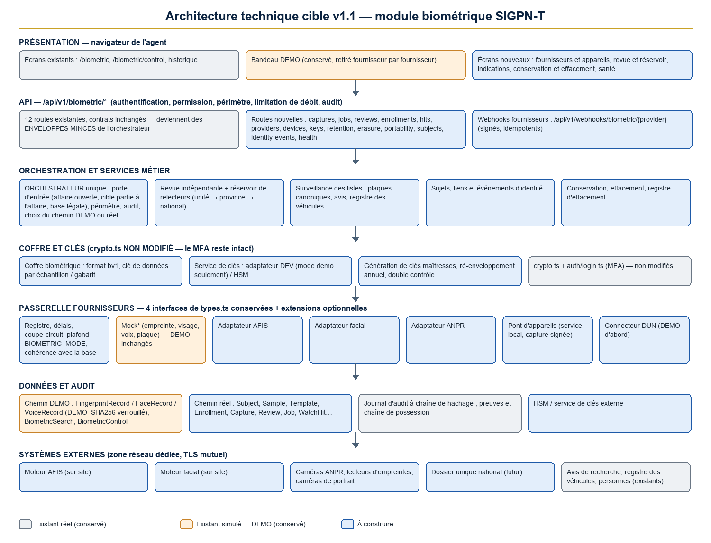
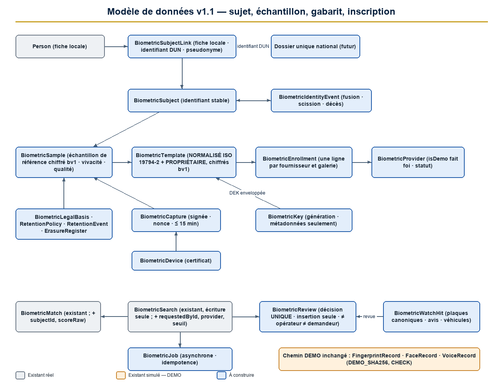
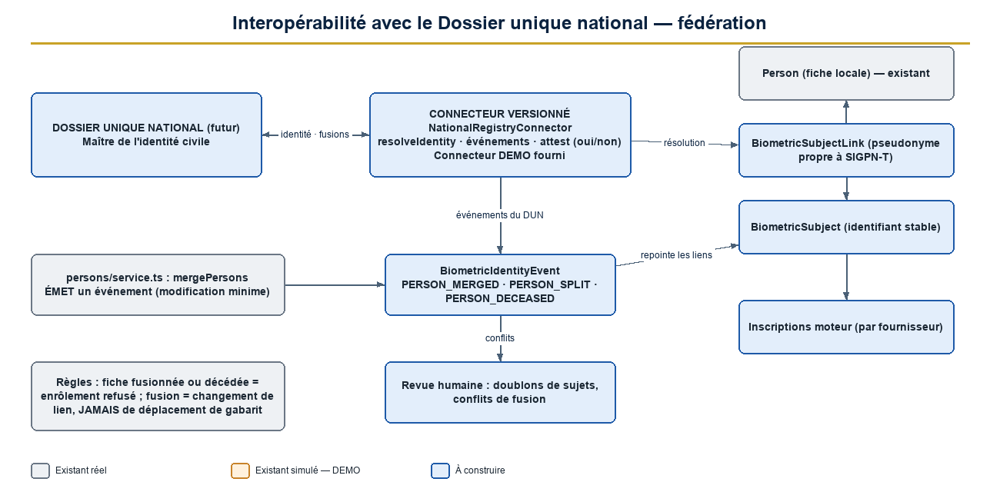
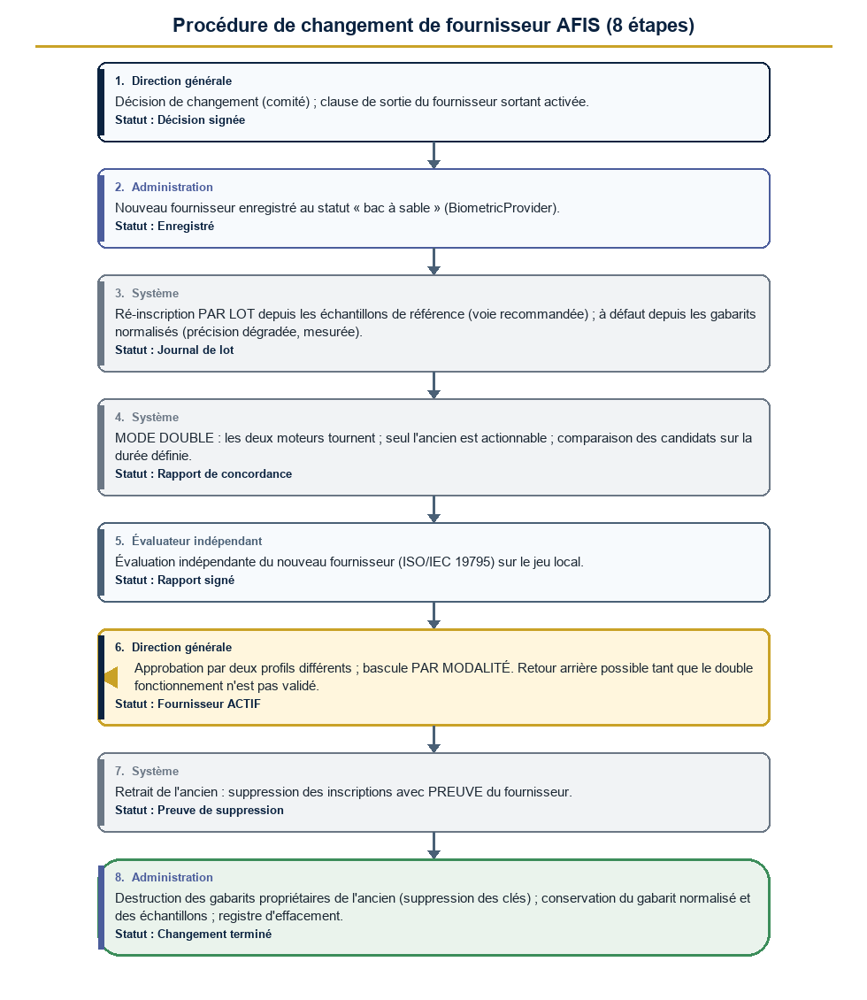
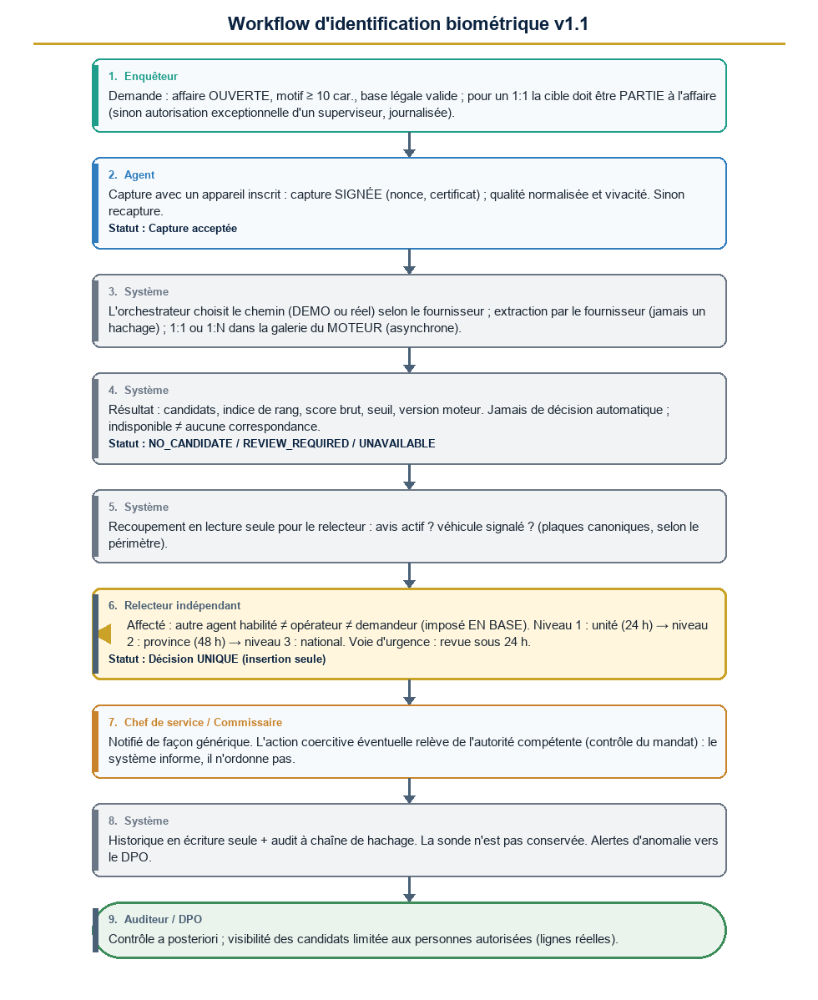
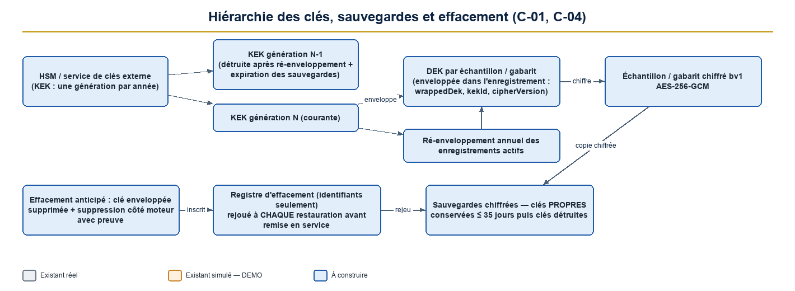
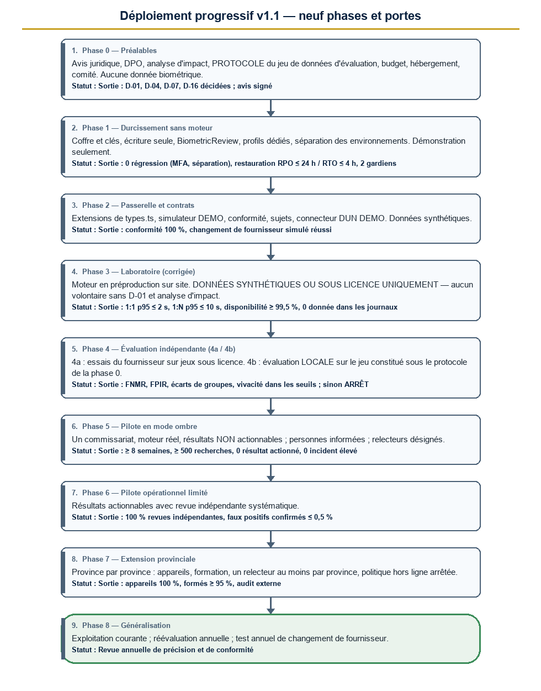

# SIGPN-T — Évolution du module biométrique : spécifications techniques, version 1.1

**Police nationale du Tchad — Éditeur : TECHNOTCHAD — Version 1.1 du 11 novembre 2026 — Document de conception soumis à une nouvelle revue indépendante**

| Rubrique | Valeur |
|---|---|
| Statut | **Conception. Aucune implémentation n'est autorisée.** Cette version intègre les corrections du rapport de validation du 11 novembre 2026 (3 bloquants, 9 majeurs, 3 moyens, 1 mineur, 16 décisions) |
| Remplace | `SPEC_EVOLUTION_BIOMETRIQUE.md` (version 1.0, commit `a93a289`) |
| Mode | **Documentation uniquement** : aucun code, aucune migration, aucune modification de base de données ni de configuration n'a été produite ou appliquée |
| Marqueurs DEMO | **Conservés.** Leur retrait n'est possible que par la procédure du chapitre 14.3 |
| Moteur réel | **Aucun n'est connecté.** Aucun ne le sera sans les six conditions du chapitre 14.4 |
| Prochaine étape | Nouvelle revue indépendante de cette version (checklist au chapitre 19), puis décision d'autorisation par la Direction |

[[SOMMAIRE]]


## 0. Ce qui change entre la version 1.0 et la version 1.1

| Domaine | Version 1.0 | Version 1.1 |
|---|---|---|
| Chiffrement | Modification de `crypto.ts` (envisagée) | **`crypto.ts` n'est pas modifié** : coffre biométrique dédié, format versionné, hiérarchie de clés par génération (C-01, C-04) |
| Historique et décisions | Présentés comme « en écriture unique » | Reclassé *partiel* ; déclencheurs d'écriture seule, décision en **table unique** à insertion seule, indépendance imposée en base (C-02, C-07) |
| Rôles | Droits biométriques attribués aux administrateurs verrouillés | **Trois profils dédiés** ; les 29 rôles existants ne perdent aucun droit ; les deux administrateurs verrouillés sont inchangés (C-03) |
| Gabarits | Un gabarit propriétaire par personne, pas d'image source | Modèle **sujet / échantillon / gabarit / inscription** : gabarit normalisé + gabarit propriétaire + échantillon de référence chiffré ; plusieurs fournisseurs en parallèle (C-05) |
| Dossier national | Non traité | **Chapitre 8** : identifiant de sujet stable, fédération, événements de fusion et de scission, connecteur versionné (C-06) |
| Changement de fournisseur | Non traité | **Chapitre 9** : procédure en huit étapes, clauses de sortie, mode double (C-05) |
| Plaques | Normalisation supposée | Forme canonique, appariement approché, revue humaine (C-12) |
| Phases | Critères qualitatifs, contradictions des phases 3 et 4 | **Critères chiffrés pour chacune des neuf phases**, données synthétiques en phase 3, jeu de données constitué dès la phase 0 (C-15) |
| Décisions | Liste de 16 | **Tableau complet** : options, recommandation, conséquences, échéance, documents requis |


## 1. Objectif, principes et périmètre

**Objectif.** Faire évoluer par étapes le module de démonstration en une solution biométrique professionnelle, sécurisée, **interopérable** et **indépendante de tout fournisseur** : moteur d'empreintes (AFIS), reconnaissance faciale, équipements de capture, recherches 1:1 et 1:N performantes, liens avec les avis de recherche et le registre des véhicules, gestion des clés, conservation, validation humaine indépendante et audit inviolable.

**Principes directeurs (version 1.1).**

1. **Conserver ce qui est correct** et **ne rien retirer** aux rôles, permissions, modules et écrans existants (chapitre 16). Toute évolution est **additive**.
2. **Deux chemins étanches** : le chemin **DEMO** (tables, moteurs et comportements actuels, inchangés) et le chemin **réel** (nouveau modèle, nouveaux fournisseurs). Aucune donnée réelle ne peut entrer dans le chemin DEMO, aucune donnée DEMO ne peut entrer dans le chemin réel (contraintes en base, chapitre 5.4).
3. **Réutiliser les quatre interfaces** de `providers/types.ts`, sans les casser ; les évolutions passent par une interface d'extension optionnelle (chapitre 7).
4. **Un résultat biométrique est une indication**, jamais une preuve ni un ordre d'agir. Aucune action coercitive sans revue humaine indépendante.
5. **Indépendance vis-à-vis du fournisseur** : tout gabarit et tout échantillon doivent permettre un changement de moteur (chapitre 9).
6. **Interopérabilité** avec le futur Dossier unique national des personnes (DUN) par un identifiant de sujet stable et un connecteur versionné (chapitre 8).
7. **Interdiction absolue** : un hachage SHA-256 d'une image **n'est pas** un gabarit biométrique. Le gabarit de démonstration est étiqueté `DEMO_SHA256` et ne peut être utilisé par aucun adaptateur réel.
8. **Aucune donnée biométrique réelle** en développement, démonstration ou essai ; jamais de moteur réel sans autorisation institutionnelle, avis juridique, évaluation indépendante et approbation du responsable du projet.

## 2. Fonctionnalités réelles, simulées et absentes (état actuel, corrigé)

### 2.1 Réel aujourd'hui (à conserver)

| Fonction | Preuve | État |
|---|---|---|
| Porte d'entrée de toute recherche : affaire dans le périmètre, motif ≥ 10 caractères, agent, type | `schemas.ts` (`searchGateSchema`) | Réel |
| Périmètres territoriaux de consultation de l'historique | `service.ts` (`biometricScopeWhere`) | Réel |
| Gabarits chiffrés au repos (AES-256-GCM), jamais exposés par l'API | `crypto.ts`, sélections sans `templateSecretEnc` | Réel |
| Capture versée comme pièce à conviction avec chaîne de possession à hachage | `detectLicensePlate`, `Evidence`, `CustodyEvent` | Réel |
| Contrôle d'identité : quatre états, « vérification humaine obligatoire », « indisponible » jamais lu comme « aucune correspondance » | `control.ts`, `biometric-control.ts` | Réel |
| Relecteur ≠ agent pour le **contrôle d'identité** (contrainte en base) | `BiometricControl_reviewer_not_officer` | Réel |
| Journal d'audit à chaîne de hachage, écriture seule | `audit_hash_chain`, `immutability_triggers` | Réel |
| Recoupement plaque et conducteur avec les avis lors d'un **contrôle routier** | `findWantedHits` | Réel |

### 2.2 Partiel aujourd'hui (corrigé par rapport à la version 1.0)

| Fonction | Réalité vérifiée | Correction prévue |
|---|---|---|
| « Historique des recherches en écriture unique » | **Convention du code uniquement** : aucun déclencheur sur `BiometricSearch` ni `BiometricMatch` | Déclencheurs en phase 1 (C-02) |
| « Décision humaine sur une recherche » | `recordBiometricAction()` **écrase** l'action à chaque appel et **n'impose pas** que l'auteur soit différent de l'opérateur | Table `BiometricReview` à insertion seule (C-02, C-07) |

### 2.3 Simulé aujourd'hui (marqué DEMO)

Les quatre moteurs (`mock-*.ts`) : gabarit = sha256, similarité = accord de chiffres hexadécimaux, plaque inventée ; qualité de capture = valeur sans signification ; contrôle d'identité tiré d'un scénario fictif (`isSimulation = true` imposé) ; seuils 60 (recherches) et 80/45/qualité 40 (contrôles) non calibrés ; sources « Base nationale (DEMO) » en étiquettes ; aucun matériel.

### 2.4 Absent aujourd'hui

Moteur AFIS et facial réels · vivacité (PAD) · lecteurs et caméras · identification 1:N dans le moteur · gestion de clés externe · conservation et effacement · base légale enregistrée · identifiant de sujet stable · liens plaques ↔ avis ↔ registre des véhicules par appariement canonique · mesure continue de la précision · portabilité · interopérabilité avec le DUN.


## 3. Registre des corrections

Pour chaque correction : **problème initial**, **solution retenue**, **composants concernés**, **risques résiduels**, **décision attendue**. Les composants « nouveaux » sont à créer ; « modifiés » existent aujourd'hui ; « non modifiés » sont expressément épargnés.

### 3.1 Bloquants

#### C-01 — Chiffrement par enveloppe sans régression sur l'authentification à deux facteurs

| Élément | Contenu |
|---|---|
| Problème initial | La v1.0 prévoyait de modifier `crypto.ts`. Or `encryptSecret`/`decryptSecret` chiffrent aussi les secrets TOTP (`mfaSecretEnc`, `auth/login.ts` lignes 100, 198, 205, 231). Un changement de format rendrait tous les secrets MFA illisibles |
| Solution retenue | **`crypto.ts` n'est pas modifié.** Création d'un **coffre biométrique** distinct avec un format versionné `bv1.<kekId>.<DEK enveloppée>.<iv>.<tag>.<chiffré>` (AES-256-GCM, une clé de données par échantillon ou gabarit). Le déchiffrement de l'ancien format à trois segments n'est accessible **que** pour les lignes `DEMO_SHA256` du chemin DEMO. Interface `KeyService` à deux adaptateurs : `DevKeyService` (clé de configuration, **réservé au mode demo**, refusé dans tout autre mode) et `HsmKeyService` (HSM ou service de clés externe) |
| Composants | **Nouveaux** : `biometric/vault.ts`, `biometric/key-service.ts`. **Modifiés** : `biometric/service.ts` (appel au coffre), `env.ts` (variables du service de clés). **Non modifiés** : `crypto.ts`, `auth/login.ts`. Garde : un test vérifie que `crypto.ts` est inchangé (empreinte du fichier) |
| Tests | Suite MFA existante verte (`tests/unit/auth-primitives.test.ts`, `mfa-switch.test.ts`, `tests/security/auth.test.ts`) ; aller-retour du format `bv1` ; refus de `DevKeyService` hors mode demo |
| Risques résiduels | Deux chemins de chiffrement à maintenir ; compromission du service de clés (mitigée par HSM, double contrôle, journalisation) |
| Décision | D-02 (hébergement), D-13 (budget HSM) |

#### C-02 — Historique et décision humaine réellement inviolables

| Élément | Contenu |
|---|---|
| Problème initial | La v1.0 classait l'historique « en écriture unique » parmi les fonctions réelles : faux en base (seuls `AuditLog` et `CustodyEvent` ont un déclencheur). `recordBiometricAction()` écrase la décision et n'exige pas relecteur ≠ opérateur |
| Solution retenue | **Phase 1 (additive)** : déclencheurs interdisant `UPDATE`/`DELETE` des colonnes principales de `BiometricSearch`, de toute ligne de `BiometricMatch` et de `BiometricReview` ; décision **uniquement par insertion** dans `BiometricReview` ; contrainte « relecteur ≠ opérateur ≠ demandeur » **dans un déclencheur** de `BiometricReview` ; une seule décision finale par recherche. **Compatibilité DEMO préservée** : pour les lignes `isDemo = true`, le comportement actuel de la route `PATCH /biometric/history/{id}` est conservé ; pour les lignes réelles la même route écrit dans `BiometricReview`. Les 206 lignes existantes sont étiquetées `LEGACY_DEMO` et **ne prétendent à aucune indépendance** |
| Composants | **Modifiés** : `schema.prisma` (via migrations additives), `biometric/service.ts` (`recordBiometricAction` devient une enveloppe), `app/api/v1/biometric/history/[id]/route.ts`, `biometric/queries.ts` (décision courante dérivée). **Nouveaux** : `biometric/review.ts` |
| Tests | Tentatives `UPDATE`/`DELETE` refusées à 100 % ; relecteur identique à l'opérateur ou au demandeur refusé (API **et** base) ; non-régression `tests/integration/biometric.test.ts` |
| Risques résiduels | Un superutilisateur de base de données peut contourner un déclencheur (mitigé : rôles de base séparés, chaîne d'audit, exportation quotidienne de l'empreinte de tête) |
| Décision | D-05 |

#### C-03 — Séparation des fonctions : profils dédiés, administrateurs verrouillés inchangés

| Élément | Contenu |
|---|---|
| Problème initial | La v1.0 attribuait des droits biométriques à `SUPER_ADMIN` et `SECURITY_ADMIN`, rôles verrouillés dont les droits sont testés à l'identique (`tests/unit/admin-separation.test.ts`) et qui ne détiennent aucun droit sur les données de police |
| Solution retenue | **Aucun changement sur `SUPER_ADMIN` ni `SECURITY_ADMIN`.** Trois **nouveaux profils système** : `BIOMETRIC_PLATFORM_ADMIN` (fournisseurs, appareils, santé), `KEY_CUSTODIAN` (clés, double contrôle), `DATA_PROTECTION_OFFICER` (conservation, effacement, historique de gouvernance). Ils sont ajoutés à la liste des rôles verrouillés (ajout seulement), n'ont **aucun** droit opérationnel de police, et une **règle d'incompatibilité** interdit de cumuler l'un de ces profils avec un profil opérationnel ou entre eux sur un même compte. Activation d'un fournisseur et rotation de clé : **approbation** par deux profils différents (`NATIONAL_COMMANDER` et `DATA_PROTECTION_OFFICER`) |
| Composants | **Modifiés** : `rbac/permissions.ts`, `roles.ts`, `sync.ts`, `sensitivity.ts`, `rbac/grants.ts` (incompatibilité), `approvals/*` (nouveaux types), `i18n/catalog.ts` (libellés FR/AR). **Non modifiés** : définitions de `SUPER_ADMIN` et `SECURITY_ADMIN`, `tests/unit/admin-separation.test.ts` (étendu, jamais assoupli) |
| Tests | Nouveaux profils sans droit opérationnel ; incompatibilité de cumul ; tests existants intacts |
| Risques résiduels | Complexité du moteur d'approbations ; rareté des personnes à nommer (3 profils, dont au moins 2 gardiens de clés distincts) |
| Décision | D-04, D-16 |

### 3.2 Majeurs

#### C-04 — Effacement cryptographique et sauvegardes

| Élément | Contenu |
|---|---|
| Problème initial | Détruire la clé de données ne rend pas un gabarit irrécupérable tant que des sauvegardes contiennent la clé enveloppée et que la clé maîtresse existe |
| Solution retenue | **Génération de clés maîtresses** (une par année) : chaque clé de données est enveloppée par la génération en cours ; une tâche annuelle **ré-enveloppe** les enregistrements actifs sur la génération courante ; une génération n'est détruite qu'après ré-enveloppement complet **et** expiration des sauvegardes qui la référencent. **Effacement anticipé** (mise hors de cause, décision) : (1) suppression de la clé enveloppée en base, (2) inscription au **registre d'effacement** (identifiants seulement, aucune donnée biométrique), (3) suppression côté moteur avec preuve, (4) **sauvegardes chiffrées par des clés propres, conservées au plus 35 jours puis détruites**, (5) toute **restauration rejoue le registre d'effacement avant remise en service** |
| Composants | **Nouveaux** : `biometric/retention.ts`, table `BiometricErasureRegister`, scripts de sauvegarde de `deploy/`. **Modifiés** : `biometric/key-service.ts` |
| Risques résiduels | Fenêtre de 35 jours pendant laquelle la clé enveloppée subsiste dans une sauvegarde chiffrée non exploitable en exploitation courante (« mise hors d'usage ») ; à valider juridiquement |
| Décision | D-06 |

#### C-05 — Portabilité entre fournisseurs AFIS

Voir le **chapitre 9** (procédure complète). En résumé :

| Élément | Contenu |
|---|---|
| Problème initial | Minimisation (aucune image) + gabarits propriétaires = impossibilité de ré-enrôler chez un autre fournisseur ; un seul fournisseur par enregistrement |
| Solution retenue | Modèle **sujet / échantillon / gabarit / inscription** : (1) **échantillon de référence** (image source) conservé **chiffré** dans le coffre, sous base légale (les **sondes** de recherche ne sont jamais conservées) ; (2) **gabarit normalisé** (ISO/IEC 19794-2 pour les empreintes) **et** gabarit propriétaire ; (3) **plusieurs inscriptions** par sujet, une par fournisseur et galerie ; (4) clauses contractuelles de sortie ; (5) **mode double** pour comparer deux moteurs ; (6) test de changement de fournisseur à chaque phase |
| Composants | **Nouveaux** : `BiometricSample`, `BiometricTemplate`, `BiometricEnrollment`, outil de ré-enrôlement par lot. **Modifiés** : `providers/types.ts` (extensions), `biometric/service.ts` |
| Risques résiduels | Perte de précision d'un gabarit normalisé entre fournisseurs (mesurée avant bascule) ; la conservation d'images augmente l'impact d'une fuite (mitigé : chiffrement, accès restreint, effacement) ; **le visage n'a pas de gabarit interopérable** : le portrait est conservé |
| Décision | D-03, D-02 |

#### C-06 — Interopérabilité avec le Dossier unique national des personnes

Voir le **chapitre 8**. En résumé :

| Élément | Contenu |
|---|---|
| Problème initial | Référence locale seulement ; `mergePersons` ne déplace aucun enregistrement biométrique ; `requirePerson` accepte une fiche fusionnée ; aucune détection de doublons ; aucun contrat d'échange |
| Solution retenue | **Identifiant de sujet biométrique stable** (distinct de la fiche locale) ; table de liens (fiche locale, identifiant DUN, pseudonyme propre à chaque système) ; **événements d'identité** (fusion, scission, décès) émis par `mergePersons` et traités par la couche biométrique ; refus d'enrôler une fiche fusionnée ou décédée ; détection de doublons par 1:N avant activation ; **connecteur DUN versionné** ; échanges normalisés (CBEFF, ANSI/NIST-ITL) ; principe de **fédération** (le DUN reste maître de l'identité civile, la police reste maître de ses données biométriques) |
| Composants | **Nouveaux** : `BiometricSubject`, `BiometricSubjectLink`, `BiometricIdentityEvent`, `NationalRegistryConnector` (interface + connecteur DEMO). **Modifiés** : `persons/service.ts` (`mergePersons` émet un événement), `biometric/service.ts` (`requirePerson` remplacé), `IdentifierType` (valeur additive) |
| Risques résiduels | Spécifications du DUN encore inconnues (contrat versionné, adaptateur) ; ambiguïtés de scission |
| Décision | D-07, D-11 |

#### C-07 — Une seule source pour la décision humaine

| Élément | Contenu |
|---|---|
| Problème initial | La décision est aujourd'hui dans `BiometricSearch.action*` et `BiometricControl.reviewed*`, et la v1.0 ajoutait une troisième table ; énumérations incompatibles ; pas de notion de demandeur |
| Solution retenue | **Source unique `BiometricReview`** (insertion seule) pour le chemin réel ; colonne `requestedById` sur `BiometricSearch` ; lecture **rétrocompatible** : la décision courante est dérivée de la dernière revue finale, sinon des anciens champs. Correspondance : `VERIFIED_BY_INVESTIGATOR` → `CONFIRMED` ; `REJECTED` → `REJECTED` ; `SENT_FOR_VERIFICATION` → état « revue demandée » (non une décision) ; `LINKED_TO_CASE` → suite `LINK_TO_CASE` (non une décision). Le contrôle d'identité garde ses champs, alimentés aussi dans `BiometricReview` |
| Composants | **Nouveaux** : `BiometricReview`, `review.ts`. **Modifiés** : `service.ts`, `control.ts`, `queries.ts`, écrans d'historique |
| Risques résiduels | Période de double lecture (anciens et nouveaux champs) ; à clore après la phase 6 |
| Décision | D-05 |

#### C-08 — Réservoir de relecteurs : plus de blocage

| Élément | Contenu |
|---|---|
| Problème initial | Seuls deux profils (enquêteur, agent biométrie) détiennent `biometric:verify` ; un petit poste n'a aucun relecteur indépendant. De même, seule la police technique enrôle et seul l'agent biométrie pourrait valider |
| Solution retenue | **Escalade en trois niveaux** : (1) autre titulaire de `verify` de la même unité (≠ opérateur ≠ demandeur) ; (2) **réservoir provincial** : titulaire d'une autre unité de la province, désigné par affectation journalisée ; (3) **réservoir national**. Délai cible : 24 h pour le niveau 1, 48 h cumulées pour le niveau 2, escalade automatique. **Voie d'urgence** : un commandant peut autoriser une action urgente motivée, avec **revue indépendante obligatoire sous 24 h**, signalée au DPO. Même règle pour la validation des enrôlements. Effectif minimal d'un relecteur par province à chaque phase d'extension |
| Composants | **Nouveaux** : `BiometricReviewAssignment`, tâche d'escalade. **Modifiés** : `review.ts`, notifications génériques |
| Risques résiduels | Charge des relecteurs ; délais en cas de pénurie ; à surveiller par indicateur |
| Décision | D-05 |

#### C-09 — API : captures, authentification des appareils et des fournisseurs, chemins uniques

| Élément | Contenu |
|---|---|
| Problème initial | `captureId` sans table ; authentification des appareils et des webhooks non définie ; nommage du webhook non aligné ; deux chemins de recherche |
| Solution retenue | **Table `BiometricCapture`** (signature, `nonce` unique, durée de vie ≤ 15 minutes, statut émise / consommée / expirée) ; **appareils** : certificat client (TLS mutuel au proxy) **et** capture signée ; **fournisseurs** : webhook signé par secret propre au fournisseur, route **`/api/v1/webhooks/biometric/{provider}`** (route publique avec limite de débit dédiée, comme `/api/v1/webhooks/payments/{provider}`) ; **routes existantes conservées comme enveloppes minces** d'un même orchestrateur (même audit, mêmes règles) ; clé d'idempotence obligatoire sur les créations ; API `/api/v1` étendue par **ajout de champs seulement** |
| Composants | **Nouveaux** : `BiometricCapture`, `biometric/orchestrator.ts`, authentification d'appareil. **Modifiés** : 12 routes existantes (enveloppes), `api.ts` (limite de débit dédiée), documentation d'API. **Non modifiés** : contrats de réponse existants |
| Risques résiduels | Gestion du cycle de vie des certificats d'appareils ; coûts d'exploitation |
| Décision | D-02, D-08 |

#### C-10 — Modèle de données : une seule source de vérité par notion

| Élément | Contenu |
|---|---|
| Problème initial | `status` et `isActive` en doublon ; `isDemo` en trois endroits plus un mode d'environnement ; scores dans `Decimal(5,2)` ; clé enveloppée sans colonne ; déclencheurs de conservation indéfinis |
| Solution retenue | (a) **Les tables DEMO existantes ne reçoivent aucune colonne de statut** : un marqueur `templateFormat = 'DEMO_SHA256'` (verrouillé par contrainte) les isole ; le nouveau modèle a un `status` unique. (b) **Précédence** : la base fait foi (`BiometricProvider.isDemo` et statut) ; la classe du fournisseur doit s'y conformer au démarrage (écart = fournisseur refusé) ; `BIOMETRIC_MODE` n'est qu'un **plafond** (mode demo = aucun fournisseur non démo, toujours). (c) **Scores** : `scoreRaw` et `scoreScale` par fournisseur ; la colonne existante `Decimal(5,2)` devient un « indice de rang » ; **aucun pourcentage de probabilité n'est affiché**. (d) Colonnes `wrappedDek`, `cipherVersion`, `kekId`. (e) **Événements de conservation** : `BiometricRetentionEvent` (affaire clôturée, mise hors de cause, décès, décision de justice, demande de la personne, échéance) émis par les services existants |
| Composants | `schema.prisma` (migrations additives), `providers/index.ts`, `env.ts`, `UI` (libellés des scores), `cases/service.ts`, `persons/service.ts` (émission d'événements) |
| Risques résiduels | Cohérence entre événements et conservation à tester ; lecture des anciens scores |
| Décision | — |

#### C-11 — Sécurité des données biométriques : lacunes comblées

| Lacune | Solution retenue |
|---|---|
| a) Une recherche 1:1 peut viser n'importe qui | La **cible d'un 1:1 doit être partie à l'affaire** (`CaseParty`) ; sinon une **autorisation exceptionnelle** d'un superviseur, motivée, journalisée ; 1:N : l'affaire doit être **ouverte** |
| b) `history_view` détenu par 12 profils | **Scission** : `history_view` (métadonnées : numéro, date, type, affaire, résultat, opérateur) conservé pour tous les détenteurs actuels ; **candidats et personnes** réservés à l'opérateur, au demandeur, aux relecteurs, à l'équipe de l'affaire et aux titulaires du nouveau droit `history_view_candidates` (DPO, auditeur, accès journalisé). **La scission ne s'applique qu'aux lignes réelles** : les lignes DEMO restent visibles comme aujourd'hui |
| c) Protection des gabarits | Exigence **ISO/IEC 24745** : gabarits jamais exportés hors du coffre, **pseudonymes différents par système** (non-liabilité), contrat exigeant l'irréversibilité du gabarit propriétaire — à défaut, il est traité comme une image |
| d) Identité à l'enrôlement | **Niveau de preuve d'identité** enregistré (pièce vérifiée, identification par deux agents, déclarative) ; un enrôlement **déclaratif** ne peut pas servir de base à une attribution positive tant qu'il n'est pas relevé |
| e) Usage anormal | Alertes initiales (à calibrer en phase 5) : > 30 recherches par agent et par jour ; > 5 recherches sur un même sujet par un même agent en 7 jours ; recherches entre 22 h et 5 h ; rafales ; tout signal ouvre une revue du DPO |
| f) Accès d'urgence | Voie d'urgence du C-08, revue sous 24 h, signalement au DPO |

Composants : `biometric/service.ts`, `queries.ts`, `review.ts`, `rbac/*`, tâche de détection d'anomalies (nouvelle). Risques résiduels : faux positifs d'alertes (réglage progressif), contournements par complicité (audit a posteriori). Décisions : D-05, D-09.

#### C-12 — Plaques : forme canonique et appariement approché

| Élément | Contenu |
|---|---|
| Problème initial | La normalisation existante ne fait que majuscules et espaces ; l'égalité est stricte ; « TD-1234-AB », « TD 1234 AB » et « TD1234AB » ne se correspondent jamais ; les confusions de lecture ne sont pas traitées |
| Solution retenue | **Forme canonique** `plateCanonical` : majuscules, retrait des séparateurs (espaces, tirets, points), normalisation Unicode ; colonne **additive** sur `WantedVehicle`, `TrafficVehicle`, `LicensePlateDetection` avec index ; **rattrapage** calculé depuis les valeurs existantes ; appariement **exact canonique**, puis **candidats approchés** (une seule confusion usuelle : 0/O, 1/I, 8/B, 5/S, 2/Z, 6/G) avec confiance moindre ; **toute indication est revue** par un humain ; une plaque seule ne désigne **jamais** une personne |
| Composants | **Nouveaux** : `traffic/plates.ts`. **Non modifiés** : `normalizePlate` et `findWantedHits` (le contrôle routier existant garde son comportement). **Modifiés** : schéma, `biometric/watchlist.ts` (nouveau) |
| Risques résiduels | Faux rapprochements (mitigé par revue) ; **format officiel des plaques tchadiennes à confirmer** auprès du service d'immatriculation |
| Décision | — (confirmation du format par l'administration) |

### 3.3 Moyens

#### C-13 — Déploiement des droits et des rôles sans régression

| Élément | Contenu |
|---|---|
| Problème initial | Chaque nouveau droit exige libellés FR/AR, attribution unique, liste des droits sensibles, mise à jour des matrices ; les nouveaux profils changent le décompte de rôles ; les nouveaux types d'approbation exigent une migration d'énumération et un exécuteur |
| Solution retenue | **Liste de contrôle par droit et par rôle** (chapitre 11.5) ; droits sensibles ajoutés **à la liste, jamais retirés** ; nouveaux types d'approbation avec exécuteur testé ; régénération de la documentation par le script existant ; décomptes mis à jour (rôles 29 → 32, droits 158 → 168 après implémentation) |
| Composants | `rbac/*`, `approvals/*`, `i18n/catalog.ts`, tests `sensitivity`, `route-matrix` et `i18n` |
| Risques résiduels | Dérive documentaire (mitigée par la régénération) |
| Décision | — |

#### C-14 — Fonctionnement hors ligne

| Élément | Contenu |
|---|---|
| Problème initial | Interdiction des captures réelles hors ligne vs déploiement provincial |
| Solution retenue | **Recommandation : biométrie en ligne seulement** (aucune capture ni gabarit stocké sur le poste). Pour les **lectures de plaques** : file locale **signée** et chiffrée, rejouée à la reconnexion, **étudiée en phase 7** seulement ; sans connexion, procédure manuelle |
| Composants | Pont d'appareils (service local), `anpr/ingest` |
| Risques résiduels | Indisponibilité en zone mal couverte ; mitigée par la procédure manuelle |
| Décision | D-08 |

#### C-15 — Phases de déploiement : critères et contradictions

Traité au **chapitre 15** : critères chiffrés pour chacune des neuf phases ; **phase 3 réalisée sur données synthétiques et jeux de recherche sous licence, sans volontaires** (volontaires admis seulement après D-01 et analyse d'impact) ; **jeu de données d'évaluation constitué sous protocole dès la phase 0** et utilisé en phase 4 ; scission de la phase 4 en 4a (essais du fournisseur sur jeux sous licence) et 4b (évaluation locale). Décisions : D-01, D-10, D-11, D-13, D-14, D-16.

### 3.4 Mineurs

#### C-16 — Rédaction et interfaces

| Point | Correction |
|---|---|
| Renvoi « chapitre 12 » pour le retrait des marqueurs DEMO | Renvoi corrigé : **chapitre 14.3** |
| Deux sections « 5.3 » | Renumérotées |
| `identifyInGallery(probe: string)` | Type explicite `ProbeInput` (image ou gabarit) — chapitre 7 |
| Relation `enroll` / `extractTemplate` | `enroll` = extraction + inscription dans le moteur ; `extractTemplate` reste pour le chemin DEMO — chapitre 7 |
| `capabilities().isDemo` double `isDemo` | Contrôle de cohérence avec la base au démarrage (écart = fournisseur refusé) |
| Test « chaque route sans droit, mauvais droit, bon droit » | Étendu aux nouvelles routes (`tests/security/route-matrix.test.ts`) |
| Tests de non-régression MFA et séparation des administrateurs | Ajoutés au chapitre 13.1 |


## 4. Architecture technique cible



**Code couleur** : gris = existant réel (conservé) · orange = existant simulé DEMO (conservé) · bleu = à construire.

### 4.1 Composants

| Composant | Rôle | Nature |
|---|---|---|
| Écrans existants et nouveaux | Recherche, contrôle, historique ; fournisseurs et appareils, revue, conservation, santé | Existant + nouveau |
| API `/api/v1/biometric/*` | 12 routes existantes (enveloppes minces) + nouvelles routes | Existant + nouveau |
| **Orchestrateur** | Point unique : porte d'entrée, périmètre, base légale, audit ; **choisit le chemin DEMO ou réel selon le fournisseur** | Nouveau (extrait de `service.ts` / `control.ts`) |
| Revue indépendante et réservoir | Décision humaine, escalade | Nouveau |
| Surveillance des listes | Recoupement plaques et identités avec les avis et le registre des véhicules | Nouveau |
| Sujets et identité | `BiometricSubject`, liens, événements d'identité, connecteur DUN | Nouveau |
| Conservation et effacement | Échéances, registre d'effacement, génération de clés | Nouveau |
| **Coffre biométrique** et service de clés | Chiffrement par enveloppe, HSM | Nouveau |
| Passerelle fournisseurs et adaptateurs | Mock* DEMO conservés ; AFIS, facial, ANPR, pont d'appareils | Mocks existants ; réels nouveaux |
| Capture signée | `BiometricCapture`, authentification d'appareil | Nouveau |
| Journal d'audit, preuves | Chaîne de hachage ; chaîne de possession | Existants |

### 4.2 Frontières de sécurité

1. Le navigateur ne parle jamais au moteur ; tout passe par le serveur (authentification, périmètre, audit).
2. Le moteur est **sur site**, en **zone réseau dédiée**, liaison **TLS mutuelle** ; aucune donnée biométrique ne quitte le territoire (D-02).
3. **Sondes** : jamais conservées. **Échantillons de référence** : conservés chiffrés dans le coffre (D-03). **Gabarits** : normalisé et propriétaire, chiffrés.
4. Les galeries d'identification vivent dans le moteur ; SIGPN-T garde la copie de référence chiffrée et les identifiants d'inscription (plusieurs fournisseurs possibles).
5. Les équipements de capture passent par un **pont local** qui signe chaque capture.

### 4.3 Performances 1:1 et 1:N

| Sujet | Aujourd'hui | Cible |
|---|---|---|
| 1:1 | Similarité calculée dans l'application | Par le moteur ; **p95 ≤ 2 s** de bout en bout (hors capture) |
| 1:N | `loadTemplates` charge et déchiffre **tous** les gabarits | **La galerie reste dans le moteur** ; aucune charge massive dans l'application ; **p95 ≤ 10 s** pour la galerie cible (à confirmer avec le fournisseur) ; tâche asynchrone |
| Résilience | Aucune | Délai maximal, coupe-circuit, « service indisponible » (jamais « aucune correspondance »), reprise |
| Réduction de galerie | Aucune | Toute réduction par métadonnées est **journalisée** ; jamais d'exclusion silencieuse |


## 5. Modèle de données version 1.1

**Règle de migration :** uniquement additive ; chaque migration a un retour arrière ; **rien n'est appliqué par ce document**.



### 5.1 Tables existantes conservées (chemin DEMO, inchangées)

`FingerprintRecord`, `FaceRecord`, `VoiceRecord`, `LicensePlateDetection`, `BiometricSearch`, `BiometricMatch`, `BiometricControl`. **Seule addition sur les trois tables de gabarits DEMO** : une colonne `templateFormat` valant `DEMO_SHA256`, verrouillée par une contrainte `CHECK` : **ces tables ne peuvent jamais contenir de donnée réelle**.

### 5.2 Colonnes ajoutées aux tables existantes

| Table | Colonne | Rôle |
|---|---|---|
| `BiometricSearch` | `requestedById`, `providerCode`, `engineVersion`, `thresholdUsed`, `galleryScope`, `latencyMs`, `jobId`, `scoreScale` | Demandeur distinct de l'opérateur ; reproductibilité |
| `BiometricMatch` | `subjectId`, `scoreRaw` | Référence au sujet ; score brut |
| `BiometricControl` | `providerCode`, `matchedSubjectId` | Chemin réel sans retirer la simulation |
| `LicensePlateDetection`, `WantedVehicle`, `TrafficVehicle` | `plateCanonical` (indexé) ; en plus sur la lecture : `trafficVehicleId`, `watchStatus`, `confidence`, `source` | Chapitre C-12 |
| `IdentifierType` (énumération) | valeur `NATIONAL_UNIQUE_ID` | Identifiant du futur DUN |

### 5.3 Nouvelles tables (chemin réel)

| Table | Contenu | Remarque |
|---|---|---|
| `BiometricSubject` | identifiant stable, statut (actif, fusionné, scindé, décédé, effacé), niveau de preuve d'identité, sujet de fusion | Sans lien direct avec la fiche locale |
| `BiometricSubjectLink` | sujet, fiche locale, identifiant DUN, **pseudonyme propre au système**, statut, période de validité | Fusion/scission = changement de lien, **sans déplacer un gabarit** |
| `BiometricSample` | sujet, modalité, doigt, capture d'origine, format source, qualité normalisée, vivacité, **échantillon chiffré (`bv1`)**, empreinte (sha256), appareil, validation, base légale, échéance, statut | Échantillon de **référence** seulement |
| `BiometricTemplate` | échantillon, **nature (NORMALISÉ ou PROPRIÉTAIRE)**, format, version, fournisseur, **gabarit chiffré (`bv1`)** | ISO/IEC 19794-2 pour le normalisé |
| `BiometricEnrollment` | gabarit, fournisseur, galerie, identifiant côté moteur, statut, dates, preuve de retrait | **Une ligne par fournisseur** : permet plusieurs moteurs |
| `BiometricCapture` | appareil, modalité, empreinte, signature, `nonce` unique, durée de vie ≤ 15 min, statut, tâche consommatrice | Capture signée à usage unique |
| `BiometricProvider` | code, modalité, nom, version, `isDemo`, statut (enregistré, bac à sable, validé, actif, suspendu, retiré), référence d'évaluation, décision | **Fait foi** sur `isDemo` |
| `BiometricDevice` | série, type, modèle, certification, unité, certificat, statut | |
| `BiometricKey` | identifiant, génération, rôle (maîtresse ou données), référence externe, dates | **Métadonnées seulement** |
| `BiometricLegalBasis`, `BiometricRetentionPolicy`, `BiometricRetentionEvent`, `BiometricRetentionRun` | Base légale ; politiques ; événements déclencheurs ; exécutions | |
| `BiometricErasureRequest`, `BiometricErasureRegister` | Demandes ; registre des effacements (identifiants seulement, rejoué après restauration) | |
| `BiometricJob` | type, fournisseur, `requestId` unique (idempotence), statut, durées, erreur | |
| `BiometricReview`, `BiometricReviewAssignment` | **Décision unique**, escalade | Insertion seule |
| `BiometricWatchHit` | origine, cible (avis, véhicule), score, statut, relecteur | Indication, jamais alerte automatique |
| `BiometricIdentityEvent` | fusion, scission, décès, état de traitement | Alimenté par `persons` |
| `BiometricProviderHealth` | latence, erreurs, version | |

### 5.4 Contraintes et garde-fous

1. **Écriture seule** (déclencheurs) : colonnes principales de `BiometricSearch`, toute ligne de `BiometricMatch`, de `BiometricReview`, de `BiometricErasureRegister`.
2. **Étanchéité DEMO / réel** : les tables DEMO n'acceptent que `DEMO_SHA256` ; les gabarits du chemin réel refusent ce format ; un fournisseur démo ne peut pas être associé à une inscription réelle.
3. `BiometricControl_simulation_only` **reste en vigueur** dans les environnements de démonstration ; son remplacement n'est possible que dans la production, par migration documentée, après décision d'activation (chapitre 14.3).
4. **Revue** : relecteur ≠ opérateur ≠ demandeur ; une seule décision finale par recherche.
5. **Précédence** : le statut du fournisseur en base fait foi ; `BIOMETRIC_MODE` (demo, shadow, operational) est un plafond ; en mode demo, aucun fournisseur non démo n'est jamais admis.
6. Aucun index ni journal sur du matériau biométrique ; schéma séparé recommandé pour les tables de gabarits et sauvegardes chiffrées à clés propres.


## 6. Spécifications des API

**Conventions** : `withApi` (authentification, permission, périmètre, limitation de débit, audit) ; réponses `{ data, meta? }` ou `{ error }` ; `multipart/form-data` pour les échantillons ; aucun échantillon brut dans une réponse ; **clé d'idempotence** obligatoire sur les créations ; l'API `/api/v1` n'évolue que par **ajout de champs**.

### 6.1 Routes existantes (conservées, contrats inchangés)

`POST …/fingerprint|face|voice/enroll` · `…/fingerprint|face|voice/search` · `…/anpr/detect` · `…/anpr/search` · `GET …/history` et `/history/{id}` · `PATCH …/history/{id}` · `GET/POST …/control` et `/control/{id}`.

**Évolution interne** : chacune devient une **enveloppe mince** de l'orchestrateur. En mode demo, comportement actuel exact ; en mode réel, même contrat, avec les règles du nouveau modèle (par exemple, le `PATCH` d'une ligne réelle écrit dans `BiometricReview`).

### 6.2 Nouvelles routes

| Méthode et chemin | Permission ou authentification | Objet |
|---|---|---|
| `POST /api/v1/biometric/captures` | certificat d'appareil + capture signée | Dépose une capture (usage unique, courte durée de vie) |
| `POST /api/v1/biometric/jobs` | droit de recherche de la modalité | Identification 1:N ou vérification 1:1 asynchrone → `202 { jobId }` |
| `GET /api/v1/biometric/jobs/{id}` | propriétaire + périmètre | Statut, candidats (selon la visibilité) |
| `POST /api/v1/biometric/reviews` | `biometric:verify` + affectation | Décision indépendante |
| `GET/POST /api/v1/biometric/review-assignments` | `biometric:verify` / commandement | Réservoir de relecteurs |
| `POST /api/v1/biometric/enrollments` · `…/{id}/validate` | `biometric:manage` · `biometric:enroll_validate` | Enrôlement puis validation indépendante |
| `POST /api/v1/biometric/anpr/ingest` | certificat d'appareil + signature | Événement de caméra |
| `GET/PATCH /api/v1/biometric/hits[/{id}]` | `biometric:watchlist_review` | Indications avis / véhicules |
| `GET/POST/PATCH /api/v1/biometric/providers` | `biometric:provider_manage` (activation = approbation) | Cycle de vie des fournisseurs |
| `GET/POST/PATCH /api/v1/biometric/devices` | `biometric:device_manage` | Appareils |
| `POST /api/v1/biometric/keys/rotate` | `biometric:key_manage` + double contrôle | Rotation de clé |
| `GET /api/v1/biometric/retention/policies` · `POST …/run` | `biometric:retention_manage` | Politiques, exécution |
| `POST/PATCH /api/v1/biometric/erasure-requests` | création : agent habilité ; décision : `biometric:erasure_decide` | Contestation, effacement |
| `POST /api/v1/biometric/portability/exports` | `biometric:export_portability` + approbations | Export gouverné pour changement de fournisseur |
| `GET /api/v1/biometric/subjects/{id}` | périmètre + `biometric:history_view_candidates` | Vue minimale d'un sujet |
| `POST /api/v1/biometric/identity-events` | interne / connecteur DUN signé | Fusion, scission, décès |
| `GET /api/v1/biometric/health` | `biometric:provider_manage` | Santé et précision |
| `POST /api/v1/webhooks/biometric/{provider}` | signature du fournisseur (route publique, limite de débit dédiée) | Résultats asynchrones, idempotents |

### 6.3 Exemples

**Soumission d'une identification 1:N**

```
POST /api/v1/biometric/jobs          Idempotency-Key: <uuid>
  { "type": "IDENTIFY", "modality": "FINGERPRINT", "caseId": "…", "reason": "≥10 car.",
    "captureId": "bcap_…", "requestedById": "<enquêteur demandeur>" }
202 { "data": { "jobId": "bjob_…", "status": "QUEUED", "pollAfterMs": 1500 } }
```

**Résultat**

```
200 { "data": { "status": "COMPLETED", "provider": { "code": "afis-x", "version": "9.2", "isDemo": false },
  "thresholdUsed": 62.0, "scoreScale": "AFIS-X-0..1000",
  "candidates": [ { "rank": 1, "scoreRaw": 780, "rankIndex": 0.78, "subjectRef": "bsub_…", "visible": true } ],
  "decision": "REVIEW_REQUIRED", "latencyMs": 4100,
  "notice": "Indication à vérifier : ni preuve, ni ordre d'agir. L'indice n'est pas une probabilité." } }
```

Valeurs possibles de `decision` : `NO_CANDIDATE`, `REVIEW_REQUIRED`, `UNAVAILABLE`. **Aucune valeur de décision automatique n'existe.**

**Revue indépendante**

```
POST /api/v1/biometric/reviews
  { "targetType": "SEARCH", "targetId": "…", "outcome": "CONFIRMED|REJECTED|INCONCLUSIVE",
    "justification": "≥ 30 car. : identité, éléments comparés, validité de la procédure",
    "followUp": "NONE|LINK_TO_CASE|NOTIFY_SUPERIOR" }
201 …  409 opérateur ou demandeur identique · 403 sans droit · 422 revue non affectée
```

### 6.4 Codes d'erreur

`400` validation · `401/403` droits · `404` hors périmètre (jamais de fuite d'existence) · `409` conflit (indépendance, sujet fusionné, fournisseur non actif) · `422` qualité ou vivacité insuffisante, base légale absente · `429` limitation · `502/504` moteur indisponible ou lent (réponse `UNAVAILABLE`, **jamais** « aucune correspondance »).


## 7. Contrats des fournisseurs

### 7.1 Principe

Les **quatre interfaces** de `types.ts` restent valides et inchangées. Un **contrat d'extension optionnel**, implémenté seulement par les adaptateurs réels, apporte les capacités modernes ; les `Mock*` ne changent pas (ils n'ont qu'à annoncer `isDemo: true`).

```ts
// Spécification (non appliquée)
type ProbeInput =
  | { kind: "image"; data: Buffer; format: "WSQ" | "PNG" | "JPEG" | "ISO_19794_4" | "ISO_19794_5" }
  | { kind: "template"; data: string; format: string; providerCode: string };

interface ProviderCapabilities {
  code: string; version: string; isDemo: boolean;           // doit égaler la valeur en base
  modality: "FINGERPRINT" | "FACE" | "VOICE" | "ANPR";
  templateFormats: string[];                                 // ex. ["ISO_19794_2", "VENDOR_X_v9"]
  supportsGalleryIdentification: boolean; supportsPad: boolean; maxGallerySize?: number;
  scoreScale: { code: string; min: number; max: number; higherIsBetter: true };
  portability: { standardTemplateExport: boolean; imageReenrollment: boolean; galleryExport: boolean };
}
interface ProviderExtensions {
  capabilities(): Promise<ProviderCapabilities>;
  health(): Promise<{ ok: boolean; latencyMs: number; version: string }>;
  assessQuality(sample: Buffer): Promise<{ standard: "NFIQ2" | "ISO_29794_5"; score: number; ok: boolean; reasons: string[] }>;
  enroll(subject: { subjectRef: string }, samples: SampleInput[], opts: { requestId: string }):
    Promise<{ enrollmentId: string; vendorTemplate: TemplateOut; standardTemplate?: TemplateOut }>;
  identifyInGallery(probe: ProbeInput, opts: { gallery: string; maxCandidates: number; threshold: number; requestId: string }):
    Promise<{ candidates: { enrollmentId: string; scoreRaw: number; scoreNormalized?: number }[]; engineVersion: string }>;
  remove(enrollmentId: string): Promise<{ deleted: boolean; proof: string }>;     // effacement avec preuve
  exportGallery?(opts: { gallery: string }): AsyncIterable<{ enrollmentId: string; standardTemplate?: TemplateOut }>;
}
```

**Relation avec l'existant** : `enroll()` = extraction **et** inscription dans le moteur ; `extractTemplate()` reste utilisé par le chemin DEMO. `identify(template, candidates[])` reste pour les Mock ; le chemin réel utilise `identifyInGallery`. **Aucune signature existante n'est modifiée.**

### 7.2 Règles communes à tous les fournisseurs

| Exigence | Détail |
|---|---|
| Gabarit | Normalisé quand il existe, sinon propriétaire **versionné** ; **jamais** un hachage d'image ; rejet explicite de `DEMO_SHA256` ; irréversibilité contractuelle (ISO/IEC 24745) |
| Portabilité | Tout fournisseur doit fournir **un gabarit normalisé** (empreintes), accepter la **ré-inscription depuis des images**, exporter sa galerie et **prouver la suppression** (clause de sortie obligatoire) |
| Scores | Échelle documentée (`scoreScale`), score brut conservé, seuil enregistré avec chaque résultat ; **jamais affiché comme un pourcentage de probabilité** |
| Idempotence, délais | `requestId` obligatoire ; délai maximal ; au-delà : `UNAVAILABLE` |
| Erreurs | Taxonomie fermée : `POOR_QUALITY`, `PAD_FAILED`, `NO_FACE_DETECTED`, `MULTIPLE_FACES`, `TEMPLATE_VERSION_MISMATCH`, `ENGINE_UNAVAILABLE`, `TIMEOUT`, `QUOTA`, `INTERNAL` |
| Données | Pas de conservation des sondes au-delà de la tâche ; pas d'apprentissage sur les données de la police ; hébergement sur site ; suppression sur demande avec preuve |
| Sécurité | TLS mutuel, secrets dans le coffre, aucun échantillon ni gabarit dans les journaux |
| Version d'algorithme | Toute montée de version = **opération planifiée** (ré-inscription), jamais silencieuse |

### 7.3 AFIS (empreintes)

Opérations : inscription, mise à jour, suppression, vérification 1:1, identification 1:N dans une galerie nommée, santé, capacités. Entrées : images WSQ/PNG/ISO à 500 ou 1000 ppp, ou gabarits ISO/IEC 19794-2. Qualité NFIQ 2 (ISO/IEC 29794-4). Résultat : liste de candidats classés avec score, **jamais de décision binaire**. Normes exigées : ISO/IEC 19794-2/-4, ANSI/NIST-ITL 1-2011, NFIQ 2, ISO/IEC 19795, ISO/IEC 24745. Exploitation : disponibilité cible 99,5 %, sauvegarde et restauration de la galerie, journal exportable.

### 7.4 Reconnaissance faciale

Opérations : détection, qualité (ISO/IEC 29794-5), vivacité (ISO/IEC 30107-3), extraction, 1:1, 1:N, suppression. L'opérateur **choisit le visage** en cas de plusieurs visages. **Le portrait de référence est conservé** (aucun gabarit facial n'est interopérable entre fournisseurs). Équité mesurée **par groupe** sur la population locale (chapitre 13.3). Usage restreint à l'**aide à la vérification** ; aucune identification de masse en temps réel dans l'espace public (D-09).

### 7.5 Voix

Interface conservée ; **aucune mise en service** (D-12, recommandation : abandon tant qu'aucun besoin n'est établi).

### 7.6 Lecture de plaques

`readPlate` conserve son contrat ; extensions facultatives : zone, format reconnu, heure de l'image. Les caméras fixes envoient des événements signés à `anpr/ingest`.

### 7.7 Pont d'appareils

Service local sur le poste ; certificat par appareil ; capture signée `{ sample, deviceId, capturedAt, nonce, operatorId, signature }` ; le serveur vérifie la signature, l'unicité du `nonce` et la fraîcheur : une image rejouée ou injectée est refusée. **Aucun stockage local d'échantillon.** Appareils inscrits dans `BiometricDevice`, révocation immédiate.


## 8. Interopérabilité avec le futur Dossier unique national des personnes (DUN)



### 8.1 Principe retenu : la fédération

| Question | Réponse |
|---|---|
| Qui est maître de l'identité civile ? | Le **DUN** |
| Qui est maître des données biométriques collectées par la police ? | La **police (SIGPN-T)**, sous base légale |
| Que s'échange-t-il ? | Des **références et des résultats** (« ce sujet a-t-il une biométrie vérifiée ? », « cette identité a fusionné avec une autre »), **jamais des gabarits** par défaut |
| Qui décide de partager un gabarit ? | Une décision écrite (Direction, juridique), cas par cas (D-07) |

### 8.2 Éléments techniques

1. **Identifiant de sujet stable** (`BiometricSubject`), distinct de la fiche locale et de l'identifiant DUN ; **pseudonyme par système** (non-liabilité entre systèmes, ISO/IEC 24745).
2. **Table de liens** (`BiometricSubjectLink`) : fiche locale, identifiant DUN, statut, période de validité.
3. **Événements d'identité** : `PERSON_MERGED`, `PERSON_SPLIT`, `PERSON_DECEASED`, émis par `persons/service.ts` et par le connecteur ; traitement : mise à jour des liens et **jamais de déplacement de gabarit** ; fusion de deux sujets = union des échantillons **avec revue humaine** des conflits.
4. **Fiches fusionnées ou décédées** : l'enrôlement et la recherche sont refusés (remplace `requirePerson`).
5. **Détection de doublons** : une recherche 1:N est lancée **avant l'activation** d'un enrôlement ; toute correspondance ouvre une revue (jamais de fusion automatique).
6. **Connecteur versionné** `NationalRegistryConnector` :

```ts
// Spécification (non appliquée)
interface NationalRegistryConnector {
  readonly version: string; readonly isDemo: boolean;
  resolveIdentity(ref: { nationalRef?: string; localPersonNumber?: string }): Promise<{ nationalRef: string; status: "ACTIVE" | "MERGED" | "DECEASED" } | null>;
  subscribeIdentityEvents(handler: (e: IdentityEvent) => Promise<void>): void;
  attest(subjectPseudonym: string): Promise<{ hasVerifiedBiometrics: boolean }>;   // oui/non, sans gabarit
}
```

Un **connecteur DEMO** est fourni, marqué DEMO, pour les essais.
7. **Formats d'échange** (si un partage est décidé) : CBEFF (ISO/IEC 19785) et ANSI/NIST-ITL 1-2011 (types 4, 10, 14, 17), mappage des identifiants, chiffrement de bout en bout.
8. **Identifiants** : valeur additive `NATIONAL_UNIQUE_ID` dans `IdentifierType` (unicité existante `(type, valeur)` conservée).

### 8.3 Scénarios de référence

| Scénario | Comportement |
|---|---|
| Deux fiches locales d'une même personne fusionnées | Événement → les liens sont repointés ; aucun gabarit ne bouge ; doublons de sujets proposés à la revue |
| Le DUN signale une fusion | Même traitement par le connecteur |
| Personne décédée | Sujet « décédé », recherche refusée, échéance de conservation déclenchée |
| Une personne est enrôlée chez la police avant d'exister dans le DUN | Lien DUN vide ; rattachement ultérieur par `resolveIdentity` |
| Le DUN change de version d'API | Nouvelle version du connecteur, ancienne conservée le temps de la transition |

### 8.4 Risques résiduels et décisions

Spécifications du DUN inconnues (adaptateur isolé, contrat versionné) ; ambiguïtés de scission traitées par revue humaine. **Décisions : D-07 (maître de la donnée et fédération), D-11 (constitution de la galerie).**


## 9. Portabilité entre fournisseurs AFIS



### 9.1 Garanties de conception

1. **Aucune dépendance exclusive** : un sujet peut avoir **plusieurs inscriptions** (une par fournisseur et galerie).
2. **Trois couches conservées**, chiffrées : échantillon de référence (image) → gabarit **normalisé** → gabarit **propriétaire**.
3. **Aucun gabarit propriétaire n'est la seule copie** d'une donnée biométrique.
4. **Clauses de sortie** dans tout contrat : export de la galerie en formats normalisés, ré-inscription depuis images, **preuve de suppression** à la fin, assistance à la migration, absence de frais de sortie déraisonnables.
5. **Test de changement de fournisseur** à chaque phase (simulateur, puis réel).

### 9.2 Procédure (huit étapes)

| Étape | Action | Preuve |
|---|---|---|
| 1 | Décision de changement (comité) et clause de sortie du fournisseur sortant activée | Décision signée |
| 2 | Enregistrement du nouveau fournisseur au statut « bac à sable » | `BiometricProvider` |
| 3 | **Ré-inscription par lot** depuis les échantillons de référence (voie recommandée) ; à défaut depuis les gabarits normalisés (précision dégradée, mesurée) | Journal de lot, taux d'échec |
| 4 | **Mode double** : les deux moteurs tournent, seul l'ancien est actionnable ; comparaison des candidats sur la durée définie | Rapport de concordance |
| 5 | **Évaluation indépendante** du nouveau fournisseur (critères du chapitre 13.3) | Rapport signé |
| 6 | Approbation de l'activation (deux profils différents), bascule **par modalité** | Approbation journalisée |
| 7 | Retrait de l'ancien : suppression des inscriptions avec **preuve** | Preuve du fournisseur |
| 8 | Destruction des gabarits propriétaires de l'ancien fournisseur (suppression de clés) ; conservation du gabarit normalisé et des échantillons | Registre d'effacement |

**Retour arrière** à l'étape 6 : le fournisseur sortant n'est pas retiré tant que la période de double fonctionnement n'est pas validée ; remise de l'ancien au statut « actif » par approbation.

### 9.3 Risques résiduels et décision

Perte de précision d'un gabarit normalisé (mesurée à l'étape 4) ; coût de ré-inscription ; accroissement du volume d'images conservées. **Décisions : D-02 (modèle de fournisseur) et D-03 (politique de portabilité).**


## 10. Workflows

### 10.1 Identification



**Règles d'indépendance (inchangées dans l'esprit, précisées)**

| Rôle | Qui | Contrainte |
|---|---|---|
| Demandeur | enquêteur de l'affaire | renseigne l'affaire, le motif ; **cible d'un 1:1 = partie à l'affaire** |
| Opérateur | agent biométrie ou enquêteur habilité | enregistré |
| **Relecteur indépendant** | titulaire de `biometric:verify`, affecté | **≠ opérateur et ≠ demandeur**, imposé **en base** ; justification ≥ 30 caractères |
| Relecteur de secours | réservoir provincial puis national | escalade chronométrée (24 h / 48 h) |
| Décideur de l'action coercitive | autorité compétente hors système | le système informe et rappelle le contrôle du mandat |
| Contrôle a posteriori | auditeur, DPO, commissaire | historique selon la visibilité du chapitre 11 |

**Étapes** : (1) autorisation : droit, affaire **ouverte**, motif, **base légale valide**, fournisseur actif ; (2) capture signée, qualité et vivacité ; (3) extraction par le fournisseur ; (4) recherche 1:1 ou 1:N (asynchrone) ; (5) résultat `NO_CANDIDATE` / `REVIEW_REQUIRED` / `UNAVAILABLE`, aucune décision automatique ; (6) recoupement en lecture seule (avis, véhicules) selon le périmètre du relecteur ; (7) **revue indépendante** avec comparaison visuelle éphémère (sans téléchargement) ; (8) suites : rattachement, notification générique ; (9) historique en écriture seule et audit ; (10) la **sonde n'est pas conservée**.

### 10.2 Enrôlement

Capture signée → qualité et vivacité → **niveau de preuve d'identité** → extraction (gabarit normalisé + propriétaire) → **détection de doublons (1:N)** → **validation indépendante** par un autre agent habilité → activation avec base légale et échéance → inscription dans la galerie. Sans validation : `PENDING_VALIDATION`, jamais comparé. Fiche fusionnée ou décédée : refus.

### 10.3 Effacement et contestation

Demande (mise hors de cause, décision de justice, contestation) → instruction → décision du DPO → suppression de la clé enveloppée + inscription au registre d'effacement + suppression côté moteur avec preuve → expiration des sauvegardes sous 35 jours → preuve datée au journal.

### 10.4 Liens avec les avis de recherche et le registre des véhicules

| Source | Recoupement | Résultat |
|---|---|---|
| Plaque lue | `plateCanonical` contre `WantedVehicle` (avis actifs) et `TrafficVehicle` (volé, saisi, suspendu) ; exact puis approché | `BiometricWatchHit` |
| Identité confirmée | `WantedPerson` en vigueur | Indication au relecteur |
| Contrôle routier | recoupement existant (`findWantedHits`) **inchangé** | inchangé |

**Règles** : jamais d'alerte nationale automatique ; une indication ouvre une revue indépendante ; notification générique des titulaires du droit de revue du commissariat ; une plaque seule ne désigne jamais une personne.


## 11. Rôles et permissions

### 11.1 Droits existants (état actuel, lu dans la base de démonstration)

| Droit | Détenu aujourd'hui par |
|---|---|
| `biometric:control` | Enquêteur, agent biométrie, police technique |
| `biometric:search_fingerprint` | Enquêteur, agent biométrie, police technique |
| `biometric:search_face`, `search_voice` | Enquêteur, agent biométrie |
| `biometric:search_anpr` | Enquêteur, agent biométrie, agent de patrouille |
| `biometric:manage` (enrôlement) | Police technique |
| `biometric:verify` | Enquêteur, agent biométrie |
| `biometric:history_view` | 12 profils (commandements, auditeur, analyste, parquet, administrateur de la police…) |

**Aucun de ces droits n'est retiré ni modifié.** La scission de la visibilité des candidats (C-11b) ne s'applique qu'aux lignes réelles.

### 11.2 Nouveaux droits (additifs)

| Droit | Objet | Sensible | Détenu par |
|---|---|---|---|
| `biometric:enroll_validate` | Valider un enrôlement fait par un autre | Oui | Agent biométrie (**ajout**) |
| `biometric:watchlist_review` | Revoir les indications avis / véhicules | Oui | Agent biométrie (**ajout**) |
| `biometric:provider_manage` | Enregistrer fournisseurs ; santé (activation par approbation) | Oui | `BIOMETRIC_PLATFORM_ADMIN` |
| `biometric:device_manage` | Inscrire et révoquer les appareils | Non | `BIOMETRIC_PLATFORM_ADMIN` |
| `biometric:export_portability` | Demander un export de portabilité (exécution après approbations) | Oui | `BIOMETRIC_PLATFORM_ADMIN` |
| `biometric:key_manage` | Rotation et destruction de clés (double contrôle) | Oui | `KEY_CUSTODIAN` |
| `biometric:retention_manage` | Politiques et exécution de la purge | Oui | `DATA_PROTECTION_OFFICER` |
| `biometric:erasure_decide` | Décider d'un effacement | Oui | `DATA_PROTECTION_OFFICER` |
| `biometric:history_view_candidates` | Voir candidats et personnes d'une recherche réelle | Oui | `DATA_PROTECTION_OFFICER`, auditeur (**ajout**, accès journalisé) |
| `biometric:governance_approve` | Approuver l'activation d'un fournisseur ou une rotation de clé | Oui | `NATIONAL_COMMANDER` (**ajout**), `DATA_PROTECTION_OFFICER` |

Les ajouts aux rôles existants (agent biométrie, auditeur, commandement national) suivent le circuit d'approbation existant (deux approbateurs) ; **aucun droit n'est retiré à aucun rôle**.

### 11.3 Nouveaux profils (additifs, verrouillés, sans droit opérationnel)

| Profil | Droits | Interdits |
|---|---|---|
| `BIOMETRIC_PLATFORM_ADMIN` | `provider_manage`, `device_manage`, `export_portability`, tableau de bord santé | Aucune recherche, aucune revue, aucune clé |
| `KEY_CUSTODIAN` (au moins deux titulaires distincts) | `key_manage` | Tout autre droit biométrique et opérationnel |
| `DATA_PROTECTION_OFFICER` | `retention_manage`, `erasure_decide`, `history_view`, `history_view_candidates`, `governance_approve` | Recherche, enrôlement, revue |

**Règle d'incompatibilité** (imposée à l'attribution d'un rôle) : aucun compte ne cumule un de ces trois profils avec un profil opérationnel ni avec un autre de ces profils.

### 11.4 Séparation des fonctions

| Profil | Peut | Ne peut pas |
|---|---|---|
| Administrateur technique (inchangé) | Plate-forme | Aucun droit biométrique |
| Administrateur de sécurité (inchangé) | Comptes, sessions, audit | Aucun droit biométrique |
| Police technique | Enrôler | Valider ses propres enrôlements |
| Agent biométrie | Rechercher, **valider** les enrôlements des autres, revoir les indications | Revoir ses propres recherches |
| Enquêteur | Demander, rechercher, revoir **les recherches des autres** | Revoir ses propres recherches ou celles qu'il a demandées |
| Commandements | Historique (métadonnées), notifications | Rechercher, enrôler |
| Auditeur, parquet | Lecture ; candidats pour l'auditeur seul | Modifier |

### 11.5 Liste de contrôle de déploiement des droits (C-13)

1. Libellés **français et arabe** de chaque droit et rôle (`i18n/catalog.ts`).
2. Attribution unique à la synchronisation (fonction « une fois », comme les droits existants).
3. Liste des droits sensibles : **ajout seulement** ; test de sensibilité mis à jour.
4. Nouveaux types d'approbation : migration d'énumération + exécuteur testé.
5. Test `admin-separation` étendu, **jamais assoupli**.
6. Matrice de routes de sécurité étendue.
7. Documentation régénérée (décomptes : rôles 29 → 32, droits 158 → 168).


## 12. Politique de sécurité et de conservation

### 12.1 Chiffrement et clés



| Sujet | Règle |
|---|---|
| Algorithme | AES-256-GCM ; format `bv1` versionné ; **`crypto.ts` non modifié** |
| Hiérarchie | **Génération de clés maîtresses** (HSM) → **clé de données par échantillon ou gabarit** (enveloppée dans l'enregistrement) |
| Ré-enveloppement | Annuel : les enregistrements actifs sont ré-enveloppés sur la génération courante |
| Destruction d'une génération | Seulement après ré-enveloppement complet **et** expiration des sauvegardes qui la référencent |
| Double contrôle | Création, rotation et destruction de clé maîtresse par **deux gardiens distincts**, journalisées |
| Effacement individuel | Suppression de la clé enveloppée + registre d'effacement + suppression côté moteur ; rejoué après toute restauration |
| Sauvegardes | Chiffrées par des clés **propres**, conservées **≤ 35 jours**, restauration testée |
| Séquestre | Procédure de séquestre de la clé maîtresse, testée ; la perte d'une clé = perte de gabarits acceptée, jamais de contournement |

### 12.2 Protection des données

1. **Minimisation** : sondes non conservées ; échantillons de référence uniquement (chiffrés, accès restreint, comparaison éphémère sans téléchargement).
2. **Séparation** : schéma dédié, aucun gabarit ni échantillon dans les journaux, exports, sauvegardes de démonstration.
3. **Accès** : besoin d'en connaître, affaire ouverte, cible partie à l'affaire, périmètre, limitation de débit, détection d'usage anormal (seuils initiaux du C-11e).
4. **Transport** : TLS partout, TLS mutuel vers le moteur et les appareils.
5. **Environnements** : aucune donnée réelle hors production ; verrou technique ; plafond `BIOMETRIC_MODE`.
6. **Analyse d'impact** sur la protection des données validée avant la phase 3.
7. **Incidents** : notification à la Direction et à l'autorité compétente dans un délai fixé par le juridique (D-15).

### 12.3 Durées de conservation proposées (à confirmer par le juridique, D-06)

| Donnée | Durée proposée | Déclencheur |
|---|---|---|
| Échantillon et gabarits d'une personne en procédure ouverte | Durée de la procédure + délai de recours (à fixer) | Clôture définitive |
| Personne mise hors de cause, non-lieu, relaxe | **Effacement sous 30 jours** | Décision |
| Personne condamnée | Selon le texte légal (à fixer) | Décision |
| Sonde d'une recherche | **Non conservée** | Fin de la tâche |
| Capture versée comme preuve | Durée de l'affaire | Clôture |
| Historique des recherches (sans biométrie) | Longue durée (à fixer) ; écriture seule | — |
| Lectures de plaques non rattachées à une affaire | 12 mois | Date de lecture |
| Contrôles simulés (démonstration) | Durée de la démonstration | — |
| Sauvegardes | **≤ 35 jours** | Date de sauvegarde |

### 12.4 Journal d'audit

Chaîne de hachage existante, nouveaux types d'événements : enrôlement, validation, recherche, tâche, revue, escalade, indication, effacement, rotation, activation de fournisseur, appareil, purge, export de portabilité. **Aucun événement ne contient de donnée biométrique.** Empreinte de tête exportée chaque jour hors de la base.


## 13. Plan de tests et de validation

### 13.1 Tests existants à conserver et suites de non-régression

| Suite | Rôle dans la non-régression |
|---|---|
| `tests/unit/biometric.test.ts`, `biometric-control.test.ts` ; `tests/integration/biometric.test.ts`, `biocontrol.test.ts` | Comportement DEMO inchangé |
| `tests/unit/auth-primitives.test.ts`, `mfa-switch.test.ts` ; `tests/security/auth.test.ts` | **MFA et chiffrement inchangés** (C-01) |
| `tests/unit/admin-separation.test.ts`, `tests/integration/admin-separation.test.ts` | Administrateurs verrouillés inchangés (C-03) |
| `tests/unit/sensitivity.test.ts`, test des libellés FR/AR | Droits sensibles et libellés (C-13) |
| `tests/security/route-matrix.test.ts` | Étendue aux nouvelles routes (C-16) |
| Toutes les suites existantes (169 unitaires, 287 d'intégration, 34 de sécurité au dernier passage) | Doivent rester vertes à chaque phase |

### 13.2 Nouveaux tests

| Famille | Contenu | Critère |
|---|---|---|
| Contrat des fournisseurs | Suite de conformité (idempotence, erreurs, délais, rejet `DEMO_SHA256`, scores, portabilité) contre chaque adaptateur et le simulateur | 100 % |
| Simulateur de moteur | Faux serveur étiqueté DEMO | Aucune dépendance à un fournisseur réel |
| Coffre et clés | Aller-retour `bv1`, ré-enveloppement, effacement, restauration + rejeu du registre, refus de `DevKeyService` hors demo | Aucun écart |
| Immuabilité | `UPDATE`/`DELETE` refusés sur les tables en écriture seule | 100 % de refus |
| Indépendance | Relecteur = opérateur ou demandeur refusé (API et base) ; escalade chronométrée | Aucun contournement |
| Étanchéité DEMO / réel | Gabarit réel refusé dans les tables DEMO et inversement ; fournisseur démo refusé en inscription réelle | 100 % |
| Dossier national | Fusion, scission, décès, doublons, connecteur DEMO | Conforme |
| Portabilité | Changement de fournisseur simulé de bout en bout, ré-inscription depuis images et depuis gabarits normalisés | Aucune perte de données ; écart de précision mesuré |
| Plaques | Formes d'une même plaque, confusions O/0, 1/I, 8/B ; aucune alerte automatique | Indication créée et revue |
| Périmètre | Aucun candidat ni historique hors périmètre ; 404 sans fuite ; scission de visibilité | Conforme |
| Performance et résilience | 1:1, 1:N, panne, lenteur, coupe-circuit | Seuils du chapitre 15 |
| Conservation | Purge à l'échéance, registre, aucun gabarit orphelin dans le moteur | Conforme |
| Anomalies | Alertes aux seuils du C-11e | Conforme |
| Accessibilité et usage | Français, arabe, téléphone, recapture | Sans aide |

### 13.3 Évaluation indépendante de la précision

| Élément | Exigence |
|---|---|
| Évaluateur | Organisme **indépendant** du fournisseur et de l'éditeur, désigné par la Direction (D-10) |
| Méthode | ISO/IEC 19795 ; jeu de données **local, constitué sous protocole validé dès la phase 0** (base légale ou consentement, analyse d'impact) ; jamais des données de démonstration |
| Mesures | Empreintes : FNMR à FMR fixé ; taux d'identification au rang 1 ; FPIR. Visage : mêmes mesures **par groupe** ; écart maximal entre groupes. Vivacité : APCER et BPCER (ISO/IEC 30107-3) |
| Seuils d'acceptation | **Fixés par l'évaluateur et approuvés par la Direction** ; valeurs indicatives au chapitre 15 |
| Résultat | Rapport signé ; les seuils de démonstration (60, 80/45/40) sont **remplacés** par les valeurs calibrées ; **réévaluation** à chaque changement de version d'algorithme ou de fournisseur |

### 13.4 Tests de sécurité

Test d'intrusion externe ; revue de la gestion des clés ; reprise après sinistre (galerie et gabarits) ; isolation réseau du moteur ; audit du coffre.


## 14. Plan de migration depuis le mode DEMO

### 14.1 Ce qui ne se migre pas

| Donnée actuelle | Décision |
|---|---|
| Gabarits sha256 (81 empreintes, 26 visages en base de développement) | **Restent en démonstration**, étiquetés `DEMO_SHA256`, **jamais copiés en production** ; ce ne sont pas des gabarits biométriques |
| Lectures de plaques du moteur de démonstration | Restent en démonstration |
| Contrôles simulés | Restent, étiquetés |

La **production démarre sans aucun gabarit** : tout sujet est enrôlé réellement.

### 14.2 Ce qui est conservé

Le code de la porte d'entrée, des périmètres, de l'historique, de la décision humaine, des contrôles, des notifications, de l'audit ; les **lignes d'historique DEMO** (`isDemo = true`, `LEGACY_DEMO`), en écriture seule et exclues des statistiques opérationnelles.

### 14.3 Étapes techniques (aucune appliquée par ce document)

1. **Migrations additives** (chapitre 5) avec retour arrière ; marqueur `DEMO_SHA256` verrouillé sur les tables existantes.
2. **Registre des fournisseurs** : les `mock-*` y sont enregistrés `isDemo = true`.
3. **Modes** `BIOMETRIC_MODE = demo | shadow | operational` : `demo` = verrou (aucun fournisseur non démo, jamais) ; `shadow` = résultats non actionnables ; `operational` = décision d'approbation enregistrée. La base fait foi ; le mode est un plafond.
4. **Bandeau DEMO** : affiché tant que le fournisseur de la modalité est de démonstration ; il disparaît **fournisseur par fournisseur**, jamais globalement.
5. **Remplacement de `simulation_only`** : uniquement en production, migration documentée, après décision d'activation par approbation de deux profils différents.
6. **Bascule** modalité par modalité, empreintes d'abord.
7. **Retour arrière** : fournisseur `SUSPENDED` → « service indisponible » (procédure manuelle) ; données déjà enrôlées conservées chiffrées.

### 14.4 Conditions préalables de bascule (toutes obligatoires)

1. Autorisation institutionnelle écrite de la Direction générale.
2. Avis juridique favorable ; base légale enregistrée.
3. Analyse d'impact sur la protection des données validée.
4. Rapport d'évaluation indépendante conforme (phase 4b).
5. Test d'intrusion sans point critique ouvert.
6. Approbation du responsable du projet.


## 15. Plan de déploiement progressif : neuf phases et critères de validation



**Légende des critères.** Les valeurs entre crochets sont des **propositions** à fixer par la Direction et l'évaluation indépendante. Pour chaque phase : *entrée* (ce qui doit être vrai pour commencer), *livrables*, *critères de sortie mesurables*, *critères d'arrêt*, *retour arrière*, *propriétaire et approbateur*.

### Phase 0 — Préalables

| Rubrique | Contenu |
|---|---|
| Entrée | Mandat de la Direction ; comité de pilotage nommé (D-16) |
| Livrables | Avis juridique ; autorité de contrôle ; DPO nommé ; analyse d'impact ; **protocole de constitution du jeu de données d'évaluation** (base légale, consentement, éthique) ; budget et hébergement (D-13) ; appel d'offres ; décisions D-01 à D-16 prises ou planifiées |
| Sortie mesurable | 100 % des décisions **D-01, D-04, D-07, D-16** prises ; avis juridique signé ; analyse d'impact validée ; budget approuvé ; protocole de collecte validé par le comité |
| Arrêt | Avis juridique défavorable ou absence de base légale |
| Retour arrière | Sans objet (aucun effet sur le système) |
| Propriétaire / approbateur | Responsable du projet / Direction générale |
| Données biométriques | **Aucune** |

### Phase 1 — Durcissement sans moteur

| Rubrique | Contenu |
|---|---|
| Entrée | Phase 0 close ; C-01, C-02, C-03 corrigés dans la spécification et revue indépendante favorable |
| Livrables | Coffre et service de clés (adaptateur de développement pour la démonstration, HSM prévu) ; déclencheurs d'écriture seule ; `BiometricReview` ; profils dédiés ; registre des fournisseurs et appareils ; conservation ; séparation des environnements ; plafond `BIOMETRIC_MODE` |
| Sortie mesurable | **Toutes les suites existantes vertes (0 régression)** ; suites MFA et séparation des administrateurs vertes ; 100 % des tentatives de modification des tables en écriture seule refusées ; test de restauration réussi, **RPO ≤ [24 h] et RTO ≤ [4 h]** ; cérémonie de clés réalisée avec **deux gardiens distincts** ; **0 vulnérabilité critique ou élevée ouverte** ; analyse automatique prouvant **0 donnée biométrique réelle** dans les environnements |
| Arrêt | Toute régression MFA ou d'authentification ; échec du test de restauration |
| Retour arrière | Migrations additives annulées (retour arrière documenté) ; aucun effet sur le chemin DEMO |
| Propriétaire / approbateur | Éditeur / responsable du projet |
| Données biométriques | **Démonstration uniquement** |

### Phase 2 — Passerelle et contrats

| Rubrique | Contenu |
|---|---|
| Entrée | Phase 1 close ; fournisseur retenu (appel d'offres) ou simulateur |
| Livrables | Extensions de `types.ts` ; simulateur de moteur étiqueté DEMO ; suite de conformité ; tâches asynchrones ; sujets et liens ; connecteur DUN DEMO ; prototype du pont d'appareils ; routes existantes en enveloppes |
| Sortie mesurable | Conformité **100 %** sur le simulateur **et** sur le bac à sable du fournisseur ; **changement de fournisseur simulé réussi** (deux simulateurs, aucune perte de donnée) ; 100 % des routes existantes inchangées pour le client (tests de contrat) ; matrice de routes de sécurité étendue |
| Arrêt | Le fournisseur ne peut pas respecter les clauses de portabilité ou de sortie |
| Retour arrière | Désactivation des extensions ; chemin DEMO intact |
| Propriétaire / approbateur | Éditeur / responsable du projet |
| Données biométriques | **Synthétiques** |

### Phase 3 — Laboratoire (corrigée)

| Rubrique | Contenu |
|---|---|
| Entrée | Phase 2 close ; analyse d'impact validée |
| Données | **Jeux synthétiques et jeux de recherche sous licence uniquement.** **Aucun volontaire ni donnée réelle** tant que D-01 et l'analyse d'impact ne l'autorisent par écrit ; l'ajout de volontaires exige un protocole éthique et un consentement écrit (contradiction de la v1.0 supprimée) |
| Livrables | Moteur en préproduction sur site ; mesures de performance ; test d'intrusion ; essai de bascule |
| Sortie mesurable | 1:1 **p95 ≤ [2 s]** (≥ 1 000 appels) ; 1:N **p95 ≤ [10 s]** à la taille de galerie cible ; disponibilité **≥ [99,5 %] sur 14 jours** ; taux d'erreur technique **< [0,5 %]** ; **0 donnée biométrique** dans les journaux (analyse automatique) ; essai de panne et de coupe-circuit réussi ; test d'intrusion **sans point élevé** |
| Arrêt | Performances hors seuil après deux réglages ; fuite de donnée |
| Retour arrière | Retrait du moteur de préproduction |
| Propriétaire / approbateur | Éditeur + fournisseur / comité |
| Données biométriques | **Synthétiques ou sous licence** |

### Phase 4 — Évaluation indépendante (scindée)

| Rubrique | Contenu |
|---|---|
| **4a** | Essais du fournisseur sur jeux sous licence (résultats de référence, vivacité) ; prérequis de la 4b |
| **4b** | **Évaluation locale** par l'organisme indépendant sur le **jeu de données constitué sous le protocole de la phase 0** |
| Entrée | 4a favorable ; protocole de la phase 0 appliqué ; base légale en vigueur pour la collecte d'évaluation |
| Sortie mesurable (indicatif) | Empreintes : **FNMR ≤ [1 %] à FMR = [0,1 %]** ; identification au rang 1 **≥ [98 %]** avec FPIR **≤ [0,1 %]** ; échec d'acquisition **≤ [2 %]**. Visage : FNMR **≤ [3 %]** à FMR = [0,1 %] ; **rapport maximal / minimal du FNMR entre groupes ≤ [1,5]**. Vivacité : **APCER ≤ [5 %]**, **BPCER ≤ [5 %]**. Taille de l'échantillon fixée par l'évaluateur |
| Arrêt | Toute mesure hors seuil : **arrêt ou changement de fournisseur** ; aucun passage en phase 5 |
| Retour arrière | Retrait du fournisseur ; données du jeu d'évaluation effacées selon le protocole |
| Propriétaire / approbateur | Organisme indépendant / Direction générale |
| Données biométriques | **Jeu d'évaluation légalement constitué** |

### Phase 5 — Pilote en mode « ombre »

| Rubrique | Contenu |
|---|---|
| Entrée | Phase 4b conforme ; base légale ; **information des personnes concernées** (D-14) ; relecteurs désignés (C-08) |
| Périmètre | **Un commissariat**, moteur réel, résultats **non actionnables** |
| Sortie mesurable | **≥ [8 semaines]** et **≥ [500] recherches** ; **0 résultat actionné** ; **0 incident de sécurité élevé** ; délai de revue **≤ [24 h] pour ≥ [95 %]** des recherches ; concordance avec la pratique actuelle **≥ [seuil fixé]** ; **100 %** des alertes d'anomalie traitées par le DPO ; **0 erreur d'identité confirmée** |
| Arrêt | Incident de sécurité élevé ; résultat actionné par erreur |
| Retour arrière | Fournisseur `SUSPENDED` ; données conservées chiffrées ; reprise de la procédure manuelle |
| Propriétaire / approbateur | Commissaire pilote et éditeur / comité |
| Données biométriques | **Réelles**, sous base légale |

### Phase 6 — Pilote opérationnel limité

| Rubrique | Contenu |
|---|---|
| Entrée | Phase 5 conforme ; décision écrite de la Direction |
| Sortie mesurable | **100 %** des décisions issues d'une revue indépendante ; taux de **faux positifs confirmés ≤ [0,5 %]** des actions ; délai de revue **≤ [24 h]** pour **≥ [95 %]** ; **0 incident de sécurité élevé** sur **[8 semaines]** ; erreurs signalées traitées sous **[7 jours]** |
| Arrêt | Faux positif conduisant à une atteinte aux droits ; incident élevé |
| Retour arrière | Retour au mode « ombre » ou suspension |
| Propriétaire / approbateur | Commissaire pilote / Direction |
| Données biométriques | **Réelles** |

### Phase 7 — Extension provinciale

| Rubrique | Contenu |
|---|---|
| Entrée | Phase 6 conforme ; **un relecteur au moins par province** ; politique hors ligne arrêtée (D-08) |
| Sortie mesurable (par province) | **100 %** des appareils inscrits et signés ; **≥ [95 %]** des utilisateurs formés et évalués ; indicateurs de la phase 6 tenus **[4 semaines]** ; **audit externe** sans point critique |
| Arrêt | Perte du réservoir de relecteurs ; indicateurs hors seuil |
| Retour arrière | Retrait de la province du périmètre |
| Propriétaire / approbateur | Délégué provincial et éditeur / comité |
| Données biométriques | **Réelles** |

### Phase 8 — Généralisation

| Rubrique | Contenu |
|---|---|
| Entrée | Phase 7 conforme dans les provinces pilotes |
| Sortie mesurable (continue) | **Réévaluation annuelle** de précision, d'écarts, de sécurité et de conformité ; **test annuel de changement de fournisseur** réussi ; indicateurs stables |
| Arrêt | Perte de conformité ; fournisseur défaillant |
| Retour arrière | Plan de sortie du fournisseur (chapitre 9) |
| Propriétaire / approbateur | Direction / comité |
| Données biométriques | **Réelles** |

### 15.1 Dépendances et ordre (corrigés)

1. Le **jeu de données d'évaluation** est constitué sous protocole **dès la phase 0** et utilisé en phase 4b.
2. La phase 1 ne manipule **aucune donnée biométrique réelle** : c'est ce qui la dispense de prérequis juridique.
3. **Volumétrie initiale, haute disponibilité, reprise sur sinistre, licences, matériel et formation** sont des livrables explicites des phases 0 et 3.
4. Chaque phase a un **propriétaire nommé**, une **durée cible** et une **porte signée** par le comité (D-16).


## 16. Garantie de non-régression : rôles, permissions et modules existants

| Élément existant | Garantie |
|---|---|
| **Les 29 rôles** | **Aucun droit retiré**. Seuls ajouts additifs (chapitre 11.2), soumis au circuit d'approbation à deux approbateurs |
| `SUPER_ADMIN`, `SECURITY_ADMIN` | **Inchangés** (définition, droits, verrouillage) ; `admin-separation` intact |
| **Les 158 droits existants** | Aucun renommé, aucun retiré ; la liste des droits sensibles ne fait que croître |
| Modules existants (plaintes, affaires, mandats, avis, arrestations, gardes à vue, incidents, patrouilles, preuves, circulation, recettes, RH, alertes, portail public, approbations) | **Non modifiés** hors les points d'émission d'événements (`persons/service.ts` : `mergePersons` ; services d'affaire : événements de conservation) |
| `crypto.ts`, `auth/login.ts`, MFA | **Non modifiés** |
| Routes `/api/v1/biometric/*` existantes | Contrats inchangés ; enveloppes minces ; ajouts de champs seulement |
| Tables et données DEMO existantes | Conservées, étiquetées, étanches ; aucune suppression ; 206 recherches et 387 contrôles conservés |
| Marqueurs DEMO | **Conservés** ; retrait fournisseur par fournisseur par la procédure du chapitre 14.3 |
| Contrôle routier (`findWantedHits`, `normalizePlate`) | **Inchangé** |
| Documentation (`SIGEC_PN_DOCUMENTATION`) | Régénérée après chaque phase par le script existant |

## 17. Fichiers et composants existants susceptibles d'être modifiés (repérage, **aucun n'est modifié**)

| Fichier ou composant | Évolution éventuelle | Correction |
|---|---|---|
| `src/server/biometric/providers/types.ts` | Ajout de `ProviderExtensions`, `ProbeInput`, `ProviderCapabilities` ; **les quatre interfaces inchangées** | C-05, C-16 |
| `providers/index.ts` | Registre de fournisseurs, contrôle de cohérence avec la base, plafond de mode | C-10 |
| `providers/mock-*.ts`, `mock-common.ts` | Annoncer `isDemo` ; aucun autre changement | C-10 |
| `biometric/service.ts`, `control.ts`, `schemas.ts`, `queries.ts`, `actions.ts`, `api-utils.ts` | Délégation à l'orchestrateur, enveloppes minces, décision dérivée | C-02, C-07, C-09 |
| `src/lib/biometric-control.ts` | Séparer le simulateur du chemin réel | — |
| `src/server/persons/service.ts` | **`mergePersons` émet un événement d'identité** ; remplacement de `requirePerson` | C-06 |
| `src/server/cases/service.ts`, `src/server/wanted/service.ts` | Événements de conservation ; recoupement canonique | C-10, C-12 |
| `src/server/traffic/schemas.ts`, `enforcement.ts` | **Non modifiés** ; `plates.ts` ajouté à côté | C-12 |
| `src/server/env.ts` | Variables du service de clés, du mode et des fournisseurs | C-01, C-10 |
| `src/server/crypto.ts`, `auth/login.ts` | **Non modifiés** (garde de non-modification) | C-01 |
| `src/server/rbac/permissions.ts`, `roles.ts`, `sync.ts`, `sensitivity.ts`, `grants.ts` | Dix droits, trois profils, incompatibilité, ajouts additifs | C-03, C-13 |
| `src/server/approvals/*` | Types `BIOMETRIC_PROVIDER_ACTIVATE`, `BIOMETRIC_KEY_ROTATE`, `BIOMETRIC_EXPORT` + exécuteurs | C-03, C-13 |
| `src/server/audit.ts`, `audit-chain.ts` | Nouveaux types d'événements ; export de l'empreinte de tête | — |
| `src/server/api.ts` | Limite de débit dédiée aux webhooks biométriques | C-09 |
| `src/server/evidence/service.ts` | Rétention des captures | — |
| `src/server/notifications.ts`, `sequences.ts` | Notifications génériques ; numéros `BJOB`, `BREV`, `BHIT`, `BCAP` | — |
| `prisma/schema.prisma` + **nouvelles migrations** | Chapitre 5 ; **la migration `20261108140000_biometric_control` n'est pas modifiée** | C-02, C-10 |
| `src/app/api/v1/biometric/**` (12 routes) + nouvelles routes | Enveloppes ; routes du chapitre 6 | C-09 |
| `src/app/(app)/biometric/**` (page, formulaires, contrôle, historique) | Soumission asynchrone, capture signée, revue, affichage de l'indice | C-07 |
| `src/lib/i18n/*` (biocontrol, catalog, errors, fr, ar), `navigation.ts`, `sidebar.tsx` | Libellés FR/AR, menus | C-13 |
| `src/server/demo/seed-biometric.ts` | Marquage `DEMO_SHA256` | C-10 |
| `.env.example`, `deploy/`, `docs/CONTROLE_BIOMETRIQUE.md` | Variables, HSM, sauvegardes à clés propres, documentation | C-04 |
| `tests/**` (liste du chapitre 13.1) | Conservés ; nouveaux tests du chapitre 13.2 | — |
| `SIGEC_PN_DOCUMENTATION/**` | Régénérée | C-13 |
| **Nouveaux composants** | `vault.ts`, `key-service.ts`, `orchestrator.ts`, `review.ts`, `retention.ts`, `watchlist.ts`, `plates.ts`, `subjects.ts`, `registry-connector.ts`, adaptateurs réels, pont d'appareils | — |


## 18. Les 16 décisions de la Direction

Chaque décision est **en attente**. Le tableau complet est aussi livré séparément (`TABLEAU_DECISIONS_V1.1`).

| N° | Décision | Options | Recommandation | Si la décision tarde ou est négative | Décideur | À prendre avant |
|---|---|---|---|---|---|---|
| **D-01** | Base légale et autorité de contrôle | A. texte existant · B. texte spécifique à obtenir · C. décret d'application | **B** avec avis juridique écrit ; autorité de contrôle désignée | Aucune donnée réelle ni de volontaires ; phases 3 (volontaires), 4b, 5 bloquées | Direction générale + Justice | Phase 0 |
| **D-02** | Hébergement et modèle de fournisseur | A. sur site, un fournisseur · B. centre national mutualisé · C. fournisseur hébergé hors territoire | **A** avec exigence de portabilité | Pas d'appel d'offres ; phase 2 bloquée | Direction + responsable du projet | Phase 0 |
| **D-03** | Portabilité des gabarits | A. gabarit normalisé seul · B. normalisé + propriétaire + échantillon de référence chiffré · C. propriétaire seul | **B** (visage : portrait conservé) | Verrouillage fournisseur ; changement impossible sans réenrôlement complet | Direction + juridique | Phase 0 |
| **D-04** | Profils de gouvernance biométrique | A. droits sur les administrateurs verrouillés · B. **profils dédiés** | **B** | Phase 1 bloquée (séparation des fonctions) | Direction | Phase 1 |
| **D-05** | Règle d'indépendance et effectifs | A. relecteur ≠ opérateur · B. ≠ opérateur ≠ demandeur + réservoir provincial · C. avec voie d'urgence | **B + C** ; lignes existantes classées « sans revue indépendante » | Revues bloquées dans les petites unités | Direction + commissaires | Phase 1 |
| **D-06** | Conservation et sauvegardes | A. durées proposées · B. durées légales spécifiques · C. sauvegardes ≤ 35 j | **A/B après avis**, **C** | Politique de conservation inapplicable ; phase 1 incomplète | Juridique + DPO | Phase 1 |
| **D-07** | Maître de la donnée face au DUN | A. DUN maître · B. police maître · C. **fédération** | **C** | Interopérabilité non figée ; risques de refonte | Direction + porteur du DUN | Phase 0 |
| **D-08** | Fonctionnement hors ligne | A. en ligne seulement · B. file locale signée pour les plaques | **A** pour la biométrie ; **B** à étudier pour les plaques | Phase 7 sans réponse pour les zones mal couvertes | Direction + opérations | Phase 6 |
| **D-09** | Périmètre de la reconnaissance faciale | A. aide à la vérification · B. identification 1:N · C. temps réel public | **A** ; **C interdit** | Risque juridique et d'atteinte aux droits | Direction + juridique | Phase 0 |
| **D-10** | Seuils d'acceptation et évaluateur | A. seuils usuels · B. seuils fixés après essais ; évaluateur national ou étranger | **B** ; évaluateur indépendant du fournisseur | Phase 4b impossible | Direction | Phase 0 |
| **D-11** | Constitution de la galerie initiale | A. suspects seuls · B. personnes arrêtées · C. personnel de police · D. import du fichier civil | **A + B** sous base légale ; **D exclu** sans décision | Volumétrie et hébergement non dimensionnés | Direction + juridique | Phase 0 |
| **D-12** | Modalité voix | A. abandonner · B. conserver sans usage | **A** | Charge de maintenance inutile | Direction | Phase 2 |
| **D-13** | Budget, HSM, licences, matériel | À chiffrer | Chiffrage avant l'appel d'offres | Pas de HSM : phase 1 limitée au développement | Direction | Phase 0 |
| **D-14** | Information et recours des personnes ; phase « ombre » | A. information publique · B. note interne | **A** avant la phase 5 ; procédure de contestation publiée | Phase 5 non autorisée | Direction + juridique | Phase 5 |
| **D-15** | Notification des incidents | A. 72 h (hypothèse) · B. autre délai légal | Délai fixé par le juridique | Procédure d'incident incomplète | Juridique | Phase 1 |
| **D-16** | Gouvernance des portes de phase | Comité nommé ; décideur par porte | Comité nommé **avant la phase 0** ; chaque porte **signée** | Aucune porte valide ; aucun passage de phase | Direction générale | Phase 0 |

## 19. Risques résiduels consolidés et conditions pour la nouvelle revue indépendante

### 19.1 Risques résiduels consolidés

| N° | Risque | Gravité | Atténuation |
|---|---|---|---|
| R-01 | Deux chemins de chiffrement à maintenir | Moyenne | Tests, garde de non-modification de `crypto.ts` |
| R-02 | Contournement des déclencheurs par un superutilisateur de base | Moyenne | Rôles de base séparés, chaîne d'audit, empreinte exportée |
| R-03 | Rareté et charge des relecteurs | Élevée | Réservoir provincial et national, effectifs minimaux, indicateurs |
| R-04 | Fenêtre de 35 jours dans les sauvegardes | Moyenne | Clés de sauvegarde propres, rejeu du registre ; validation juridique |
| R-05 | Perte de précision des gabarits normalisés entre fournisseurs | Moyenne | Mesure avant bascule, ré-inscription depuis les images |
| R-06 | Impact d'une fuite accru par la conservation d'images | Élevée | Chiffrement, accès restreint, comparaison éphémère |
| R-07 | Spécifications du DUN inconnues | Moyenne | Connecteur versionné, adaptateur isolé |
| R-08 | Faux rapprochements de plaques | Moyenne | Revue humaine obligatoire, jamais d'alerte automatique |
| R-09 | Cadre juridique tchadien non confirmé | **Élevée** | D-01 avant toute donnée réelle |
| R-10 | Dérive documentaire | Faible | Régénération après chaque phase |

### 19.2 Checklist pour la nouvelle revue indépendante

Le réviseur vérifiera notamment que :

1. `crypto.ts` n'est modifié à aucune étape et la suite MFA reste intacte (C-01).
2. Les déclencheurs d'écriture seule couvrent toutes les tables listées et la décision est unique et indépendante en base (C-02, C-07).
3. Aucun droit n'est retiré à un rôle existant et les deux rôles verrouillés sont inchangés ; l'incompatibilité de cumul est complète (C-03, chapitre 16).
4. L'effacement est démontrable, sauvegardes et moteur compris (C-04).
5. Le changement de fournisseur est possible sans réenrôlement manuel complet et la procédure est testée (C-05).
6. Les scénarios de fusion, scission et décès sont couverts et aucune fiche fusionnée n'est enrôlable (C-06).
7. L'escalade de relecteurs ne laisse aucune situation bloquée (C-08).
8. Les routes existantes restent compatibles, l'authentification des appareils et des webhooks est complète (C-09).
9. Le modèle ne contient aucune double source de vérité (C-10).
10. Les lacunes de sécurité a) à f) sont traitées (C-11).
11. L'appariement des plaques gère les formes et confusions courantes (C-12).
12. Les droits, libellés, approbations et décomptes sont couverts (C-13).
13. Chaque phase a des critères **mesurables**, un arrêt et un retour arrière, et les phases 3 et 4 ne contiennent plus de contradiction (C-15).
14. Aucune donnée réelle n'est possible avant les conditions du chapitre 14.4.

**Rappel de la consigne.** Cette version est un document de conception. Aucun code, aucune migration, aucune modification de base de données ni de configuration n'ont été produits ; les marqueurs DEMO sont conservés ; aucun moteur réel n'est connecté ; aucun commit n'a été poussé. **L'implémentation reste interdite** tant que cette version n'a pas été revue de façon indépendante et que la Direction ne l'a pas autorisée.
