# SIGPN-T — Évolution du module biométrique : spécifications techniques, version 1.2

**Police nationale du Tchad — Éditeur : TECHNOTCHAD — Version 1.2 du 11 novembre 2026 — Document de conception à soumettre à des validateurs externes**

| Rubrique | Valeur |
|---|---|
| Statut | **Conception. Aucune implémentation n'est autorisée.** Cette version intègre intégralement les **30 anomalies** de la revue indépendante de la version 1.1 (2 critiques, 14 majeures, 12 moyennes, 2 mineures) |
| Remplace | `SPEC_EVOLUTION_BIOMETRIQUE_V1.1` (commit `31adc24`) ; la revue examinée est `REVUE_INDEPENDANTE_V1.1` (commit `54b0bdf`) |
| Mode | **Documentation uniquement** : aucun code, aucune table, aucune donnée, aucune configuration modifiés ; **aucune migration exécutée** ; aucun commit poussé |
| Marqueurs DEMO | **Conservés** (chapitre 20) |
| Moteur réel | **Aucun n'est connecté** et aucun ne le sera sans les conditions des chapitres 11 et 12 |
| **Validation externe obligatoire** | Cette version doit être soumise à **un architecte sécurité externe, un juriste et un responsable indépendant de la protection des données** avant toute autorisation d'implémentation (checklists du chapitre 14.3). Elle n'a **pas** été validée par eux |
| Livrables associés | Registre des 23 décisions · Registre des 25 risques · Tableau de traçabilité des 30 anomalies · Diagrammes techniques |

[[SOMMAIRE]]

## 1. Objectif, principes et périmètre

**Objectif.** Faire évoluer par étapes le module de démonstration en une solution biométrique sécurisée, interopérable et indépendante de tout fournisseur, **dont l'inviolabilité tient même face à un administrateur privilégié**.

**Principes directeurs de la version 1.2** (les huit de la version 1.1 sont conservés, quatre sont ajoutés).

1. **Conserver et ne rien retirer** aux rôles, droits, modules et écrans existants ; toute évolution est additive.
2. **Deux chemins étanches** : DEMO (inchangé) et réel (nouveau modèle) ; aucune donnée réelle dans le chemin DEMO et inversement.
3. **Réutiliser les quatre interfaces** de `providers/types.ts` ; extensions facultatives seulement.
4. **Un résultat est une indication**, jamais une preuve ni un ordre d'agir.
5. **Indépendance vis-à-vis du fournisseur** (D-03 option B obligatoire).
6. **Interopérabilité** par identifiant de sujet stable et connecteur versionné, **sans divulgation sortante**.
7. **Interdiction absolue** d'utiliser un hachage SHA-256 d'une image comme gabarit biométrique.
8. **Aucune donnée biométrique réelle** hors production, ni avant le statut requis du fournisseur.
9. **Défense en profondeur face au privilégié** : aucune garantie d'intégrité ne repose sur un seul administrateur, un seul compte ou un seul système.
10. **Séparation des fonctions au niveau de la personne physique**, pas seulement du compte.
11. **Preuve d'intégrité vérifiable à l'extérieur** : tout événement important est inscrit dans un registre chaîné, signé et ancré hors de l'exploitation.
12. **Corroboration obligatoire** : aucune mesure coercitive sur la seule base d'un résultat biométrique.

### 1.1 Correspondance entre les priorités demandées et les dix étapes de la revue

| Priorité demandée | Étape de la revue (ordre respecté dans ce document) | Chapitre |
|---|---|---|
| 1. A-01 : séparation des privilèges PostgreSQL | **Étape 1** | 5 |
| 2. A-02 : intégrité cryptographique des événements et décisions | **Étape 2** | 6 |
| 3. Sauvegardes et restauration | **Étape 3** | 7 |
| 4. Architecture du coffre de clés | **Étape 4** | 8 |
| 5. Séparation des responsabilités au niveau des personnes physiques | **Étape 5** | 9 |
| (conservation, bases multiples, précédence) | **Étape 6** | 10 |
| 6. Portabilité AFIS et interdiction des essais prématurés | **Étape 7** (+ D-03 à l'étape 9) | 11, 13 |
| 8. Neuf phases mesurables | **Étape 8** | 12 |
| 7. Fédération avec le Dossier unique national · 9. Décisions D-17 à D-23 | **Étape 9** | 13 |
| 10. Reclassement des risques | **Étape 10** | 14 |

## 2. Modèle de menace

| Adversaire | Capacités supposées | Biens visés | Contrôles principaux (chapitres) |
|---|---|---|---|
| Administrateur de la plate-forme | Accès au serveur, à l'environnement, éventuellement à la base | Historique, gabarits, configuration | Rôles PostgreSQL séparés, tripwire, registre ancré (5, 6) |
| Administrateur de base de données | Superutilisateur possible, restauration | Historique, effacements | Superutilisateur scellé et alerté, restauration à quorum, ancrage externe (5, 6, 7) |
| Développeur malveillant ou compromis | Modification du code | Clés, contrôles, droits | Service biométrique séparé, épinglage en base, revue du code, HSM (8, 9) |
| Agent initié (enquêteur, relecteur) | Compte légitime | Données de personnes, décisions | Cible partie à l'affaire, anomalies, revue en aveugle, corroboration (9, 10, 15) |
| Fournisseur du moteur | Accès au moteur, aux sondes | Données réelles | Classes de données, statuts, zone réseau, contrat (11) |
| Attaquant externe | Intrusion de l'application web | Déballage massif, exfiltration | Service biométrique séparé, quotas, coupe-circuit (8) |
| Personne à double identité | Deux comptes pour une personne | Séparation des fonctions | Identité d'agent, réconciliation (9) |
| Autorité hors cadre | Pression pour un usage détourné | Finalité | Base légale, DPO indépendant, audit externe (13, 14) |

**Hypothèses.** Le HSM, le support d'ancrage externe et le tiers d'horodatage ne sont **pas** administrés par les mêmes personnes que la base et l'application ; les gardiens des clés sont au moins trois personnes distinctes.

## 3. Architecture technique cible

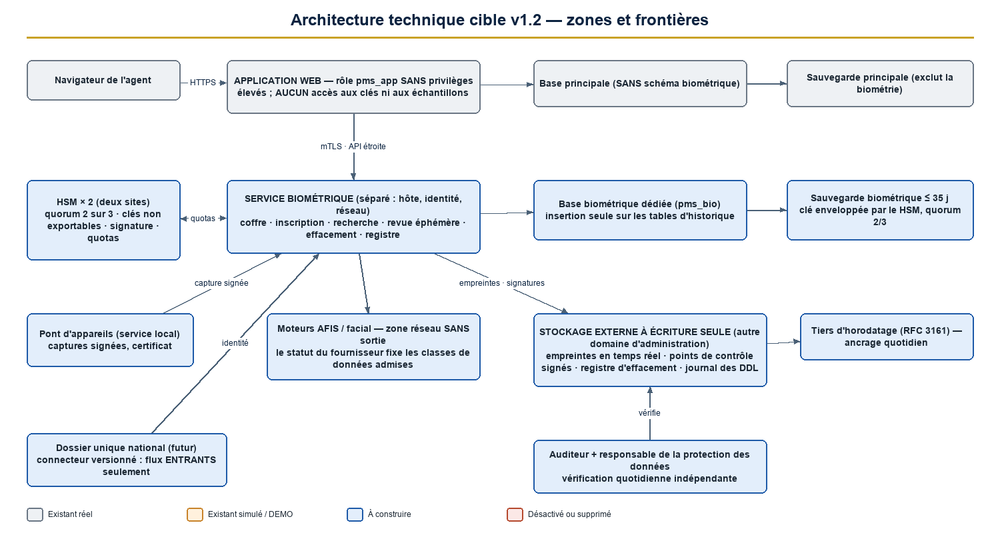

| Zone | Composants | Particularités |
|---|---|---|
| Application web | Écrans, API existantes (enveloppes minces), orchestrateur | **Aucun accès aux clés ni aux échantillons en clair** ; rôle de base `pms_app` sans privilèges élevés |
| **Service biométrique** (nouveau) | Coffre, inscription, recherche, matériel de revue éphémère, effacement, registre biométrique | Hôte, identité et réseau distincts ; base biométrique dédiée ; quotas de déballage |
| HSM (deux appareils) | Clés maîtresses non exportables, clés de signature, clé de pseudonymes | Quorum natif ; rôles HSM séparés |
| Moteurs AFIS et facial | Fournisseurs | Zone réseau dédiée sans sortie ; statut gouvernant les classes de données |
| Stockage externe à écriture seule | Empreintes du registre, points de contrôle signés, registre d'effacement, journal des DDL | Autre domaine d'administration ; tiers d'horodatage |
| Dossier unique national (futur) | Connecteur versionné | Flux **entrants** par défaut |
| Base principale | Données de l'application | Sauvegarde sans le schéma biométrique |

**Frontières.** (1) Le navigateur ne parle jamais au moteur ni au service biométrique ; (2) l'application ne détient aucune clé ; (3) le service biométrique n'expose aucun point de déchiffrement en masse ; (4) toute communication est chiffrée et authentifiée mutuellement ; (5) les sondes ne sont jamais conservées ; (6) les échantillons de référence sont chiffrés dans le coffre (D-03).

**Performances** (inchangées) : 1:1 p95 ≤ 2 s ; 1:N p95 ≤ 10 s, la galerie restant dans le moteur ; « indisponible » n'est jamais « aucune correspondance ».

<!--pagebreak-->

## 4. Ce qui change entre la version 1.1 et la version 1.2

| Domaine | Version 1.1 | Version 1.2 |
|---|---|---|
| Privilèges de base | « Rôles de base séparés » invoqués, inexistants | **Cinq rôles PostgreSQL**, tripwire, `REVOKE`, surveillance des DDL (ch. 5) |
| Intégrité | Déclencheurs seuls | **Registre chaîné, points de contrôle signés par le HSM, ancrage externe** (ch. 6) |
| Restauration | Non encadrée ; registre d'effacement en base | **Quorum natif, quarantaine, comparaison aux ancrages, registre d'effacement externe** (ch. 7) |
| Coffre | Dans l'application | **Service biométrique séparé**, quotas, HSM à quorum, cycle de vie, AAD (ch. 8) |
| Séparation | Au niveau du compte | **Identité d'agent**, épinglage, éligibilité par type, amorçage (ch. 9) |
| Conservation | Une base légale | **Bases multiples**, précédence (ch. 10) |
| Fournisseurs | Double fonctionnement avant évaluation | **Classes de données et statuts**, ordre corrigé, essai bi-fournisseur (ch. 11) |
| Phases | Critères qualitatifs | **Critères mesurables, phase 3b, retour arrière en cinq classes** (ch. 12) |
| Fédération | `attest()` | **Supprimé** ; flux ; scissions ; mode dégradé (ch. 13) |
| Décisions | 16 | **23** |
| Risques | 10 | **25**, reclassés (ch. 14) |

<!--pagebreak-->

## 5. Étape 1 — Séparation des privilèges PostgreSQL et exploitation (A-01)

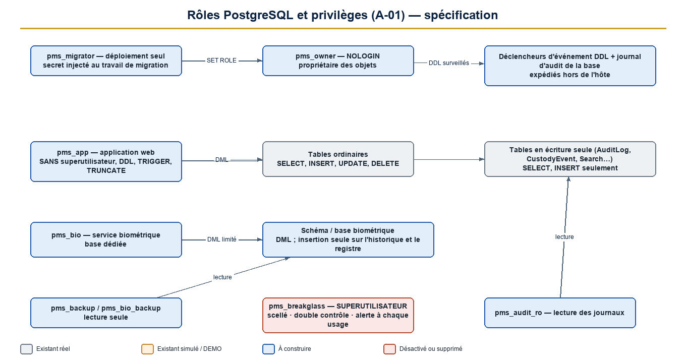

### 5.1 Constat à corriger

Le compte `pms_app` est propriétaire des tables **et** superutilisateur (vérifié) ; la configuration de production utilise le même identifiant pour le cluster et l'application. Les déclencheurs d'écriture seule (`AuditLog`, `CustodyEvent`) sont donc **désactivables par l'application**.

### 5.2 Rôles cibles (spécification, non appliquée)

| Rôle | Connexion | Droits | Usage |
|---|---|---|---|
| `pms_owner` | **Aucune** | Propriétaire des schémas et objets | Jamais utilisé en connexion |
| `pms_migrator` | Oui, **secret injecté au seul travail de migration** | Membre de `pms_owner` (changement de rôle) ; DDL | `prisma migrate deploy` au déploiement |
| `pms_app` | Oui | `SELECT, INSERT, UPDATE, DELETE` sur les tables ordinaires ; **`SELECT, INSERT` seulement** sur les tables en écriture seule (`AuditLog`, `CustodyEvent`, `BiometricMatch`, `BiometricReview`…) ; **tables mixtes DEMO / réel** (`BiometricSearch`, `BiometricControl`) : `SELECT, INSERT` plus **droits de colonne limités** (`UPDATE` sur `action`, `actionNotes`, `actionById`, `actionAt` ; états des contrôles simulés), le déclencheur par ligne interdisant toute modification d'une ligne réelle — en production sans ligne DEMO, ces droits de colonne sont retirés ; **ni `TRUNCATE`, ni `TRIGGER`, ni `REFERENCES`, ni `CREATE`** ; **ni superutilisateur, ni propriétaire** | Application web |
| `pms_bio` | Oui (service biométrique seulement) | DML sur la base biométrique dédiée ; insertion seule sur le registre | Service biométrique |
| `pms_backup` / `pms_bio_backup` | Oui | Lecture seule (`pg_read_all_data`) ; la sauvegarde principale **exclut** le schéma biométrique | Sauvegardes |
| `pms_audit_ro` | Oui | `SELECT` sur les journaux | Vérificateur d'audit |
| `pms_breakglass` | Oui, **scellé** | Superutilisateur | Secours : double contrôle, alerte immédiate à chaque usage, journal externe |

### 5.3 Mesures complémentaires

1. `REVOKE UPDATE, DELETE, TRUNCATE` des tables en écriture seule pour `pms_app` ; `REVOKE CREATE ON SCHEMA public`.
2. **`pg_hba`** : une ligne par rôle et par origine ; **TLS obligatoire** ; `scram-sha-256`.
3. **Déclencheurs d'événement** (`ddl_command_end`, `sql_drop`) et journal d'audit de la base enregistrant tout DDL, tout changement de rôle, toute modification d'un déclencheur ; **expédition hors de l'hôte** vers le support externe (chapitre 6).
4. **Tripwire** au démarrage : l'application consulte son propre rôle et **refuse de démarrer** s'il est superutilisateur, propriétaire d'un objet, ou s'il possède `CREATE`/`TRIGGER`.
5. **Migrations hors du conteneur applicatif** (`deploy/entrypoint.sh` ne lance plus `migrate deploy`) ; deux URL distinctes (`DATABASE_URL` pour l'exécution, URL de migration pour le déploiement).
6. **Secrets** : le mot de passe du superutilisateur de secours est scellé (deux personnes) ; aucun secret de migration ni de secours n'est présent sur l'hôte applicatif.
7. **Environnement de développement** : le poste de développement conserve ses facilités (superutilisateur local) ; **les tests d'attaque s'exécutent sur un profil durci** (préproduction), jamais sur le poste de développement.

### 5.4 Tests d'attaque (exécutés en tant que `pms_app`)

`UPDATE`/`DELETE`/`TRUNCATE` sur chaque table en écriture seule ; `ALTER TABLE … DISABLE TRIGGER` ; `SET session_replication_role = replica` ; `CREATE TABLE` / `CREATE FUNCTION` ; `DROP TRIGGER` ; lecture du schéma biométrique : **tous doivent échouer (code 42501)**. Test d'introspection : `rolsuper = faux`, propriétaire ≠ rôle applicatif, `has_table_privilege` conforme. Test du tripwire : démarrage refusé avec un rôle excessif.

### 5.5 Fiches des anomalies de l'étape 1

{{STEP1}}

<!--pagebreak-->

## 6. Étape 2 — Intégrité cryptographique des événements et décisions (A-02, A-03, A-06, A-07)

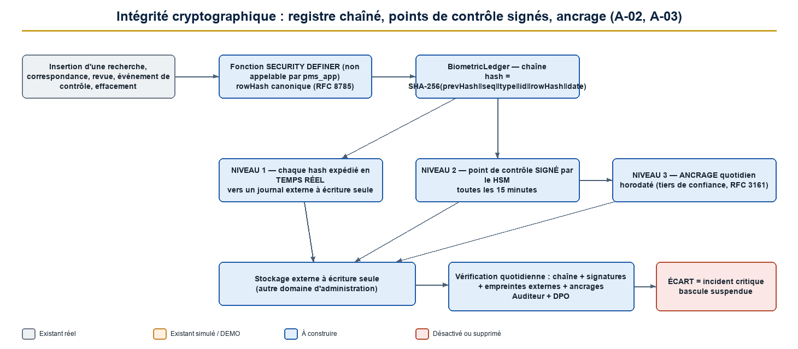

### 6.1 Registre biométrique chaîné

`BiometricLedger(seq, type, entityId, rowHash, prevHash, hash, at)`. Alimenté par des **fonctions `SECURITY DEFINER`** (non appelables directement par `pms_app`) déclenchées à chaque insertion dans `BiometricSearch`, `BiometricMatch`, `BiometricReview`, `BiometricControlEvent` et `BiometricErasureRegister`.

```
rowHash = SHA-256( JSON canonique (RFC 8785) des colonnes de la ligne )
hash    = SHA-256( prevHash ‖ seq ‖ type ‖ entityId ‖ rowHash ‖ at )
```

Verrou consultatif sur la dernière ligne (comme `AuditLog`) ; `seq` sans trou ; aucune mise à jour ni suppression.

### 6.2 Trois niveaux de preuve hors de portée de l'exploitation

| Niveau | Mécanisme | Cadence | Détecte |
|---|---|---|---|
| 1 | **Expédition de chaque `hash`** vers un journal externe à écriture seule | Temps réel | Toute altération, y compris dans la fenêtre entre deux points de contrôle |
| 2 | **Point de contrôle signé** (`seq`, `hash` de tête, date) par une **clé de signature du HSM** | 15 minutes | Reconstruction de la chaîne par un administrateur sans accès au HSM |
| 3 | **Ancrage quotidien horodaté** par un tiers de confiance (RFC 3161) | Quotidien | Retour en arrière complet de la base et du journal local |

Le même dispositif est appliqué à la tête de `AuditLog` (levée de la limite connue : suppression de la dernière ligne).

### 6.3 Vérification

Vérification quotidienne par l'**auditeur** et le **responsable de la protection des données**, indépendants de l'exploitation : chaîne complète, signatures, concordance avec les empreintes externes et les ancrages. **Écart = incident critique** avec suspension de la bascule en production.

### 6.4 Colonnes immuables et contraintes (A-06, A-07)

| Table | Règle |
|---|---|
| `BiometricSearch` | **Insertion seule pour les lignes réelles** ; pour les lignes `isDemo = vrai`, seules `action`, `actionNotes`, `actionById`, `actionAt` restent modifiables (comportement conservé) ; **`isDemo` immuable dans tous les cas** (déclencheur) ; `CHECK (isDemo = faux ⇒ requestedById, providerCode, subjectScope NON NULS)` |
| `BiometricMatch` | Insertion seule ; `subjectId` obligatoire, `personId` interdit pour les lignes réelles |
| `BiometricReview` | Insertion seule ; **une seule décision finale** par recherche (index unique partiel) ; `INCONCLUSIVE` suivie d'une seconde revue par une **autre identité** ; au-delà : escalade |
| `BiometricControl` (réel) | Insertion seule ; transitions dans `BiometricControlEvent` (insertion seule) ; champs `reviewed*` dérivés en lecture seule ; contrôles simulés inchangés |
| `BiometricLedger`, checkpoints, registre d'effacement | Insertion seule |

Le déclencheur de `BiometricReview` impose **opérateur ≠ demandeur ≠ relecteur au niveau de l'identité d'agent** (chapitre 9) et enregistre la force d'authentification (`mfaVerifiedAt`).

### 6.5 Fiches des anomalies de l'étape 2

{{STEP2}}

<!--pagebreak-->

## 7. Étape 3 — Sauvegardes, restauration et registre d'effacement (A-04, A-05, A-16)

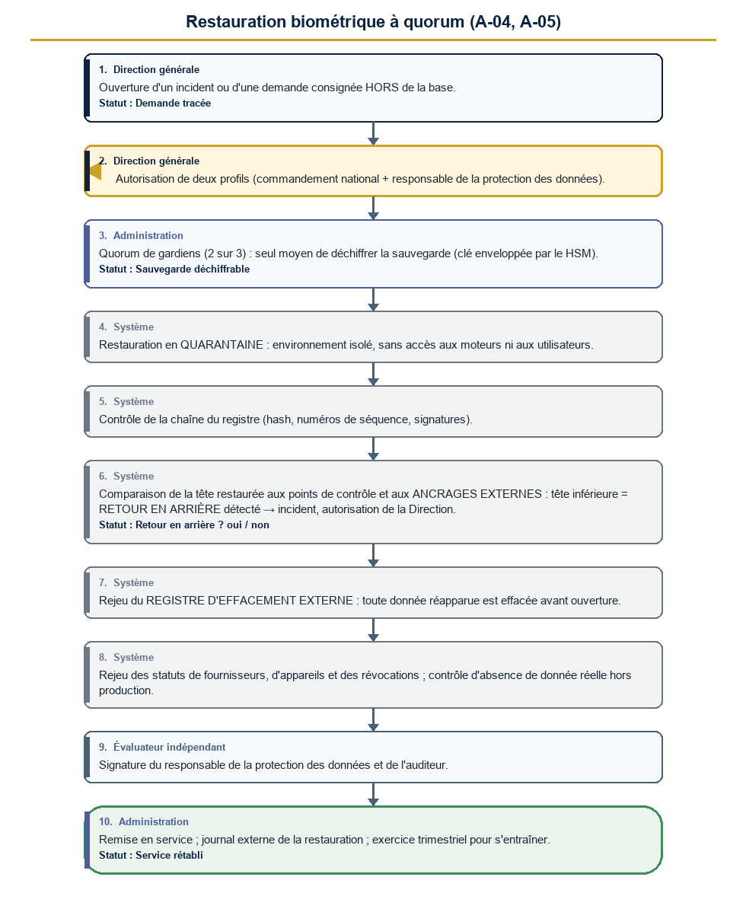

### 7.1 Principes

| Sujet | Règle |
|---|---|
| Séparation | **Base biométrique dédiée** ; la sauvegarde principale de l'application **exclut** le schéma biométrique (contrôle automatique) |
| Chiffrement | Sauvegarde biométrique chiffrée par une **clé de sauvegarde enveloppée par le HSM** ; déchiffrement **seulement avec le quorum de gardiens** |
| Rétention | **≤ 35 jours**, verrouillage d'objet ; clé de sauvegarde **détruite** à l'échéance |
| Restauration | **Jamais** par le droit `system:backup` ; procédure à quorum (7.2) |
| Registre d'effacement | **Répliqué en continu hors de la base**, entrées signées par le HSM, conservé **≥ 125 jours** (35 + 90 ; recommandation : 1 an) |

### 7.2 Procédure de restauration (dix étapes)

1. Ouverture d'un **incident ou d'une demande** consignée (hors base).
2. **Autorisation** de deux profils (commandement national et responsable de la protection des données).
3. **Quorum de gardiens** (2 sur 3) pour déchiffrer la sauvegarde.
4. Restauration en **quarantaine** (environnement isolé, sans accès au moteur ni aux utilisateurs).
5. **Contrôle de la chaîne** du registre.
6. **Comparaison de la tête restaurée** aux points de contrôle et ancrages externes : tête inférieure = **retour en arrière détecté** → incident, autorisation de la Direction, journalisation.
7. **Rejeu du registre d'effacement externe** : toute donnée réapparue est effacée.
8. **Rejeu des statuts** de fournisseurs, d'appareils et de révocations.
9. Contrôle d'absence de donnée réelle hors production.
10. **Remise en service** après signature du responsable de la protection des données et de l'auditeur.

### 7.3 Exercices et indicateurs

Exercice **trimestriel** observé par l'auditeur ; objectifs indicatifs : RPO ≤ [24 h], RTO ≤ [4 h] ; test annuel de perte du quorum ; test de rétention (aucune sauvegarde biométrique > 35 jours).

### 7.4 Fiches des anomalies de l'étape 3

{{STEP3}}

<!--pagebreak-->

## 8. Étape 4 — Architecture du coffre de clés (A-11, A-12, A-13)

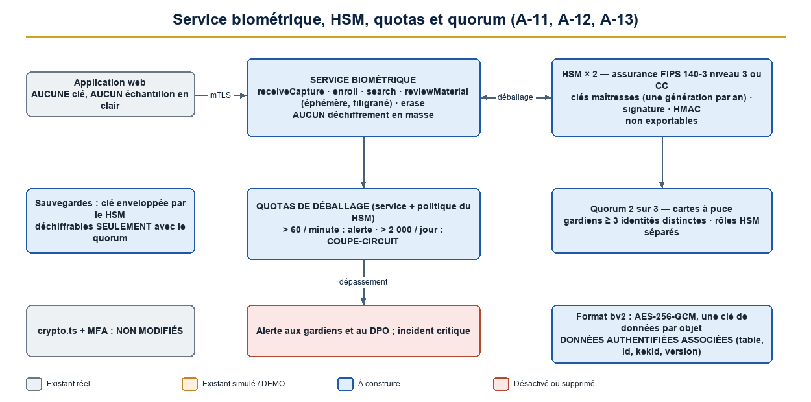

### 8.1 Service biométrique séparé

L'application web ne détient **aucune clé et aucun échantillon en clair**. Le service biométrique expose une API étroite : `receiveCapture`, `enroll`, `search`, `reviewMaterial` (rendu éphémère filigrané, lien signé ≤ 60 s, sans téléchargement), `erase`. **Aucun point ne déchiffre ou n'exporte en masse.** Le service s'authentifie auprès du HSM par une identité dédiée.

### 8.2 HSM

| Sujet | Exigence |
|---|---|
| Matériel | **Deux HSM** synchronisés, sur deux sites ; assurance **FIPS 140-3 niveau 3** ou Critères Communs (D-21) |
| Rôles HSM | **Officier de sécurité**, **officier de chiffrement**, **auditeur**, tenus par des personnes différentes |
| Quorum | **2 sur 3** au minimum (cartes à puce) pour : générer ou détruire une clé maîtresse, déchiffrer les sauvegardes, administrer le HSM |
| Clés | Maîtresses (une génération par année), de signature (registre, effacement), de pseudonymes (HMAC) : **non exportables** |
| Contrôle | Les approbations applicatives sont un **complément**, jamais le seul contrôle |

### 8.3 Quotas de déballage et coupe-circuit (valeurs initiales, à calibrer en phase 3)

| Seuil | Action |
|---|---|
| > 60 déballages par minute | Ralentissement et alerte aux gardiens et au responsable de la protection des données |
| > 2 000 déballages par jour | **Coupe-circuit** : déballage suspendu, incident critique |
| Déballage hors recherche, revue ou inscription en cours | Refus et alerte |

### 8.4 Format de chiffrement `bv2` et données authentifiées associées

`bv2.<kekId>.<DEK enveloppée>.<iv>.<tag>.<chiffré>` (AES-256-GCM ; IV de 96 bits aléatoire ; **une clé de données par objet**). Les **données authentifiées associées** sont `bv2 | kekId | table | identifiant de l'enregistrement | version | finalité` : un chiffré **ne peut pas être substitué** à un autre enregistrement ou rejoué. `crypto.ts` et l'authentification à deux facteurs ne sont **pas** modifiés.

### 8.5 Cycle de vie des clés

| État | Description |
|---|---|
| Générée | Créée dans le HSM par cérémonie à quorum ; non active |
| **Active** | Enveloppe les nouvelles clés de données (une génération par an) |
| Désactivée | Ne sert plus qu'à déballer ; ré-enveloppement en cours |
| **Détruite** | Après ré-enveloppement **complet** et **expiration des sauvegardes** qui la référencent |
| **Compromise** | Voir 8.6 |

### 8.6 Procédures

| Événement | Procédure |
|---|---|
| **Compromission d'une clé maîtresse** | (1) déclarer l'incident, (2) couper le déballage, (3) générer une génération de remplacement par cérémonie, (4) ré-envelopper toutes les clés de données (lot supervisé, débit limité), (5) détruire la génération compromise **après vérification**, (6) évaluer l'exposition et notifier (D-15) |
| Panne d'un HSM | Bascule sur le second ; remplacement et resynchronisation par cérémonie ; test annuel |
| Migration d'un HSM à un autre fournisseur | Ré-enveloppement des clés de données (ancien HSM déballe, nouveau enveloppe) dans les quotas ; double fonctionnement ; destruction de l'ancien |
| Départ d'un gardien | Révocation de sa carte, ré-émission, re-clé du quorum ; au moins 3 titulaires en permanence |
| Séquestre | Sauvegarde chiffrée native du HSM, conservée sous scellés dans un lieu distinct ; test annuel de restauration |
| Agilité cryptographique | Version de format et registre d'algorithmes ; revue tous les trois ans ; migration planifiée |

### 8.7 Fiches des anomalies de l'étape 4

{{STEP4}}

<!--pagebreak-->

## 9. Étape 5 — Séparation des responsabilités au niveau des personnes physiques (A-19, A-20, A-21, A-22)

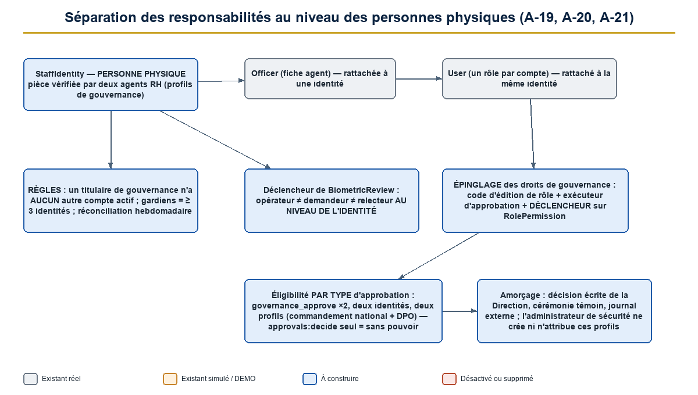

### 9.1 Identité d'agent

`StaffIdentity(id, documentType, documentDigest, verifiedBy, verifiedAt, status)` : une **personne physique** (pièce vérifiée, résumé à clé du numéro). Chaque fiche agent (`Officer`) et chaque compte (`User`) se rattachent à **une** identité. Règles :

1. Un titulaire de **profil de gouvernance** n'a **aucun autre compte actif** (contrainte et réconciliation hebdomadaire).
2. Les **gardiens de clés** sont au moins **trois identités distinctes**.
3. La revue vérifie **opérateur ≠ demandeur ≠ relecteur au niveau de l'identité**.
4. L'identité d'un titulaire de gouvernance est vérifiée **par deux agents des ressources humaines distincts** (droit existant `hr:manage`).

### 9.2 Épinglage des droits de gouvernance

| Droit | Attribuable seulement à |
|---|---|
| `biometric:provider_manage`, `device_manage`, `export_portability` | `BIOMETRIC_PLATFORM_ADMIN` |
| `biometric:key_manage` | `KEY_CUSTODIAN` |
| `biometric:retention_manage`, `erasure_decide` | `DATA_PROTECTION_OFFICER` |
| `biometric:history_view_candidates` | `DATA_PROTECTION_OFFICER`, `AUDITOR` |
| `biometric:governance_approve` | `NATIONAL_COMMANDER`, `DATA_PROTECTION_OFFICER` |
| `biometric:enroll_validate`, `watchlist_review` | `BIOMETRIC_OFFICER` |

Contrôle **à trois niveaux** : code d'édition de rôle, exécuteur d'approbation, **déclencheur de base** sur `RolePermission` ; test automatisé.

### 9.3 Éligibilité d'approbation par type

| Type d'approbation | Conditions |
|---|---|
| Activation d'un fournisseur | `governance_approve` ×2, **deux identités et deux profils distincts** (commandement national + responsable de la protection des données) |
| Rotation ou destruction de clé | idem + quorum du HSM |
| Export de portabilité | idem + gardiens |
| Attribution d'un profil de gouvernance | idem ; **l'administrateur de sécurité ne peut ni créer ni attribuer** ces profils |

Les titulaires de `approvals:decide` **seuls** n'ont aucun pouvoir sur ces types.

### 9.4 Amorçage

Premier responsable de la protection des données et premiers gardiens désignés par **décision écrite de la Direction** lors d'une **cérémonie témoin** (deux témoins, procès-verbal, journal externe). La décision d'amorçage est conservée hors de la base.

### 9.5 Droits existants et rôles (A-22)

Aucun des 29 rôles ne perd un droit ; aucun des 158 droits n'est renommé ni supprimé. **Tests à adapter** : sensibilité, libellés FR/AR, matrice de routes, décomptes de documentation. La réponse de l'historique porte un champ `visibility`.

### 9.6 Fiches des anomalies de l'étape 5

{{STEP5}}

<!--pagebreak-->

## 10. Étape 6 — Bases légales multiples et précédence preuve / effacement (A-14, A-15)

### 10.1 Bases légales multiples

`BiometricSampleBasis(sampleId, caseId ou décision, start, end, status)`. **Échéance = maximum des bases actives.** Événements de conservation : statut de partie (`CLEARED`, `CHARGED`…), issue d'affaire (`UNFOUNDED`, `DISMISSED`…), décès, décision de justice, demande de la personne. **Effacement seulement lorsque plus aucune base n'est active.**

| Situation | Résultat |
|---|---|
| Hors de cause dans l'affaire A, partie active dans l'affaire B | Conservation (base B active) |
| Hors de cause partout | Effacement sous 30 jours (délai à confirmer) |
| Personne décédée | Échéance déclenchée ; recherche refusée |

### 10.2 Précédence entre preuve et effacement (A-15, D-06)

| Objet | Règle proposée |
|---|---|
| **Copie probatoire** (pièce avec chaîne de possession) | **Conservée** tant que l'affaire est ouverte (décision du magistrat) ; hors de la galerie |
| **Échantillon de référence opérationnel** | Effacé selon la politique et le registre d'effacement |
| Copies | **Inventoriées** et rattachées au registre ; effacées conjointement quand l'autorisation judiciaire le permet |

### 10.3 Fiches des anomalies de l'étape 6

{{STEP6}}

## 11. Étape 7 — Portabilité AFIS et interdiction des essais prématurés (A-08, A-09)

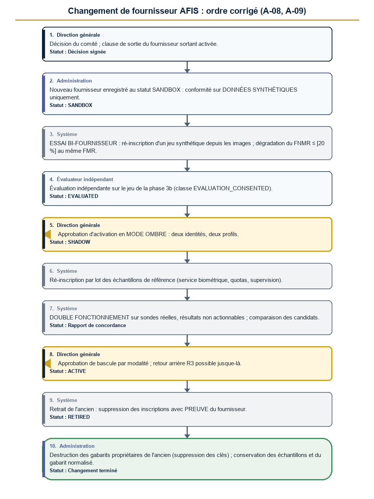

### 11.1 Classes de données et statuts de fournisseur

| Statut du fournisseur | Classes de données admises | Sondes réelles |
|---|---|---|
| `REGISTERED` | Aucune | Interdites |
| `SANDBOX` | `SYNTHETIC`, `LICENSED_RESEARCH` | **Interdites** |
| `EVALUATED` | + `EVALUATION_CONSENTED` (sous protocole) | **Interdites** |
| `SHADOW` | + `OPERATIONAL` | **Oui, non actionnables** |
| `ACTIVE` | `OPERATIONAL` | Oui |
| `SUSPENDED`, `RETIRED` | Aucune | Interdites |

Chaque échantillon et chaque sonde portent une **classe de données**. L'orchestrateur **et un déclencheur de base** refusent d'associer une classe à un fournisseur dont le statut ne l'admet pas. Les moteurs sont dans une zone réseau **sans sortie** ; l'instance `SANDBOX` est **isolée** de toute galerie opérationnelle et de toute clé de production.

### 11.2 Procédure de changement de fournisseur (ordre corrigé)

1. Décision du comité ; clause de sortie du fournisseur sortant activée.
2. Nouveau fournisseur enregistré (`SANDBOX`) : conformité sur **données synthétiques**.
3. **Essai bi-fournisseur** : ré-inscription du jeu synthétique depuis les images ; écart de précision mesuré.
4. **Évaluation indépendante** (classe `EVALUATION_CONSENTED`, protocole de la phase 3b) → statut `EVALUATED`.
5. **Approbation d'activation en mode ombre** (deux identités, deux profils) → statut `SHADOW`.
6. **Ré-inscription par lot** des échantillons de référence (service biométrique, quotas, supervision).
7. **Double fonctionnement** sur sondes réelles, résultats non actionnables.
8. **Approbation de bascule** par modalité → `ACTIVE`.
9. Retrait de l'ancien avec **preuve de suppression** ; statut `RETIRED`.
10. Destruction des gabarits propriétaires de l'ancien (suppression des clés) ; conservation des échantillons et du gabarit normalisé.

**Retour arrière** (classe R3) : tant que l'étape 8 n'est pas validée, l'ancien reste `ACTIVE`.

### 11.3 Essai bi-fournisseur et portabilité éprouvée

Critère de la phase 3 : ré-inscription d'un jeu synthétique ou sous licence de l'AFIS A vers l'AFIS B **depuis les images** ; **dégradation relative du FNMR ≤ [20 %] au même FMR** ; résultat de l'échange de gabarits normalisés documenté. Le **cahier des charges impose au soumissionnaire un bac à sable** pour cet essai ; **exercice annuel réel** ensuite.

### 11.4 Fiches des anomalies de l'étape 7

{{STEP7}}

<!--pagebreak-->

## 12. Étape 8 — Les neuf phases : critères mesurables, collecte encadrée, retour arrière (A-23, A-24, A-25, A-26)

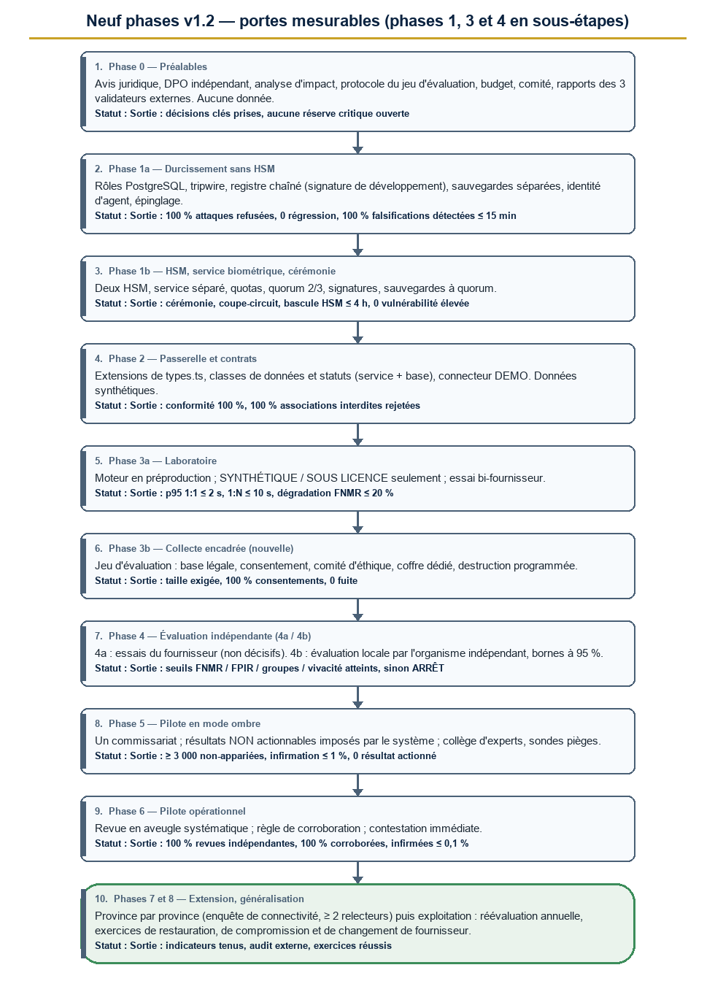

### 12.1 Principes de mesure

| Principe | Application |
|---|---|
| **Vérité terrain** | Jeu étiqueté (évaluation) ; **contre-expertise d'un échantillon aléatoire** par un collège d'experts indépendant (opération) ; **sondes pièges** |
| **Bornes de confiance à 95 %** | **Règle des trois** : zéro événement sur *n* essais indépendants borne le taux à **3/n** |
| **Tailles minimales** | Pour borner un taux d'erreur à 0,1 % : **≥ 3 000** essais non-appariés ; à 0,5 % : ≥ 600 ; à 1 % : ≥ 300 (évaluateur : bornes exactes) |
| Mesure humaine | Sensibilité et spécificité sur sondes pièges ; taux d'infirmation par le collège |

Les valeurs entre crochets sont des **propositions** à fixer par la Direction et l'évaluateur (D-10).

### 12.2 Classes de retour arrière

| Classe | Définition |
|---|---|
| **R0** | Drapeau ou configuration |
| **R1** | Version logicielle précédente, compatible avec les données |
| **R2** | Restauration (double contrôle, chapitre 7) |
| **R3** | Bascule de fournisseur (chapitre 11) |
| **R4** | Ré-enveloppement en deux temps : l'ancienne génération de clé reste **active** jusqu'à vérification |

**Avancer seulement** : les valeurs d'énumération ajoutées sont inertes et conservées ; aucune table contenant des données réelles n'est supprimée avant l'échéance de conservation ; on **désactive** plutôt que de supprimer.

### 12.3 Phase 0 — Préalables

| Rubrique | Contenu |
|---|---|
| Entrée | Mandat de la Direction ; comité nommé, **indépendant de l'éditeur et du fournisseur** (D-16) |
| Livrables | Avis juridique ; autorité de contrôle ; **responsable de la protection des données indépendant (D-20)** ; analyse d'impact ; **protocole du jeu d'évaluation** ; budget (D-13, D-21) ; appel d'offres ; **rapports des trois validateurs externes** ; décisions D-01, D-03, D-04, D-07, D-16, D-17, D-18, D-19, D-20, D-21, D-23 |
| Sortie mesurable | Décisions listées **prises** ; avis juridique signé ; **aucune réserve critique ouverte** dans les trois rapports externes ; budget approuvé |
| Arrêt | Avis juridique défavorable (R-09) |
| Retour arrière | Sans objet (R0) |
| Données | **Aucune** |

### 12.4 Phase 1a — Durcissement sans HSM

| Rubrique | Contenu |
|---|---|
| Entrée | Phase 0 close |
| Livrables | Rôles PostgreSQL et tripwire ; déclencheurs et contraintes ; registre chaîné avec **signature de développement** ; journal externe de test ; séparation des sauvegardes ; identité d'agent et épinglage ; nouveaux types d'approbation |
| Sortie mesurable | **100 % des tests d'attaque refusés (42501)** ; **tripwire** : démarrage refusé avec un rôle excessif ; **toutes les suites existantes vertes** (0 régression ; MFA et séparation des administrateurs incluses) ; registre : **10 000 événements synthétiques** vérifiés, **100 %** des falsifications injectées détectées en **≤ 15 min** ; sauvegarde principale **sans** table biométrique ; restauration d'essai réussie ; 0 donnée biométrique réelle (analyse automatique) |
| Arrêt | Régression MFA ; échec d'une attaque simulée |
| Retour arrière | R1 |
| Données | Démonstration et synthétiques |

### 12.5 Phase 1b — HSM, service biométrique et cérémonie

| Rubrique | Contenu |
|---|---|
| Entrée | 1a close ; **deux HSM livrés** (D-13, D-21) ; ≥ 3 gardiens désignés |
| Livrables | Service biométrique séparé ; quotas ; cérémonie de clés ; signatures du registre par le HSM ; sauvegardes à quorum ; ancrage horodaté |
| Sortie mesurable | Cérémonie à **quorum 2 sur 3** réalisée ; **quotas** : alerte et coupe-circuit déclenchés aux seuils ; déballage impossible sans quorum pour les sauvegardes ; **bascule HSM ≤ [4 h]** ; compromission simulée (R4) réussie ; **0 vulnérabilité critique ou élevée** (test d'intrusion visant l'exfiltration massive) |
| Arrêt | Échec du quorum ou du coupe-circuit |
| Retour arrière | R4 |
| Données | Synthétiques |

### 12.6 Phase 2 — Passerelle et contrats

| Rubrique | Contenu |
|---|---|
| Livrables | Extensions de `types.ts` ; simulateur DEMO ; conformité ; classes de données et statuts (service et base) ; sujets et liens ; connecteur DEMO |
| Sortie mesurable | Conformité **100 %** (simulateur et bac à sable, données synthétiques) ; **100 % des tentatives d'association d'une classe non admise rejetées** (service et base) ; contrats des routes existantes inchangés (tests de contrat à 100 %) ; matrice de routes de sécurité étendue |
| Arrêt | Le fournisseur refuse les clauses de portabilité ou de sortie |
| Retour arrière | R0 / R1 |
| Données | Synthétiques |

### 12.7 Phase 3a — Laboratoire (données synthétiques et sous licence)

| Rubrique | Contenu |
|---|---|
| Entrée | Phase 2 close ; analyse d'impact validée |
| Sortie mesurable | 1:1 **p95 ≤ [2 s]** (≥ 1 000 appels) ; 1:N **p95 ≤ [10 s]** à la taille cible ; disponibilité **≥ [99,5 %] sur 14 jours** ; erreurs techniques **< [0,5 %]** ; **0 donnée biométrique** dans les journaux (analyse automatique) ; **essai bi-fournisseur : dégradation du FNMR ≤ [20 %]** ; quotas calibrés ; test d'intrusion sans point élevé |
| Arrêt | Performances hors seuil après deux réglages |
| Retour arrière | R3 |
| Données | **Synthétiques et sous licence uniquement** (aucun volontaire) |

### 12.8 Phase 3b — Collecte encadrée du jeu d'évaluation (nouvelle)

| Rubrique | Contenu |
|---|---|
| Entrée | **D-01** (base légale), **D-17** (mineurs), analyse d'impact, responsable de la protection des données, **comité d'éthique**, **1b close** (coffre dédié, HSM), protocole de la phase 0 |
| Livrables | Registre de consentements ; coffre dédié (classe `EVALUATION_CONSENTED`) ; plan de **destruction** du jeu après l'évaluation |
| Sortie mesurable | Jeu conforme à la **taille exigée par l'évaluateur** (ordre de grandeur : ≥ [1 000] personnes) ; **100 %** des échantillons rattachés à un consentement ; **0 fuite** (audit) ; jeu **isolé** de toute galerie opérationnelle |
| Arrêt | Un consentement manquant ; une fuite |
| Retour arrière | R0 : effacement du jeu |
| Données | Personnes réelles consentantes |

### 12.9 Phase 4 — Évaluation indépendante (4a / 4b)

| Rubrique | Contenu |
|---|---|
| 4a | Essais du fournisseur sur jeux sous licence (prérequis, **non décisifs**) |
| 4b | **Évaluation locale** par l'organisme indépendant sur le jeu de la phase 3b |
| Sortie mesurable (indicatif, bornes à 95 %) | Empreintes : **FNMR ≤ [1 %] à FMR = [0,1 %]** ; identification au rang 1 **≥ [98 %]** avec FPIR **≤ [0,1 %]** ; échec d'acquisition **≤ [2 %]**. Visage : FNMR **≤ [3 %]** à FMR = [0,1 %] ; **rapport FNMR maximal / minimal entre groupes ≤ [1,5]**. Vivacité : **APCER ≤ [5 %]**, **BPCER ≤ [5 %]** |
| Arrêt | **Toute mesure hors seuil** : arrêt ou changement de fournisseur |
| Retour arrière | R3 ; effacement du jeu selon le protocole |
| Données | Jeu d'évaluation légalement constitué |

### 12.10 Phase 5 — Pilote en mode « ombre »

| Rubrique | Contenu |
|---|---|
| Entrée | 4b conforme ; fournisseur `SHADOW` (approbation) ; personnes informées (D-14) ; relecteurs désignés ; **résultats non actionnables imposés par le système** (aucune notification, aucun lien, aucune suite) |
| Périmètre | Un commissariat |
| Sortie mesurable | Durée **≥ [8 semaines]** ; **≥ [3 000] recherches non-appariées** (taux d'erreur borné à 0,1 %) ; **collège d'experts** : taux d'infirmation des résultats « à revoir » **≤ [1 %]** sur un échantillon aléatoire de **≥ [5 %]** ; **sondes pièges** : sensibilité des relecteurs **≥ [95 %]**, spécificité **≥ [98 %]** ; revue **≤ [24 h]** pour **≥ [95 %]** ; **0 résultat actionné** (audit) ; **0 incident de sécurité élevé** ; 100 % des alertes d'anomalie traitées |
| Arrêt | Incident élevé ; résultat actionné par erreur |
| Retour arrière | R0 : fournisseur `SUSPENDED` ; données conservées chiffrées |
| Données | Réelles, base légale |

### 12.11 Phase 6 — Pilote opérationnel limité

| Rubrique | Contenu |
|---|---|
| Entrée | Phase 5 conforme ; **règle de corroboration** adoptée (D-19) ; fournisseur `ACTIVE` par approbation |
| Sortie mesurable | **100 %** des décisions issues d'une **revue indépendante en aveugle** ; **100 %** des mesures coercitives **corroborées** par un élément non biométrique ; décisions **infirmées** (contestation ou collège) **≤ [0,1 %]** des actions ; revue **≤ [24 h]** pour **≥ [95 %]** ; 0 incident élevé sur **[8 semaines]** ; erreurs signalées traitées sous **[7 jours]** |
| Arrêt | Atteinte aux droits avérée ; incident élevé |
| Retour arrière | R0 (retour en mode ombre) |
| Données | Réelles |

### 12.12 Phase 7 — Extension provinciale

| Rubrique | Contenu |
|---|---|
| Entrée | Phase 6 conforme ; **enquête de connectivité** (D-23) ; politique hors ligne arrêtée (D-08) ; **≥ [2] relecteurs par province** |
| Sortie mesurable (par province) | **100 %** des appareils inscrits et signés ; **≥ [95 %]** des utilisateurs formés et évalués ; indicateurs de la phase 6 tenus **[4 semaines]** ; **audit externe** sans point critique |
| Arrêt | Réservoir de relecteurs insuffisant |
| Retour arrière | R0 : province retirée du périmètre |

### 12.13 Phase 8 — Généralisation

| Rubrique | Contenu |
|---|---|
| Sortie mesurable (continue) | **Réévaluation annuelle** (précision, écarts de groupes, vivacité) ; **exercice annuel réel de changement de fournisseur** ; **exercice trimestriel de restauration** ; exercice annuel de compromission de clé ; revue annuelle des anomalies et de la qualité de la revue humaine |
| Arrêt | Perte de conformité ; fournisseur défaillant |
| Retour arrière | R3 (plan de sortie) |

### 12.14 Fiches des anomalies de l'étape 8

{{STEP8}}

<!--pagebreak-->

## 13. Étape 9 — Décisions D-17 à D-23, fédération avec le Dossier unique national (A-10, A-17, A-18, A-27)

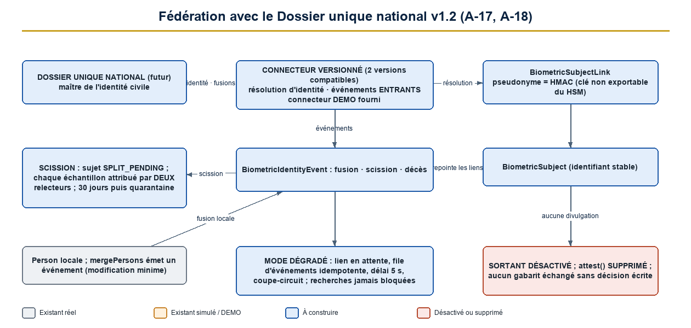

### 13.1 Fédération sans divulgation sortante

| Flux | Direction | Contenu | Base légale | État par défaut |
|---|---|---|---|---|
| Résolution d'identité | Dossier national → police | Identifiant national, statut | Texte du dossier unique | **Activé** |
| Événements d'identité (fusion, scission, décès) | Dossier national → police | Type, identifiants | Idem | **Activé** |
| Fusions décidées par la police | Police → dossier national | Type, identifiants | À créer | **Désactivé** (D-07) |
| **Attestation « possède une biométrie »** | Police → dossier national | — | — | **Supprimée** (A-17) |
| Échange de gabarits ou d'échantillons | — | — | Décision écrite | **Désactivé** |

**Divulgation sortante future** (si une base légale l'exige) : requête limitée à une finalité, approuvée par le responsable de la protection des données, limitée en débit, journalisée, sans révéler l'absence ou la présence hors finalité.

### 13.2 Procédure de scission (A-18)

1. Événement `PERSON_SPLIT` : le sujet passe en `SPLIT_PENDING` ; **aucune attribution positive** n'est possible.
2. **Attribution de chaque échantillon** à l'une des nouvelles identités par **deux relecteurs indépendants**.
3. Délai de **30 jours** ; à défaut, **mise en quarantaine** (exclusion des galeries).
4. Création des nouveaux sujets ; ré-inscription ; journalisation.

### 13.3 Pseudonymes, mode dégradé, versionnement

| Sujet | Règle |
|---|---|
| Pseudonyme par système | `HMAC-SHA-256(clé du HSM, référence nationale ‖ « SIGPN-T »)` ; clé non exportable ; rotation avec table de correspondance protégée |
| **Mode dégradé** | Dossier injoignable : enrôlement avec **lien en attente** (durée limitée), file d'événements **rejouée de façon idempotente**, délai de 5 s, coupe-circuit ; **aucune recherche opérationnelle bloquée** |
| Versionnement | Contrat versionné ; **fenêtre de compatibilité de deux versions** ; tests de contrat ; connecteur DEMO |
| Fusion de fiches locales | Changement de lien, **jamais de déplacement de gabarit** ; doublons de sujets proposés à la revue |

### 13.4 Portabilité et décision D-03 (A-10)

**D-03 est contraignant : option B obligatoire** (gabarit normalisé + propriétaire + échantillon de référence chiffré). Toute autre option : portabilité **non garantie**, projet **suspendu** tant que le risque n'est pas accepté par écrit. **Format d'archivage** : empreintes sans perte (PNG ou JPEG 2000 sans perte, ISO/IEC 19794-4, ≥ 500 ppp, 1000 ppp si capturé) ; visage ISO/IEC 19794-5 / 39794-5 sans compression destructive ; valeurs à confirmer par l'évaluateur.

### 13.5 Registre des 23 décisions

{{DECISIONS}}

Le registre complet (options, conséquences, documents requis) est livré séparément (`REGISTRE_DECISIONS_V1.2`).

### 13.6 Fiches des anomalies de l'étape 9

{{STEP9}}

<!--pagebreak-->

## 14. Étape 10 — Registre des risques et checklists de validation externe (A-28, A-29, A-30)

### 14.1 Échelle et classes

| Élément | Définition |
|---|---|
| Probabilité (P) | 1 rare · 2 peu probable · 3 possible · 4 probable · 5 quasi certaine |
| Impact (I) | 1 faible · 2 limité · 3 sérieux · 4 grave · 5 critique (atteinte aux droits, perte de confiance) |
| Niveau | P × I : **Critique ≥ 15** · **Élevé 10–14** · **Moyen 5–9** · **Faible ≤ 4** |
| **Bloquant** | Condition non remplie qui **empêche toute phase** (indépendamment du score) |

### 14.2 Registre des 25 risques

{{RISKS}}

**Reclassements majeurs.** R-09 (cadre juridique) : **Bloquant**. R-11 (faux positif entraînant une interpellation injustifiée) : **Critique** avant mesures ; **jamais sous « Élevé »** après mesures (risque irréductible). R-02 (falsification par privilégié) : **Critique** avant mesures.

### 14.3 Checklists de validation externe (remplacent celles de l'auteur)

**A. Architecte sécurité externe**

1. Rôles PostgreSQL : aucun superutilisateur ni propriétaire côté application ; tests d'attaque 42501 rejoués.
2. Registre chaîné : preuve de chaînage, signature par le HSM, ancrage externe ; essai de falsification.
3. Restauration : quorum natif, quarantaine, comparaison aux ancrages, rejeu du registre d'effacement externe.
4. Service biométrique : aucun point de déchiffrement en masse ; quotas et coupe-circuit testés.
5. HSM : quorum, rôles séparés, assurance (D-21), double site, séquestre.
6. Format `bv2` et données authentifiées associées ; cycle de vie et compromission simulée.
7. Épinglage des droits : déclencheur de base, éligibilité par type d'approbation.
8. Classes de données et statuts de fournisseur : refus par le service et par la base.
9. Pseudonymes et connecteur : aucune divulgation sortante.
10. Zones réseau, absence de sortie des moteurs.
11. Revue de code des contrôles critiques ; test d'intrusion.
12. `crypto.ts` non modifié ; suite MFA verte.

**B. Juriste**

1. Base légale du traitement (D-01) ; autorité de contrôle.
2. Mineurs (D-17) ; échanges internationaux (D-18).
3. Valeur probante, **règle de corroboration**, droit de contestation (D-19).
4. Durées, bases multiples, précédence preuve / effacement, « mise hors d'usage » des sauvegardes (D-06).
5. Interdiction de l'identification faciale en temps réel dans l'espace public (D-09).
6. Information des personnes et procédure de contestation (D-14).
7. Conditions de la collecte du jeu d'évaluation et du consentement (phase 3b).
8. Fédération : flux et absence de divulgation sortante (D-07).
9. Accès du parquet (D-22) ; notification des incidents (D-15).
10. Contrats : clauses de portabilité, de sortie, de suppression, de localisation.

**C. Responsable indépendant de la protection des données**

1. Indépendance et moyens du responsable (D-20).
2. Analyse d'impact complète.
3. Minimisation : sondes non conservées, échantillons de référence justifiés.
4. Registre d'effacement externe, démonstration d'un effacement bout en bout.
5. Qualité de la revue humaine : en aveugle, pièges, indicateurs.
6. Détection d'usage anormal : seuils, procédure, sanctions.
7. Droits des personnes : accès, contestation, effacement.
8. Vérification quotidienne de l'ancrage : procédure indépendante de l'exploitation.
9. Séparation au niveau des personnes : réconciliation hebdomadaire.
10. Registre des risques : exhaustivité et reclassements.

### 14.4 Fiches des anomalies de l'étape 10

{{STEP10}}

<!--pagebreak-->

## 15. Modèle de données consolidé v1.2

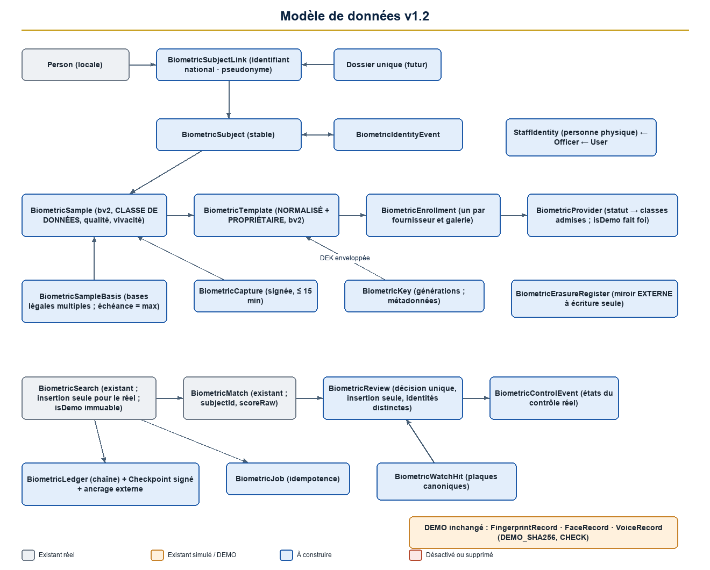

**Règle de migration** : uniquement additive, avancer seulement (énumérations inertes), **rien n'est appliqué par ce document**.

### 15.1 Tables existantes conservées (chemin DEMO, inchangées)

`FingerprintRecord`, `FaceRecord`, `VoiceRecord` (marqueur `templateFormat = 'DEMO_SHA256'` verrouillé), `LicensePlateDetection`, `BiometricSearch`, `BiometricMatch`, `BiometricControl`.

### 15.2 Colonnes ajoutées

| Table | Colonnes |
|---|---|
| `BiometricSearch` | `requestedById`, `providerCode`, `engineVersion`, `thresholdUsed`, `galleryScope`, `latencyMs`, `jobId`, `scoreScale`, `dataClass` |
| `BiometricMatch` | `subjectId`, `scoreRaw` |
| `BiometricControl` | `providerCode`, `matchedSubjectId` |
| `LicensePlateDetection`, `WantedVehicle`, `TrafficVehicle` | `plateCanonical` (indexé) ; en plus sur la lecture : `trafficVehicleId`, `watchStatus`, `confidence`, `source` |
| `Officer`, `User` | rattachement à `StaffIdentity` |
| `IdentifierType` (énumération) | valeur `NATIONAL_UNIQUE_ID` (inerte si inutilisée) |

### 15.3 Nouvelles tables

| Table | Contenu |
|---|---|
| `BiometricSubject`, `BiometricSubjectLink`, `BiometricIdentityEvent` | Sujet stable, liens (fiche locale, identifiant national, pseudonyme), événements de fusion, scission, décès |
| `BiometricSample`, `BiometricTemplate`, `BiometricEnrollment` | Échantillon de référence chiffré (`bv2`) avec **classe de données**, gabarits normalisé et propriétaire, une inscription par fournisseur |
| `BiometricSampleBasis` | Bases légales multiples |
| `BiometricCapture` | Capture signée, nonce, durée ≤ 15 min |
| `BiometricProvider` (statut, classes admises), `BiometricDevice`, `BiometricKey` | Fournisseurs, appareils, métadonnées de clés |
| `BiometricLegalBasis`, `BiometricRetentionPolicy`, `BiometricRetentionEvent`, `BiometricRetentionRun` | Conservation |
| `BiometricErasureRequest`, `BiometricErasureRegister` | Effacement ; registre **répliqué hors base** |
| `BiometricJob`, `BiometricReview`, `BiometricReviewAssignment`, `BiometricControlEvent`, `BiometricWatchHit`, `BiometricProviderHealth` | Recherches, décision unique, escalade, états de contrôle, indications, santé |
| `BiometricLedger`, `BiometricLedgerCheckpoint` | Registre chaîné et points de contrôle signés |
| `StaffIdentity` | Personne physique |

### 15.4 Contraintes et garde-fous

1. **Écriture seule** et immuabilité (chapitre 6.4) ; `isDemo` immuable.
2. **Étanchéité DEMO / réel** ; gabarit `DEMO_SHA256` jamais associé à une inscription réelle.
3. **Classes de données** ↔ statut de fournisseur (chapitre 11).
4. `BiometricControl_simulation_only` reste en vigueur dans les environnements de démonstration ; remplacement en production seulement (chapitre 20).
5. Épinglage des droits (déclencheur sur `RolePermission`).
6. Précédence : la base fait foi pour le statut des fournisseurs ; `BIOMETRIC_MODE` est un plafond **scellé** (modification = redéploiement approuvé + alerte).

## 16. API et contrats fournisseurs consolidés

### 16.1 Routes existantes (contrats inchangés, enveloppes minces)

`POST …/fingerprint|face|voice/enroll` · `…/search` · `…/anpr/detect` · `…/anpr/search` · `GET …/history[/{id}]` · `PATCH …/history/{id}` · `GET/POST …/control[/{id}]`. Mode demo : comportement actuel exact ; mode réel : même contrat, règles du nouveau modèle.

### 16.2 Nouvelles routes

| Chemin | Permission ou authentification | Objet |
|---|---|---|
| `POST /biometric/captures` | certificat d'appareil + capture signée | Dépose une capture |
| `POST /biometric/jobs` · `GET /jobs/{id}` | droit de recherche | Identification 1:N / vérification 1:1 asynchrones |
| `POST /biometric/reviews` · `GET/POST /review-assignments` | `biometric:verify` + affectation | Décision unique, réservoir |
| `POST /biometric/enrollments` · `/{id}/validate` | `biometric:manage` · `biometric:enroll_validate` | Enrôlement, validation indépendante |
| `GET/PATCH /biometric/hits` | `biometric:watchlist_review` | Indications |
| `GET/POST/PATCH /biometric/providers` | `biometric:provider_manage` (statuts par approbation) | Cycle de vie des fournisseurs |
| `GET/POST/PATCH /biometric/devices` | `biometric:device_manage` | Appareils |
| `POST /biometric/keys/rotate` | `biometric:key_manage` + **quorum du HSM** | Rotation |
| `GET /biometric/retention/policies` · `POST /retention/run` | `biometric:retention_manage` | Conservation |
| `POST/PATCH /biometric/erasure-requests` | création : agent habilité ; décision : `erasure_decide` | Effacement |
| `POST /biometric/portability/exports` | `biometric:export_portability` + approbations | Export gouverné |
| `GET /biometric/subjects/{id}` | `biometric:history_view_candidates` | Vue minimale |
| `POST /biometric/identity-events` | connecteur signé | Fusion, scission, décès |
| `GET /biometric/health` | `biometric:provider_manage` | Santé |
| `POST /api/v1/webhooks/biometric/{provider}` | signature du fournisseur (route publique, limitation dédiée) | Résultats asynchrones, idempotents |

**Conventions** : clé d'idempotence obligatoire (24 h puis purge) ; l'API `/api/v1` n'évolue que par ajout de champs ; valeurs de décision : `NO_CANDIDATE`, `REVIEW_REQUIRED`, `UNAVAILABLE` (**aucune décision automatique**) ; l'indice n'est **jamais** présenté comme une probabilité.

### 16.3 Contrats des fournisseurs

Les **quatre interfaces** de `types.ts` restent inchangées. Extensions facultatives (spécification) :

```ts
type ProbeInput = { kind: "image"; data: Buffer; format: string; dataClass: DataClass } | { kind: "template"; data: string; format: string; providerCode: string; dataClass: DataClass };
interface ProviderExtensions {
  capabilities(): Promise<ProviderCapabilities>;   // isDemo doit égaler la base ; portability{...}
  health(): Promise<{ ok: boolean; latencyMs: number; version: string }>;
  assessQuality(sample: Buffer): Promise<{ standard: "NFIQ2" | "ISO_29794_5"; score: number; ok: boolean }>;
  enroll(subject: { subjectRef: string }, samples: SampleInput[], opts: { requestId: string }): Promise<{ enrollmentId: string; vendorTemplate: TemplateOut; standardTemplate?: TemplateOut }>;
  identifyInGallery(probe: ProbeInput, opts: { gallery: string; maxCandidates: number; threshold: number; requestId: string }): Promise<{ candidates: { enrollmentId: string; scoreRaw: number }[]; engineVersion: string }>;
  remove(enrollmentId: string): Promise<{ deleted: boolean; proof: string }>;
  exportGallery?(opts: { gallery: string }): AsyncIterable<{ enrollmentId: string; standardTemplate?: TemplateOut }>;
}
```

**Règles communes** : rejet de `DEMO_SHA256` ; gabarit normalisé et ré-inscription depuis images **obligatoires** ; export de galerie et **preuve de suppression** ; idempotence ; taxonomie d'erreurs fermée ; pas de conservation des sondes ; hébergement sur site ; **refus d'une classe de données non admise par le statut**.

## 17. Workflows

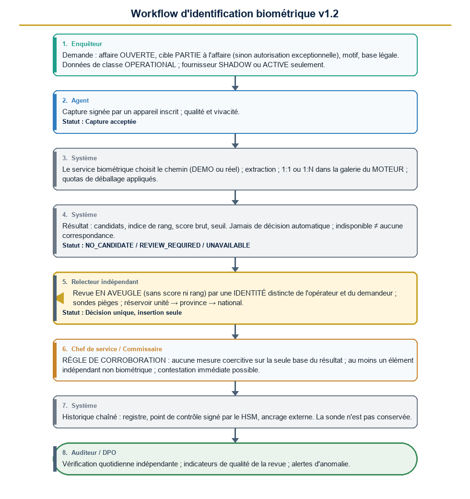

**Règles** : demande (affaire **ouverte**, cible **partie à l'affaire**, base légale) → capture signée (classe `OPERATIONAL`, fournisseur `SHADOW`/`ACTIVE`) → recherche → résultat sans décision → recoupement en lecture seule → **revue en aveugle** par un relecteur d'**identité distincte** (réservoir, escalade 24 h / 48 h) → décision unique → **corroboration obligatoire avant toute mesure coercitive** → historique chaîné, signé, ancré → contrôle a posteriori. **Enrôlement** : capture, qualité, vivacité, preuve d'identité, détection de doublons, **validation indépendante**, base légale, classe, inscription. **Effacement** : demande → décision du DPO → clé enveloppée supprimée + registre externe + suppression côté moteur avec preuve → sauvegardes ≤ 35 jours.

## 18. Rôles et permissions (préservation des 29 rôles et des 158 droits)

| Garantie | Détail |
|---|---|
| 29 rôles | **Aucun droit retiré** ; ajouts additifs soumis au circuit d'approbation ; `SUPER_ADMIN` et `SECURITY_ADMIN` **inchangés** |
| 158 droits | Aucun renommé ni retiré ; liste des droits sensibles : ajout seulement |
| Nouveaux droits (10) | `enroll_validate`, `watchlist_review`, `provider_manage`, `device_manage`, `export_portability`, `key_manage`, `retention_manage`, `erasure_decide`, `history_view_candidates`, `governance_approve` → **168** |
| Nouveaux profils (3) | `BIOMETRIC_PLATFORM_ADMIN`, `KEY_CUSTODIAN` (≥ 3 identités), `DATA_PROTECTION_OFFICER` → **32** rôles ; verrouillés, sans droit opérationnel |
| Visibilité de l'historique | Lignes DEMO : inchangée ; lignes réelles : métadonnées pour les 12 détenteurs de `history_view` ; candidats réservés à l'opérateur, au demandeur, aux relecteurs, à l'équipe d'affaire, au DPO et à l'auditeur |

## 19. Plan de tests et de validation

### 19.1 Tests existants à conserver

`tests/unit/biometric*.test.ts`, `tests/integration/biometric.test.ts`, `biocontrol.test.ts` ; `tests/unit/auth-primitives.test.ts`, `mfa-switch.test.ts`, `tests/security/auth.test.ts` (**MFA et chiffrement**) ; `tests/unit/admin-separation.test.ts`, `tests/integration/admin-separation.test.ts` ; `tests/unit/sensitivity.test.ts` ; test des libellés FR/AR ; `tests/security/route-matrix.test.ts` ; toutes les suites existantes (169 unitaires, 287 d'intégration, 34 de sécurité au dernier passage).

### 19.2 Nouveaux tests

| Famille | Contenu | Critère |
|---|---|---|
| **Attaque base de données** | UPDATE/DELETE/TRUNCATE/DISABLE TRIGGER/CREATE/`session_replication_role` en tant que `pms_app` ; tripwire | 100 % refusés |
| **Intégrité** | Falsification de chaque colonne, suppression, rejeu ; vérification de chaîne, de signature, d'ancrage | 100 % détectées ≤ 15 min |
| **Restauration** | Quorum, quarantaine, retour en arrière détecté, rejeu du registre d'effacement | Conforme |
| **Coffre** | Quotas, coupe-circuit, substitution de chiffré (AAD), compromission simulée, perte de quorum | Conforme |
| **Personnes physiques** | Double compte, gardiens distincts, revue d'identités | 100 % |
| **Épinglage** | Attribution d'un droit de gouvernance à un autre rôle ; approbation par un titulaire de `approvals:decide` seul | 100 % refusés |
| **Classes de données** | Classe non admise ↔ statut ; association interdite (service **et** base) | 100 % refusés |
| **Fédération** | Fusion, scission, décès, mode dégradé, absence de divulgation sortante | Conforme |
| **Portabilité** | Essai bi-fournisseur, ré-inscription depuis images | Seuil du 11.3 |
| **Qualité de la revue** | Sondes pièges, aveugle, indicateurs | Seuils du 12 |
| Existants adaptés | Sensibilité, libellés, routes, décomptes, contrat de l'historique (`visibility`) | Verts |

### 19.3 Évaluation indépendante

Organisme indépendant du fournisseur et de l'éditeur (D-10) ; ISO/IEC 19795 ; jeu local constitué sous protocole (phase 3b) ; mesures et seuils du chapitre 12 ; réévaluation à chaque changement de version d'algorithme ou de fournisseur.

## 20. Plan de migration depuis le mode DEMO

| Donnée | Décision |
|---|---|
| Gabarits `sha256` de démonstration (81 empreintes, 26 visages en base de développement) | **Restent en démonstration**, jamais copiés en production |
| Lectures de plaques et contrôles simulés | Restent, étiquetés |
| Historique DEMO (206 recherches, 387 contrôles) | Conservé, `isDemo = vrai`, exclu des statistiques opérationnelles |

**Étapes (aucune appliquée)** : migrations additives **avancer seulement** ; registre des fournisseurs (`mock-*` en `isDemo = vrai`) ; modes `demo`/`shadow`/`operational` **scellés** ; bandeau DEMO levé **fournisseur par fournisseur** ; remplacement de `simulation_only` **uniquement en production** après approbation de deux profils ; bascule modalité par modalité. **Conditions préalables de bascule** : autorisation institutionnelle, avis juridique, analyse d'impact, évaluation indépendante conforme, test d'intrusion, **rapports des trois validateurs externes**, approbation du responsable du projet.

## 21. Fichiers et composants existants susceptibles d'être modifiés (repérage, **aucun n'est modifié**)

| Fichier ou composant | Évolution éventuelle | Anomalies |
|---|---|---|
| `deploy/docker-compose.yml`, `deploy/entrypoint.sh`, `deploy/backup/*` | Rôles distincts, migrations séparées, sauvegardes biométriques dédiées | A-01, A-04, A-16 |
| `prisma/schema.prisma` + nouvelles migrations (avancer seulement) | Chapitre 15 ; **migration `20261108140000_biometric_control` non modifiée** | A-02, A-06, A-07 |
| `src/server/db.ts`, `src/server/env.ts` | Tripwire ; variables ; mode scellé | A-01, A-30 |
| `src/server/crypto.ts`, `auth/login.ts` | **Non modifiés** | — |
| `src/server/audit.ts`, `audit-chain.ts` | Ancrage de `AuditLog` ; nouveaux types d'événements | A-02, A-03 |
| `src/server/biometric/*` (service, control, schemas, queries, actions) | Délégation au service biométrique ; revue unique ; contrôles insertion seule | A-07, A-11, A-22 |
| `src/server/biometric/providers/*` | Extensions facultatives ; statuts et classes de données | A-08, A-09 |
| `src/server/persons/service.ts` | `mergePersons` émet un événement d'identité | A-18 |
| `src/server/cases/service.ts`, `wanted/service.ts`, `evidence/service.ts` | Événements de conservation ; copies probatoires | A-14, A-15 |
| `src/server/rbac/*`, `admin/roles.ts`, `admin/users.ts` | Dix droits, trois profils, épinglage, identité d'agent | A-19, A-20, A-21 |
| `src/server/approvals/*` | Nouveaux types, éligibilité par type | A-20 |
| `src/server/api.ts` | Limite de débit dédiée aux webhooks biométriques | — |
| `src/app/api/v1/biometric/**`, `(app)/biometric/**` | Enveloppes ; revue en aveugle ; filigrane | A-26 |
| `src/lib/i18n/*`, `navigation.ts` | Libellés FR/AR | A-22 |
| `tests/**` | Chapitre 19 | A-22 |
| **Nouveaux** | Service biométrique, registre chaîné, ancrage, restauration, `StaffIdentity`, connecteur DEMO, adaptateurs réels | — |

## 22. Soumission aux validateurs externes

Cette version est **conditionnée** à la revue de **trois validateurs indépendants** : un **architecte sécurité externe**, un **juriste**, un **responsable indépendant de la protection des données** (checklists du 14.3). Les réserves critiques ouvertes bloquent toute autorisation. **L'implémentation reste interdite** tant que ces trois rapports ne sont pas remis et que la Direction n'a pas autorisé par écrit.

**Rappel de la consigne.** Cette version est un document de conception. Aucun code, aucune table, aucune donnée, aucune configuration n'ont été modifiés ; aucune migration n'a été exécutée ; les marqueurs DEMO sont conservés ; aucun moteur réel n'est connecté ; aucun commit n'a été poussé.

<!--pagebreak-->

## Annexe A — Tableau de traçabilité des 30 anomalies

{{TRACE}}
